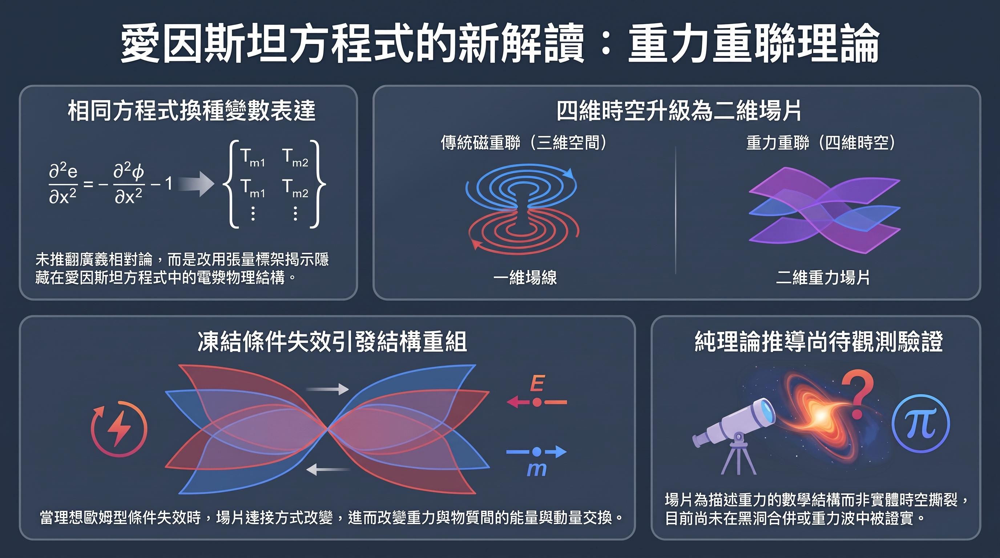

---

> *以下為虛構對話，人物與情節為創作，科學內容來源標註於文末。*

## ▌下午兩點的咖啡廳

下午兩點，店裡沒什麼人。

陽光斜斜切過靠窗的長桌，剛好停在 Dg 的鍵盤上。

他在打 IG 貼文。

「重力會斷掉，然後重新連上。」

他唸出聲，很滿意。

「你在講前任？」

Dg 抬頭。Cala 端著拿鐵，站在桌邊。

「……妳怎麼在這。」

「路過。」她拉開對面的椅子，「公司 Wi-Fi 壞了。」

她的筆電沒有拿出來。

「我在講物理。」Dg 清了清喉嚨，「最新論文。愛因斯坦方程式換一套變數寫，結果長得跟電漿一樣。電漿裡的磁力線會被扭、會斷、會重新接起來，叫磁重聯。太陽閃焰就是這樣爆的。」

「所以重力也會。」

「理論上。」

Cala 攪著拿鐵。

「斷了還能接回去。然後放出一堆能量。」

「對，能量會——」

「這不就是吵架嗎。吵完和好，比以前還黏。」

「不是，這是重力場——」

「冷戰期就是在累積能量啊。扭得越緊，爆得越大。」

Dg 張著嘴。

螢幕上那句貼文，突然好像也可以這樣讀。

## ▌四維的場線

「重點是，」Dg 決定拉回來，「重力的結構不是線。」

「我知道啊，四維的場線嘛。」

「不是場線。」

「論文就是這樣寫的。」Cala 很肯定，「四維場線。」

「妳看過那篇？」

「沒有。」

她的手機擱在桌上，螢幕亮著。一篇科普文，作者欄寫著「收集資料的K」。捲軸停在很後面。

Dg 看了那支手機一眼。

「是場片。」他說，「時空是四維的。線多加一個維度，就變成面。很多條線並排黏起來，一張片。」

「片。」

「所以不是場線，是場片。」

「我就是這個意思。」

Cala 喝了一口拿鐵。

「那場片斷掉，就是時空破洞了吧。宇宙被撕開一條縫。」

「呃，應該——」

她已經拿起手機，往上滑了兩下。

「……文章說，不要想成時空像布被撕開。」聲音小了一點，「場片是數學結構，不是真的薄膜。」

「所以斷掉又接上的是——」

「連接方式。」她把手機推回桌上，「我剛剛是在測試你。」

## ▌凍住的規則

Dg 想挽回一點氣勢。

「愛因斯坦說過，想像力比知識更重要。這些研究者就是靠想像力，想出一種新的重力——」

「沒有新的重力。」

Cala 盯著螢幕，沒抬頭。

「方程式是同一組。只是換一套變數寫，原本藏在裡面的規則才看得到。」

「……什麼規則。」

「理想狀態下，場片怎麼連，就一直那樣連。」她唸得很慢，「像凍住一樣。等那個條件失效，才會重連。然後重力跟物質之間交換的能量就變了。」

Dg 安靜了一會。

「所以不是吵架。」

「本來就不是。」

「是規則一直都在。平常看不出來，要換個講法讀，才知道它什麼時候會被打破。」

Cala 沒回話。

「那能放出多少能量？」

「還沒算。」

「黑洞相撞的時候會發生嗎？」

「不知道。LIGO 聽不聽得到也不知道。」她把手機推遠一點，「純理論。」

「那妳剛剛講得好像——」

「我才沒有特別去看。」

她站起來。拿鐵還剩一半。

「Wi-Fi 好像修好了。」

*Dg 把「重力會斷掉，然後重新連上」整句刪掉，重新打了一行：「規則一直都在，只是要換個講法才看得到。」游標在句尾閃了很久。最後他補上一個標籤：#純理論。*

---

**一百多年前寫下的愛因斯坦方程式，至今還能挖出新東西。兩位物理學家把它改用另一套數學變數重寫，發現它和描述電漿的方程式長得出奇相似，並由此推出一個新概念：「重力重聯」。簡單說，就是重力場的結構在特定條件下會改變彼此的連接方式，並改變重力與物質之間的能量交換。目前它還只是理論，但可能替黑洞碰撞的研究提供一套新工具。**

---

## 關鍵亮點

- 哥倫比亞大學的 **Luca Comisso** 與智利 Adolfo Ibáñez 大學的 **Felipe A. Asenjo**，在《Physical Review D》發表〈Reconnection of Gravitational Fields〉，提出「**重力重聯**」理論。
- 做法不是發明新理論，而是**把同一組愛因斯坦方程式換一套變數寫**，讓它的結構看起來像電漿物理。
- 因為時空是四維的，重力場對應的結構不是「線」，而是「**場片**」（field sheets）。
- 目前**純屬理論**：還不知道它是否真的發生在宇宙中、能牽動多少能量，也不知道會不會留下可偵測的重力波訊號。

---

## 1. 先熱身：磁力線斷掉再接起來，會發生什麼事？

*太陽閃焰是磁重聯最有名的「現場演出」。*

### 電漿：宇宙最常見的物質狀態

要理解這篇研究，得先認識它的靈感來源。宇宙中大量的物質不是固體、液體或氣體，而是**電漿**——一種帶電的氣體，恆星裡、太空中到處都是。

電漿裡有磁場，而物理學家習慣用「**磁力線**」來描繪磁場。你國中做過的實驗——把鐵粉撒在磁鐵上方的紙上，看它排成一圈圈弧線——那些弧線就是磁力線的樣子。

### 把橡皮筋拉到斷掉

電漿會流動、會翻滾，磁力線就跟著被拉長、被扭轉。想像你一直扭一條橡皮筋，扭到某個程度，「啪」一聲斷掉，兩端又甩到別處接上別的橡皮筋。

這個「斷掉、重新接上」的過程叫做**磁重聯**（magnetic reconnection）。關鍵在於：原本被扭緊、儲存在磁場裡的能量，會在重聯的瞬間釋放出來，轉交給電漿裡的粒子，讓它們加速、升溫。**太陽閃焰**這類劇烈爆發，背後就是這個機制。

Comisso 本人正是研究電漿出身。於是一個問題自然冒出來：**重力場會不會也有類似的戲碼？**

---

## 2. 換個語言讀愛因斯坦：重力原來也有「場片」

### 同一句話，換種說法就看到新東西

根據**廣義相對論**，重力不只是一股拉力，而是質量和能量讓**時空彎曲**的結果。描述這件事的愛因斯坦場方程式，寫於一百多年前。

這次的研究沒有推翻它，也沒有發明新的重力理論。兩位作者做的事比較像「翻譯」：把方程式改寫成**張量標架**（tetrad）形式，用類似電場和磁場的量來表達重力。數學內容完全一樣，只是換了一套變數——就像同一首詩，從中文譯成日文後，你突然注意到原本沒察覺的押韻結構。

改寫之後，研究者發現這組方程式和描述電漿的方程式**長得很像**。Comisso 說得直白：方程式裡藏著一些含意，光盯著原本的寫法很難看出來。

### 從「線」升級成「面」

但重力不是照抄磁場就好。磁力線通常是畫在三維空間裡的線，而廣義相對論處理的是**四維時空**（三維空間＋一維時間）。

Comisso 的比喻很好懂：**一條線多加一個維度，就變成一個面。** 你可以想像把很多條線並排黏在一起，變成一張「片」。所以在這套理論裡，對應磁力線的結構是二維的「**重力場片**」（gravitational field sheets）。

> ⚠️ 請注意：這些「場片」是**數學結構**，不是漂浮在太空中的實體薄膜。

---

## 3. 理想狀態 vs. 出狀況：重聯到底怎麼發生？

*左：三維空間中的磁力線；右：四維時空中的重力場片（概念示意，非實際形狀）。*

### 先定義「什麼叫正常」

研究磁重聯時，物理學家會先設定一個理想基準：在**理想磁流體**的情況下，磁通量守恆，兩團被同一條磁力線連著的電漿，之後也會一直被連著。磁力線好像「凍結」在電漿裡，跟著它一起動。

只有當局部出現不理想的條件，例如電漿有電阻，這個「凍結」才會失效，重聯才有機會發生。

### 重力版的「凍結」

Comisso 與 Asenjo 把同樣的思路搬到重力上。他們在張量標架形式中定義了一個「**理想重力歐姆型條件**」：只要這個條件成立，重力通量就守恆，**場片的連接方式也不會改變**——即使時空本身的形狀在變。

這一步其實來自他們先前與 **Maricarmen A. Winkler** 合作、刊登在《Physical Review Letters》的研究〈Frozen-In Gravitational Fields〉。那篇論文指出廣義相對論中存在「凍結」的重力場連結，並導出一些守恆量，也就是新聞稿所說的「**時空演化中原本沒被注意到的限制條件**」。

### 條件破功，場片就重連

這次的新論文往前一步：如果偏離了理想條件呢？研究者把「**重力重聯**」定義為：理想凍結演化失效時，重力場片的連接方式發生改變。他們還推導出衡量**重聯速率**的定量指標，並指出重聯會**改變重力與物質之間的能量動量交換**，也會影響一個叫「重力螺旋度」的量如何演化。

### 一張表看懂兩種重聯

| 比較項目 | 磁重聯 | 重力重聯 |
|---------|-------|---------|
| 理論框架 | 磁流體力學（電漿物理） | 張量標架形式的廣義相對論 |
| 舞台 | 三維空間 | 四維時空 |
| 被「連接」的結構 | 磁力線（一維的線） | 重力場片（二維的面） |
| 理想時的規則 | 磁通量守恆，連接不變 | 重力通量守恆，連接不變 |
| 什麼時候重聯 | 局部偏離理想，例如電阻 | 理想重力歐姆型條件失效 |
| 能量後果 | 磁能轉成粒子的熱與動能 | 重力與物質間的能量動量交換改變 |
| 觀測狀態 | 已在太陽與實驗室中觀測到 | **尚未觀測，純理論** |

---

## 4. 這有什麼用？黑洞碰撞與重力波的新線索

### 黑洞相撞，只能靠電腦硬算

宇宙中最適合找重力重聯的地方，是**雙黑洞合併**：兩顆黑洞互相繞轉、越轉越近、最後撞成一顆。這時重力場的變化又強又快。

問題是，這種極端情況幾乎沒辦法用紙筆解出來。物理學家靠的是**數值相對論**：把愛因斯坦方程式交給超級電腦，從某個起始狀態一步步算下去。這方法很強大，但很吃計算資源，而且電腦吐出一堆數字，不一定能告訴你「背後的規則是什麼」。

### 先知道規則，再看細節

這正是新研究可能派上用場的地方。研究者認為，這些隱藏的限制條件也許能讓科學家**不必算出每個細節，就先知道時空必須遵守哪些行為模式**。打個比方：你不用看完整場球賽的每一次傳球，只要知道規則，就能判斷某些情況「不可能發生」。

### LIGO 聽得到嗎？

**LIGO**（雷射干涉重力波天文台）專門偵測黑洞合併時發出的重力波——時空本身的漣漪。如果重力重聯真的在合併過程中發生，它會不會在重力波訊號裡留下特殊的「指紋」？研究者的答案很老實：**還不知道，有待研究。**

---

## 5. 先冷靜一下：這項研究還沒回答的問題

### 標題很聳動，但時空沒有被「撕破」

「重力場會斷掉重連」這種說法很吸睛，但有報導特別提醒：**不要把它想像成時空像一塊布被撕開**。所謂斷掉與重連，指的是數學結構的連接方式改變，而不是宇宙出現裂縫。

### 三個待解的大問號

1. **它真的會在宇宙中發生嗎？** 目前沒有任何觀測證據，黑洞合併中是否出現也尚未確認。
2. **能牽動多少能量？** 論文提供了計算框架，但實際的量級還沒算出來。
3. **會留下可偵測的訊號嗎？** 能不能被 LIGO 這類儀器捕捉，仍是開放問題。

### 別跟「黑洞磁重聯」搞混

同一組作者在 2021 年還提出過一個很有名的「**Comisso-Asenjo 機制**」：利用旋轉黑洞周圍電漿的**磁重聯**來萃取黑洞能量，後來有大量論文跟進。那是電漿裡的**磁場**重聯，跟這次的**重力場**重聯是兩件不同的事，讀相關新聞時要分清楚。

---

## 常見問題（FAQ）

**Q1：這是在推翻愛因斯坦嗎？**
不是。研究用的還是同一組愛因斯坦方程式，只是換了一套變數表達。比較像是用新角度重讀經典，而不是改寫經典。

**Q2：「場片」是真實存在的東西嗎？**
它是數學結構。就像地圖上的等高線不是真的畫在山坡上，場片是描述重力場的工具，不是太空中漂浮的薄膜。

**Q3：為什麼重力用「面」，磁場用「線」？**
因為舞台不同。磁力線通常在三維空間中描述，重力則要放在四維時空裡處理。多了一個維度，對應的結構就從線變成面。

**Q4：重力重聯會讓黑洞爆炸或釋放超大能量嗎？**
目前無法回答。論文說明重聯會改變重力與物質之間的能量交換，但交換多少、往哪個方向、在真實天體中會不會發生，都還沒有答案。

**Q5：一般人什麼時候會聽到「證實」的消息？**
沒有時間表。下一步可能是把這套框架用在黑洞合併的模擬上，再看重力波觀測能否找到對應的痕跡，這需要理論與觀測兩邊持續累積。

---

## 結論

這項研究最有趣的地方，不在於它宣布了什麼驚天發現，而在於它提醒我們：**一組寫了一百多年的方程式，換個寫法還能看出新結構。** 電漿物理學家用自己熟悉的語言重讀廣義相對論，發現重力場也可能有「凍結」與「重連」的規則，並把這些規則量化。

接下來的關鍵，是這套框架能不能真正幫上忙：讓黑洞合併的模擬更好理解，或在重力波資料中找到可以檢驗的預測。在那之前，「重力重聯」是一個漂亮、嚴謹、但還在等宇宙回信的理論。

---

## 延伸搜尋

- [磁重聯 太陽閃焰](https://www.google.com/search?q=%E7%A3%81%E9%87%8D%E8%81%AF+%E5%A4%AA%E9%99%BD%E9%96%83%E7%84%B0)
- [數值相對論 黑洞合併](https://www.google.com/search?q=%E6%95%B8%E5%80%BC%E7%9B%B8%E5%B0%8D%E8%AB%96+%E9%BB%91%E6%B4%9E%E5%90%88%E4%BD%B5)
- [廣義相對論 時空彎曲](https://www.google.com/search?q=%E5%BB%A3%E7%BE%A9%E7%9B%B8%E5%B0%8D%E8%AB%96+%E6%99%82%E7%A9%BA%E5%BD%8E%E6%9B%B2)
- [LIGO 重力波 原理](https://www.google.com/search?q=LIGO+%E9%87%8D%E5%8A%9B%E6%B3%A2+%E5%8E%9F%E7%90%86)
- [gravitational reconnection Comisso Asenjo](https://www.google.com/search?q=gravitational+reconnection+Comisso+Asenjo)

---

## 參考資料來源

- [Reconnection of Gravitational Fields（Comisso & Asenjo, arXiv 2609.25241）](https://arxiv.org/abs/2609.25241)
- [Frozen-In Gravitational Fields（Asenjo, Winkler & Comisso, arXiv 2609.25240）](https://arxiv.org/abs/2609.25240)
- [Generalized Magnetofluid Connections in Relativistic Magnetohydrodynamics（Asenjo & Comisso, arXiv 1502.07461）](https://arxiv.org/abs/1502.07461)
- [Magnetic Reconnection as a Mechanism for Energy Extraction from Rotating Black Holes（Comisso & Asenjo, arXiv 2012.00879）](https://arxiv.org/abs/2012.00879v1)
- [Black-hole binaries, gravitational waves, and numerical relativity（Centrella et al., arXiv 1010.5260）](https://arxiv.org/abs/1010.5260)
- [Numerical Relativity of Compact Binaries in the 21st Century（Duez & Zlochower, arXiv 1808.06011）](https://arxiv.org/abs/1808.06011)
- [Einstein's equations offer new clues to extreme gravity and space-time behavior（The Brighter Side of News）](https://www.thebrighterside.news/post/einsteins-equations-offer-new-clues-to-extreme-gravity-and-space-time-behavior/)
- [Gravitational Reconnection: New Theory Says Gravitational Fields Can Change Connectivity（XenoSpectrum）](https://xenospectrum.com/en/gravitational-reconnection-einstein-equations-theoretical-framework/)
- [Einstein's equations hint gravity can break, reconnect like magnetic fields（Interesting Engineering）](https://interestingengineering.com/science/columbia-clue-gravitational-reconnection)
---
title: "重力也會「斷線重連」？愛因斯坦方程式換個寫法，竟長得像太陽閃焰的劇本！"
date: 2026-11-02 22:19:00 +0800
categories:
  - 物理
tags:
  - 廣義相對論
  - 重力重聯
  - 磁重聯
  - 電漿物理
  - 黑洞
  - 重力波
layout: single
author_profile: false
toc: true
toc_sticky: true
header:
  teaser: /assets/images/2026-11-02-gravitational-reconnection.png
excerpt: "把愛因斯坦方程式換一套變數重寫，竟和電漿方程式相似。物理學家據此提出「重力重聯」：重力場片在條件失效時會改變連接方式，改變重力與物質的能量交換。目前仍是純理論。"
---

---

> *以下為虛構對話，人物與情節為創作，科學內容來源標註於文末。*

## ▌下午兩點的咖啡廳

下午兩點，店裡沒什麼人。

陽光斜斜切過靠窗的長桌，剛好停在 Dg 的鍵盤上。

他在打 IG 貼文。

「重力會斷掉，然後重新連上。」

他唸出聲，很滿意。

「你在講前任？」

Dg 抬頭。Cala 端著拿鐵，站在桌邊。

「……妳怎麼在這。」

「路過。」她拉開對面的椅子，「公司 Wi-Fi 壞了。」

她的筆電沒有拿出來。

「我在講物理。」Dg 清了清喉嚨，「最新論文。愛因斯坦方程式換一套變數寫，結果長得跟電漿一樣。電漿裡的磁力線會被扭、會斷、會重新接起來，叫磁重聯。太陽閃焰就是這樣爆的。」

「所以重力也會。」

「理論上。」

Cala 攪著拿鐵。

「斷了還能接回去。然後放出一堆能量。」

「對，能量會——」

「這不就是吵架嗎。吵完和好，比以前還黏。」

「不是，這是重力場——」

「冷戰期就是在累積能量啊。扭得越緊，爆得越大。」

Dg 張著嘴。

螢幕上那句貼文，突然好像也可以這樣讀。

## ▌四維的場線

「重點是，」Dg 決定拉回來，「重力的結構不是線。」

「我知道啊，四維的場線嘛。」

「不是場線。」

「論文就是這樣寫的。」Cala 很肯定，「四維場線。」

「妳看過那篇？」

「沒有。」

她的手機擱在桌上，螢幕亮著。一篇科普文，作者欄寫著「收集資料的K」。捲軸停在很後面。

Dg 看了那支手機一眼。

「是場片。」他說，「時空是四維的。線多加一個維度，就變成面。很多條線並排黏起來，一張片。」

「片。」

「所以不是場線，是場片。」

「我就是這個意思。」

Cala 喝了一口拿鐵。

「那場片斷掉，就是時空破洞了吧。宇宙被撕開一條縫。」

「呃，應該——」

她已經拿起手機，往上滑了兩下。

「……文章說，不要想成時空像布被撕開。」聲音小了一點，「場片是數學結構，不是真的薄膜。」

「所以斷掉又接上的是——」

「連接方式。」她把手機推回桌上，「我剛剛是在測試你。」

## ▌凍住的規則

Dg 想挽回一點氣勢。

「愛因斯坦說過，想像力比知識更重要。這些研究者就是靠想像力，想出一種新的重力——」

「沒有新的重力。」

Cala 盯著螢幕，沒抬頭。

「方程式是同一組。只是換一套變數寫，原本藏在裡面的規則才看得到。」

「……什麼規則。」

「理想狀態下，場片怎麼連，就一直那樣連。」她唸得很慢，「像凍住一樣。等那個條件失效，才會重連。然後重力跟物質之間交換的能量就變了。」

Dg 安靜了一會。

「所以不是吵架。」

「本來就不是。」

「是規則一直都在。平常看不出來，要換個講法讀，才知道它什麼時候會被打破。」

Cala 沒回話。

「那能放出多少能量？」

「還沒算。」

「黑洞相撞的時候會發生嗎？」

「不知道。LIGO 聽不聽得到也不知道。」她把手機推遠一點，「純理論。」

「那妳剛剛講得好像——」

「我才沒有特別去看。」

她站起來。拿鐵還剩一半。

「Wi-Fi 好像修好了。」

*Dg 把「重力會斷掉，然後重新連上」整句刪掉，重新打了一行：「規則一直都在，只是要換個講法才看得到。」游標在句尾閃了很久。最後他補上一個標籤：#純理論。*

---

**一百多年前寫下的愛因斯坦方程式，至今還能挖出新東西。兩位物理學家把它改用另一套數學變數重寫，發現它和描述電漿的方程式長得出奇相似，並由此推出一個新概念：「重力重聯」。簡單說，就是重力場的結構在特定條件下會改變彼此的連接方式，並改變重力與物質之間的能量交換。目前它還只是理論，但可能替黑洞碰撞的研究提供一套新工具。**

---

## 關鍵亮點

- 哥倫比亞大學的 **Luca Comisso** 與智利 Adolfo Ibáñez 大學的 **Felipe A. Asenjo**，在《Physical Review D》發表〈Reconnection of Gravitational Fields〉，提出「**重力重聯**」理論。
- 做法不是發明新理論，而是**把同一組愛因斯坦方程式換一套變數寫**，讓它的結構看起來像電漿物理。
- 因為時空是四維的，重力場對應的結構不是「線」，而是「**場片**」（field sheets）。
- 目前**純屬理論**：還不知道它是否真的發生在宇宙中、能牽動多少能量，也不知道會不會留下可偵測的重力波訊號。

---

## 1. 先熱身：磁力線斷掉再接起來，會發生什麼事？

*太陽閃焰是磁重聯最有名的「現場演出」。*

### 電漿：宇宙最常見的物質狀態

要理解這篇研究，得先認識它的靈感來源。宇宙中大量的物質不是固體、液體或氣體，而是**電漿**——一種帶電的氣體，恆星裡、太空中到處都是。

電漿裡有磁場，而物理學家習慣用「**磁力線**」來描繪磁場。你國中做過的實驗——把鐵粉撒在磁鐵上方的紙上，看它排成一圈圈弧線——那些弧線就是磁力線的樣子。

### 把橡皮筋拉到斷掉

電漿會流動、會翻滾，磁力線就跟著被拉長、被扭轉。想像你一直扭一條橡皮筋，扭到某個程度，「啪」一聲斷掉，兩端又甩到別處接上別的橡皮筋。

這個「斷掉、重新接上」的過程叫做**磁重聯**（magnetic reconnection）。關鍵在於：原本被扭緊、儲存在磁場裡的能量，會在重聯的瞬間釋放出來，轉交給電漿裡的粒子，讓它們加速、升溫。**太陽閃焰**這類劇烈爆發，背後就是這個機制。

Comisso 本人正是研究電漿出身。於是一個問題自然冒出來：**重力場會不會也有類似的戲碼？**

---

## 2. 換個語言讀愛因斯坦：重力原來也有「場片」

### 同一句話，換種說法就看到新東西

根據**廣義相對論**，重力不只是一股拉力，而是質量和能量讓**時空彎曲**的結果。描述這件事的愛因斯坦場方程式，寫於一百多年前。

這次的研究沒有推翻它，也沒有發明新的重力理論。兩位作者做的事比較像「翻譯」：把方程式改寫成**張量標架**（tetrad）形式，用類似電場和磁場的量來表達重力。數學內容完全一樣，只是換了一套變數——就像同一首詩，從中文譯成日文後，你突然注意到原本沒察覺的押韻結構。

改寫之後，研究者發現這組方程式和描述電漿的方程式**長得很像**。Comisso 說得直白：方程式裡藏著一些含意，光盯著原本的寫法很難看出來。

### 從「線」升級成「面」

但重力不是照抄磁場就好。磁力線通常是畫在三維空間裡的線，而廣義相對論處理的是**四維時空**（三維空間＋一維時間）。

Comisso 的比喻很好懂：**一條線多加一個維度，就變成一個面。** 你可以想像把很多條線並排黏在一起，變成一張「片」。所以在這套理論裡，對應磁力線的結構是二維的「**重力場片**」（gravitational field sheets）。

> ⚠️ 請注意：這些「場片」是**數學結構**，不是漂浮在太空中的實體薄膜。

---

## 3. 理想狀態 vs. 出狀況：重聯到底怎麼發生？

*左：三維空間中的磁力線；右：四維時空中的重力場片（概念示意，非實際形狀）。*

### 先定義「什麼叫正常」

研究磁重聯時，物理學家會先設定一個理想基準：在**理想磁流體**的情況下，磁通量守恆，兩團被同一條磁力線連著的電漿，之後也會一直被連著。磁力線好像「凍結」在電漿裡，跟著它一起動。

只有當局部出現不理想的條件，例如電漿有電阻，這個「凍結」才會失效，重聯才有機會發生。

### 重力版的「凍結」

Comisso 與 Asenjo 把同樣的思路搬到重力上。他們在張量標架形式中定義了一個「**理想重力歐姆型條件**」：只要這個條件成立，重力通量就守恆，**場片的連接方式也不會改變**——即使時空本身的形狀在變。

這一步其實來自他們先前與 **Maricarmen A. Winkler** 合作、刊登在《Physical Review Letters》的研究〈Frozen-In Gravitational Fields〉。那篇論文指出廣義相對論中存在「凍結」的重力場連結，並導出一些守恆量，也就是新聞稿所說的「**時空演化中原本沒被注意到的限制條件**」。

### 條件破功，場片就重連

這次的新論文往前一步：如果偏離了理想條件呢？研究者把「**重力重聯**」定義為：理想凍結演化失效時，重力場片的連接方式發生改變。他們還推導出衡量**重聯速率**的定量指標，並指出重聯會**改變重力與物質之間的能量動量交換**，也會影響一個叫「重力螺旋度」的量如何演化。

### 一張表看懂兩種重聯

| 比較項目 | 磁重聯 | 重力重聯 |
|---------|-------|---------|
| 理論框架 | 磁流體力學（電漿物理） | 張量標架形式的廣義相對論 |
| 舞台 | 三維空間 | 四維時空 |
| 被「連接」的結構 | 磁力線（一維的線） | 重力場片（二維的面） |
| 理想時的規則 | 磁通量守恆，連接不變 | 重力通量守恆，連接不變 |
| 什麼時候重聯 | 局部偏離理想，例如電阻 | 理想重力歐姆型條件失效 |
| 能量後果 | 磁能轉成粒子的熱與動能 | 重力與物質間的能量動量交換改變 |
| 觀測狀態 | 已在太陽與實驗室中觀測到 | **尚未觀測，純理論** |

---

## 4. 這有什麼用？黑洞碰撞與重力波的新線索

### 黑洞相撞，只能靠電腦硬算

宇宙中最適合找重力重聯的地方，是**雙黑洞合併**：兩顆黑洞互相繞轉、越轉越近、最後撞成一顆。這時重力場的變化又強又快。

問題是，這種極端情況幾乎沒辦法用紙筆解出來。物理學家靠的是**數值相對論**：把愛因斯坦方程式交給超級電腦，從某個起始狀態一步步算下去。這方法很強大，但很吃計算資源，而且電腦吐出一堆數字，不一定能告訴你「背後的規則是什麼」。

### 先知道規則，再看細節

這正是新研究可能派上用場的地方。研究者認為，這些隱藏的限制條件也許能讓科學家**不必算出每個細節，就先知道時空必須遵守哪些行為模式**。打個比方：你不用看完整場球賽的每一次傳球，只要知道規則，就能判斷某些情況「不可能發生」。

### LIGO 聽得到嗎？

**LIGO**（雷射干涉重力波天文台）專門偵測黑洞合併時發出的重力波——時空本身的漣漪。如果重力重聯真的在合併過程中發生，它會不會在重力波訊號裡留下特殊的「指紋」？研究者的答案很老實：**還不知道，有待研究。**

---

## 5. 先冷靜一下：這項研究還沒回答的問題

### 標題很聳動，但時空沒有被「撕破」

「重力場會斷掉重連」這種說法很吸睛，但有報導特別提醒：**不要把它想像成時空像一塊布被撕開**。所謂斷掉與重連，指的是數學結構的連接方式改變，而不是宇宙出現裂縫。

### 三個待解的大問號

1. **它真的會在宇宙中發生嗎？** 目前沒有任何觀測證據，黑洞合併中是否出現也尚未確認。
2. **能牽動多少能量？** 論文提供了計算框架，但實際的量級還沒算出來。
3. **會留下可偵測的訊號嗎？** 能不能被 LIGO 這類儀器捕捉，仍是開放問題。

### 別跟「黑洞磁重聯」搞混

同一組作者在 2021 年還提出過一個很有名的「**Comisso-Asenjo 機制**」：利用旋轉黑洞周圍電漿的**磁重聯**來萃取黑洞能量，後來有大量論文跟進。那是電漿裡的**磁場**重聯，跟這次的**重力場**重聯是兩件不同的事，讀相關新聞時要分清楚。

---

## 常見問題（FAQ）

**Q1：這是在推翻愛因斯坦嗎？**
不是。研究用的還是同一組愛因斯坦方程式，只是換了一套變數表達。比較像是用新角度重讀經典，而不是改寫經典。

**Q2：「場片」是真實存在的東西嗎？**
它是數學結構。就像地圖上的等高線不是真的畫在山坡上，場片是描述重力場的工具，不是太空中漂浮的薄膜。

**Q3：為什麼重力用「面」，磁場用「線」？**
因為舞台不同。磁力線通常在三維空間中描述，重力則要放在四維時空裡處理。多了一個維度，對應的結構就從線變成面。

**Q4：重力重聯會讓黑洞爆炸或釋放超大能量嗎？**
目前無法回答。論文說明重聯會改變重力與物質之間的能量交換，但交換多少、往哪個方向、在真實天體中會不會發生，都還沒有答案。

**Q5：一般人什麼時候會聽到「證實」的消息？**
沒有時間表。下一步可能是把這套框架用在黑洞合併的模擬上，再看重力波觀測能否找到對應的痕跡，這需要理論與觀測兩邊持續累積。

---

## 結論

這項研究最有趣的地方，不在於它宣布了什麼驚天發現，而在於它提醒我們：**一組寫了一百多年的方程式，換個寫法還能看出新結構。** 電漿物理學家用自己熟悉的語言重讀廣義相對論，發現重力場也可能有「凍結」與「重連」的規則，並把這些規則量化。

接下來的關鍵，是這套框架能不能真正幫上忙：讓黑洞合併的模擬更好理解，或在重力波資料中找到可以檢驗的預測。在那之前，「重力重聯」是一個漂亮、嚴謹、但還在等宇宙回信的理論。

---

## 延伸搜尋

- [磁重聯 太陽閃焰](https://www.google.com/search?q=%E7%A3%81%E9%87%8D%E8%81%AF+%E5%A4%AA%E9%99%BD%E9%96%83%E7%84%B0)
- [數值相對論 黑洞合併](https://www.google.com/search?q=%E6%95%B8%E5%80%BC%E7%9B%B8%E5%B0%8D%E8%AB%96+%E9%BB%91%E6%B4%9E%E5%90%88%E4%BD%B5)
- [廣義相對論 時空彎曲](https://www.google.com/search?q=%E5%BB%A3%E7%BE%A9%E7%9B%B8%E5%B0%8D%E8%AB%96+%E6%99%82%E7%A9%BA%E5%BD%8E%E6%9B%B2)
- [LIGO 重力波 原理](https://www.google.com/search?q=LIGO+%E9%87%8D%E5%8A%9B%E6%B3%A2+%E5%8E%9F%E7%90%86)
- [gravitational reconnection Comisso Asenjo](https://www.google.com/search?q=gravitational+reconnection+Comisso+Asenjo)

---

## 參考資料來源

- [Reconnection of Gravitational Fields（Comisso & Asenjo, arXiv 2609.25241）](https://arxiv.org/abs/2609.25241)
- [Frozen-In Gravitational Fields（Asenjo, Winkler & Comisso, arXiv 2609.25240）](https://arxiv.org/abs/2609.25240)
- [Generalized Magnetofluid Connections in Relativistic Magnetohydrodynamics（Asenjo & Comisso, arXiv 1502.07461）](https://arxiv.org/abs/1502.07461)
- [Magnetic Reconnection as a Mechanism for Energy Extraction from Rotating Black Holes（Comisso & Asenjo, arXiv 2012.00879）](https://arxiv.org/abs/2012.00879v1)
- [Black-hole binaries, gravitational waves, and numerical relativity（Centrella et al., arXiv 1010.5260）](https://arxiv.org/abs/1010.5260)
- [Numerical Relativity of Compact Binaries in the 21st Century（Duez & Zlochower, arXiv 1808.06011）](https://arxiv.org/abs/1808.06011)
- [Einstein's equations offer new clues to extreme gravity and space-time behavior（The Brighter Side of News）](https://www.thebrighterside.news/post/einsteins-equations-offer-new-clues-to-extreme-gravity-and-space-time-behavior/)
- [Gravitational Reconnection: New Theory Says Gravitational Fields Can Change Connectivity（XenoSpectrum）](https://xenospectrum.com/en/gravitational-reconnection-einstein-equations-theoretical-framework/)
- [Einstein's equations hint gravity can break, reconnect like magnetic fields（Interesting Engineering）](https://interestingengineering.com/science/columbia-clue-gravitational-reconnection)
