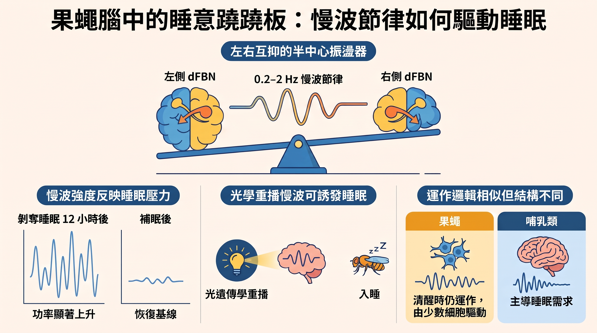

---

> *以下為虛構對話，人物與情節為創作，科學內容來源標註於文末。*

## ▌第二發

傍晚，照明燈剛亮。光暈裡繞著一團飛蟲。

Aon 的第二發掛網。

「三十八。」他自己報數，彎腰撿球。「上週是六十一。」

「你昨晚沒睡。」

「你怎麼知道。」

「發球。」

K 走到場邊，拿起水壺。

「果蠅也一樣。睡不夠，腦裡的慢波就變強。牛津那篇。睡意是一段節奏。」

Aon 把球拍夾在腋下。

「等一下。」

K 喝水。

「你從『睡不夠』跳到『睡意是一段節奏』，中間至少跳了三步。」

## ▌三步

「哪三步。」

「第一，誰的慢波？」

「dFBN。睡眠神經元。」K 說。「左右腦各一兩個節律細胞，互相抑制。左邊壓右邊，右邊彈回來壓左邊。」

「蹺蹺板。」

「半中心振盪器。」

「第二。」Aon 豎起兩根手指。「『睡不夠就變強』，怎麼量的？剝奪多久？跟什麼比？」

「剝奪十二小時，慢波功率上升，其他頻段不變。補眠後一天內回到基線。」

「其他頻段不變，」Aon 點頭，「這句很重要。不然可能只是整個腦都比較吵。」

「嗯。」

「第三。」第三根手指。「變強，不代表它造成睡意。熬夜的人眼睛也比較紅，你不會說紅眼睛讓人想睡。」

K 把水壺放下。

「他們反過來做了。」

## ▌拿掉，放回去

「阻斷那群神經元的麩胺酸，蹺蹺板斷掉，慢波沒了，平常的睡眠跟補眠一起亂掉。」

「拿掉，睡眠壞掉。」

「再用光遺傳把慢波播回去。果蠅睡著。」

Aon 停了大概一秒。

「……放進去，就睡著。」

「對。」

「好，這個漂亮。」他的語速開始加快。「兩個方向都有，這才叫在講因果。不是看兩條線一起往上走就說誰推誰。你知道有多少研究只做到一起往上走——」

「你要發球嗎。」

「樣本呢？」

「預印本的影像資料，兩百八十四隻。」

「預印本。」Aon 抓住這個詞。「正式版呢？」

「Nature Neuroscience。標題的 encodes 改成 regulates。」

「動詞改了。」他把球在拍面上彈兩下。「記錄跟動手差很多。那數字有沒有跟著改？」

「沒看到全文。」

「那十二小時是哪來的？」

「中文的二手整理。」

「二手。」他重複一次，像在記分。

## ▌主詞

K 回到底線，拋球，平擊。球落在 T 點。

Aon 沒接，繼續說。

「然後最大的問題。果蠅。」

「我沒說人。」

「你說『睡意是一段節奏』，主詞不見了。聽的人會自己補成『人』。」

K 沒回。

「人的慢波長什麼樣？」

「大片腦區同步。果蠅是一兩顆細胞在拉鋸。」K 說。「而且果蠅醒著的時候慢波也在，只是小聲。」

「外觀像，零件不同。」Aon 開始在網前踱步。「那最多只能說：在果蠅身上，慢波可以是原因。人的慢波是不是原因，另外證。這兩句中間要隔一道牆——」

「嗯。」

「還有，慢波是連續的，越來越大聲。可是睡跟醒是二選一。誰把音量轉成開關？」

「沒人知道。論文自己寫了。」

「自己寫了，好，很誠實。」他點頭點得很用力。「所以目前能說的是：在果蠅身上，兩群神經元互相抑制產生的慢波，強度跟著睡眠需求走，拿掉會亂、放回會睡。人的部分證據不足以下結論，開關機制未知，細節要等正式版全文——你覺得這樣有沒有漏——」

沒有人回答。

照明燈下只剩飛蟲。

*Aon 轉過身，才發現長椅上的球袋已經不見了。他站了一會兒，把散在網前的球一顆一顆撿回籃子，邊撿邊小聲數：「十二小時、兩百八十四、預印本。」*

---

**你熬夜越久，就越想睡，這股累積起來的睡意，科學家稱為「睡眠壓力」。牛津大學團隊在果蠅腦中找到一組神經元，牠們分成左右兩隊、像蹺蹺板一樣輪流壓制對方，產生緩慢的電節律。節律越強，睡意越重；用光把這段節律「重播」給果蠅，牠就睡著了。慢波，也許不只是睡眠的伴奏，而是推人入睡的那隻手。**

---

## 關鍵亮點（Key Highlights）

- 果蠅腦中一群控制睡眠的神經元（dFBN）會產生**慢波活動**，頻率大約每秒零點幾次到兩次。
- 這段節律由**左右兩群神經元互相抑制**產生，結構和控制走路、呼吸的神經迴路相同。
- 睡眠剝奪後慢波變強；**用光重播慢波能讓果蠅入睡**，干擾迴路則打亂睡眠，指向因果而非單純相關。
- 結論目前只在果蠅身上成立，人類的慢波是否也是「推手」，仍是開放問題。

---

## 一、睡眠壓力：清醒越久，越想睡的那股力量

### 一個你每天都在體驗的現象

熬夜到凌晨三點，眼皮重得撐不住；午睡過後，晚上反而不太想睡。這種「醒越久、越想睡；睡夠了、睡意就退」的機制，睡眠研究稱為**睡眠恆定（sleep homeostasis）**，而那個隨清醒時間累積、隨睡眠消退的量，就是**睡眠壓力（sleep pressure）**。

可以把它想成一個沙漏：醒著的時候沙一直往下流，下面堆得越高，越想睡；睡覺就是把沙漏翻回去。

### 問題是：沙漏在哪裡？

「睡眠壓力」聽起來像一個抽象的感覺，但大腦必須用某種實體的方式記錄它。這正是 Gero Miesenböck 團隊多年來在追的問題。他們先前的研究指出，果蠅的睡眠壓力和**粒線體呼吸作用**有關，也就是細胞燒氧氣產生能量的過程：醒著越久，特定睡眠神經元的粒線體「電子漏得越多」，這些化學變化成了睡意的原料。

但「原料」還不是「訊號」。化學層面累積的睡意，要怎麼變成神經系統能讀懂、能據以行動的指令？這次的研究，回答的就是這中間的一段。

*果蠅腦中央的「扇形體」，是調控睡眠的重要區域，dFBN 神經元的投射集中在它的背側層。*

---

## 二、果蠅腦裡的蹺蹺板：半中心振盪器

### 主角：dFBN 神經元

研究的主角是一群投射到果蠅腦中「扇形體」背側的神經元，簡稱 **dFBN**。過去已知啟動牠們能讓果蠅睡覺，但牠們在自然狀態下「怎麼活動」，一直不清楚。

研究團隊用**基因編碼鈣離子感測器**觀察牠們：這是一種會發光的蛋白質，神經元一活躍、鈣離子湧入，它就變亮。透過在果蠅頭上開的「光學小窗」，研究者能直接看到神經元一閃一閃的活動。

結果發現，這群神經元會產生 0.2 到 2 赫茲的慢波活動，研究者認為它與睡眠存在因果關係。換成白話：大約每隔半秒到五秒，神經元就在「活躍」與「安靜」之間切換一次。

### 兩隊人馬，輪流壓制

更有意思的是節律怎麼來的。依預印本的描述，整群 dFBN 裡，每個腦半球只有一到兩個真正有節律的細胞，而這些細胞分成左右兩隊。節律依靠左右兩個抑制性「半中心」之間的直接競爭，兩者以麩胺酸突觸相連。

用蹺蹺板來想最直觀：左邊這隊一活躍，就把右邊壓下去；壓久了左邊累了、鬆手，右邊彈起來，換它壓左邊。如此反覆，就形成穩定的節奏。生物通整理的正式論文內容也提到，左右兩側的鈣訊號呈反相，一個週期約兩秒，相當於每秒半次。

這種「兩隊輪流互相抑制」的迴路設計，學界叫做**半中心振盪器（half-center oscillator）**。它並不新鮮，反而是神經系統裡的老牌設計：控制走路、游泳、呼吸這類節律動作的**中樞模式產生器（CPG）**，常常就是這個結構。左腳右腳輪流邁步，和左右兩群神經元輪流壓制，邏輯是一樣的。

*兩群神經元互相抑制、輪流活躍，就能在沒有外部節拍器的情況下自己產生節奏。*

---

## 三、從「看到」到「證明」：研究團隊怎麼確認因果

### 為什麼「看到」不夠？

在睡覺時看到慢波，只能說明兩者**一起出現**。就像下雨時街上的傘變多，但傘不會造成下雨。神經科學長久以來的疑問正是：睡眠中的各種腦波節律，究竟只是被動的鏡子，還是主動製造睡眠的引擎。

要從相關走到因果，研究團隊做了三類實驗。

### 實驗一：睡越少，慢波越強

如果慢波真的在「記錄」睡眠壓力，那麼睡眠不足時它應該變強。根據生物通對正式論文的整理，剝奪睡眠 12 小時後，慢波的功率上升，其他頻段則沒有變化；恢復睡眠後 12 到 24 小時，又降回基線。

這像是一個會隨沙漏高度調整音量的鼓聲：沙堆越高，鼓打得越重。

### 實驗二：拆掉蹺蹺板的支點

如果節律來自兩隊之間的互相抑制，那切斷它們的溝通，節律應該消失。研究團隊阻斷了 dFBN 釋放麩胺酸的能力，結果慢波被破壞，平常的睡眠與熬夜後的補眠也都受影響。

### 實驗三：用光重播節律

最關鍵的一步，是反過來操作：不靠果蠅自己產生慢波，而是由研究者用**光遺傳學**（讓神經元帶上對光敏感的開關，用光控制它何時活動）把這段慢節律「播放」給牠。結果重播這種振盪能促進睡眠。

三個實驗合在一起，邏輯是完整的：睡眠需求高時慢波變強、破壞慢波就睡不好、人為製造慢波就睡著。這比單純「睡覺時看到慢波」有說服力得多。

### 這份研究的規模

依 bioRxiv 預印本，鈣影像的完整資料集涵蓋 284 隻果蠅、790 個觀測區域。正式發表於 Nature Neuroscience 的版本標題從 *encodes*（編碼）改成 *regulates*（調控），數據細節可能經過審查修訂，引用時宜以正式版為準。

---

## 四、跟人類的慢波睡眠，像在哪？不像在哪？

### 意外的相似

人類進入深層的非快速動眼期睡眠時，腦波會出現大而緩慢的波形，稱為**慢波睡眠**；熬夜後，這種慢波也會變多。研究團隊特地沿用哺乳類的命名，把果蠅的這段節律也叫作「慢波」或「delta 波」。昆蟲和人類演化分家已經數億年，卻在睡眠裡出現相似的節奏，這本身就很耐人尋味。

### 但構造不一樣

相似不等於相同。研究者在學會海報中強調了一個重要差異：果蠅的 dFBN 會和負責喚醒的多巴胺神經元互相抑制，但牠們的振盪在清醒時依然持續。另一份研討會摘要也指出，這個振盪器在清醒的果蠅身上一樣運作，只是功率會隨睡眠需求增加。

| 比較項目 | 哺乳類（含人類）慢波 | 果蠅 dFBN 慢波 |
|---|---|---|
| 頻率範圍 | delta 頻段 | 研究者定義為 0.2–2 Hz，沿用哺乳類命名 |
| 何時出現 | 主要在深層睡眠 | 整個睡眠–清醒週期都有，強弱隨睡眠需求變化 |
| 由誰產生 | 大範圍腦區、大量神經元同步 | 每側腦半球僅一兩個節律細胞，左右互相抑制 |
| 與睡眠需求的關係 | 熬夜後增強 | 剝奪睡眠後增強 |
| 是否已證明為「推手」 | 尚不清楚 | 在果蠅中有因果證據（光重播促進睡眠） |

簡單說：兩者「表現像」，但「零件不同」。果蠅的結果不能直接搬到人類身上，它提供的是一個可能性，而不是答案。

*外觀相似的慢節律，在兩種生物腦中由截然不同的迴路產生。*

---

## 五、還沒解開的問題

### 連續的音量，怎麼變成二選一的開關？

慢波的強弱是**連續變化**的，像音量旋鈕；但睡覺或清醒是**二選一**的，像電燈開關。正式論文的摘要也承認，振盪的形式能連續編碼睡眠壓力，但還需要另一套機制，把強弱變化轉成睡或醒的二元狀態。這個「轉換器」在哪，目前還不知道。

### 迴路怎麼避免「越壓越強」？

研究還發現，熬夜後 dFBN 的突觸會自我調弱。依生物通的整理，研究者的簡化模型顯示，兩個互相抑制的 dFBN 若要在各種條件下維持穩定，就必須搭配這種恆定性的突觸減弱。這像是蹺蹺板兩邊都越用力時，系統自動把彈簧調鬆，避免整台機器失控。

### 睡眠的好處，來自慢波本身嗎？

即使在果蠅身上證明慢波能「推人入睡」，睡眠帶來的修復效果是否直接來自慢波，仍是另一個問題。至於人類與其他哺乳類的慢波是否同樣扮演推手，報導明確表示仍不清楚。研究團隊提到，理解睡眠壓力在大腦中如何被表示，未來或許有助於釐清失眠、阻塞性睡眠呼吸中止症等問題，但這還停留在研究方向的層次，沒有臨床證據。

---

## 常見問題（FAQ）

**Q1：為什麼要用果蠅研究睡眠？**
果蠅也會睡覺：會有一段時間不動、對刺激反應變慢，被剝奪睡眠後也會補眠。牠們的神經元數量少、基因工具成熟，研究者能精準開關特定幾顆神經元，這在人腦裡很難做到。

**Q2：「睡眠壓力」和「生理時鐘」是同一件事嗎？**
不是。睡眠壓力像沙漏，跟你醒了多久有關；生理時鐘像鬧鐘，跟一天中的時間有關。兩者共同決定你何時想睡。這次研究也觀察到 dFBN 的慢波會隨晝夜時間起伏，但主角是沙漏那一側。

**Q3：用光讓果蠅睡著，以後能用在人身上治失眠嗎？**
目前不行。光遺傳學需要先改造神經元的基因，而且人類慢波的產生方式和果蠅不同。這項研究的價值在於釐清「慢波可以是原因」這個概念，而不是提供療法。

**Q4：慢波在清醒時也存在，那不是很奇怪嗎？**
這正是果蠅和哺乳類不同的地方之一。在果蠅身上，慢波比較像一個一直在響、但音量會變的訊號：睡眠需求低時小聲，需求高時大聲。它不是「睡著才出現」，而是「持續報告目前累積了多少睡意」。

**Q5：「半中心振盪器」這個名字是什麼意思？**
「半中心」指的是迴路裡的其中一半，也就是左右兩群互相抑制的神經元，各自是半個中心。兩個半中心合起來，一來一往，就成了能自己產生節奏的振盪器。

---

## 結論

這項研究把「睡眠壓力」從一個抽象概念，往前推進到一段可以觀察、可以破壞、也可以重播的神經節律。果蠅腦中左右兩群 dFBN 像蹺蹺板一樣輪流壓制，產生的慢波會隨睡意增強；干擾它，睡眠就亂掉，重播它，果蠅就睡著。這為「慢波是睡眠的推手，而不只是伴奏」提供了目前最直接的證據之一。

但這份證據的邊界也很清楚：它只在果蠅身上成立，人類慢波的產生方式不同，是否同樣具有因果角色仍待驗證。下一步的關鍵，是找出那個把連續訊號轉成「睡或醒」的機制，並在哺乳類身上檢驗類似的邏輯。從粒線體裡漏出來的電子，到左右腦交替的節奏，再到最後閉上眼睛，睡意的完整路徑，正一段一段地被接起來。

---

## 延伸搜尋

- [中樞模式產生器](https://www.google.com/search?q=%E4%B8%AD%E6%A8%9E%E6%A8%A1%E5%BC%8F%E7%94%A2%E7%94%9F%E5%99%A8)
- [光遺傳學 原理](https://www.google.com/search?q=%E5%85%89%E9%81%BA%E5%82%B3%E5%AD%B8+%E5%8E%9F%E7%90%86)
- [慢波睡眠 非快速動眼期](https://www.google.com/search?q=%E6%85%A2%E6%B3%A2%E7%9D%A1%E7%9C%A0+%E9%9D%9E%E5%BF%AB%E9%80%9F%E5%8B%95%E7%9C%BC%E6%9C%9F)
- [睡眠壓力 腺苷](https://www.google.com/search?q=%E7%9D%A1%E7%9C%A0%E5%A3%93%E5%8A%9B+%E8%85%BA%E8%8B%B7)
- [half-center oscillator](https://www.google.com/search?q=half-center+oscillator)

---

## 參考資料來源

- [A half-center oscillator encodes sleep pressure（bioRxiv 預印本）](https://www.biorxiv.org/content/10.1101/2024.02.23.581780v2)
- [果蠅 dFBN 半中心振盪器通過慢波活動連續編碼睡眠壓力並促進睡眠（生物通，二手整理，原文為簡體中文）](https://www.ebiotrade.com/newsf/2026-10/20261016031847772.htm)
- [Special seminar: Dr. Peter Hasenhütl（維也納醫學大學）](https://cccnmh.meduniwien.ac.at/ueber-uns/events/detail/special-seminar-dr-peter-hasenhuetl-center-for-neural-circuits-and-behaviour-university-of-oxford/)
- [A half-centre oscillator encodes sleep need in the Drosophila brain（FENS Forum 2024 海報）](https://world-wide.org/conf/fens-24/half-centre-oscillator-encodes-uolzbsni)
- [Emerging Neuroscientists Seminar Series（Sainsbury Wellcome Centre）](https://www.sainsburywellcome.org/events/emerging-neuroscientists-seminar-series-neuronal-and-metabolic-dynamics-underlying-sleep)
- [Sleep pressure accumulates in a voltage-gated lipid peroxidation memory（Nature 2025，ORA 開放取用）](https://ora.ox.ac.uk/objects/uuid:ad9b1678-eb62-48e3-a392-7d13ad558e96)
- [Mitochondrial origins of the pressure to sleep（Nature 2025，摘要頁）](https://www.dpag.ox.ac.uk/publication_modal/2247230)
- [A potassium channel β-subunit couples mitochondrial electron transport to sleep（Nature 2019，PMC）](https://pmc.ncbi.nlm.nih.gov/articles/PMC6522370)
- [Animals Sleep Because Electrons Leak（The Scientist）](https://www.the-scientist.com/animals-sleep-because-electrons-leak-73356)
