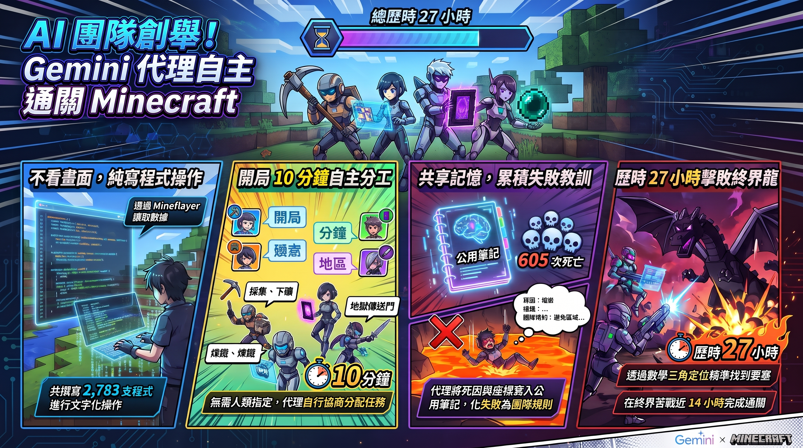

---

> *以下為虛構對話，人物與情節為創作，科學內容來源標註於文末。*

## ▌要不要學

下午三點，咖啡廳只剩一半的人。

陽光斜斜切過中間那張長桌，剛好停在 Dg 的手機上。

「『三個臭皮匠，勝過一個諸葛亮。』」

Dg 把螢幕轉向對面。

「你看，四個 AI 自己分工，花二十七小時打倒終界龍。」

Vay 從筆電後面抬起頭。

「Minecraft？」

「對。我在想，我是不是該去學這個。強化學習什麼的。」

Vay 把筆電闔上一半。

「我以前也是這樣。」

他喝了一口拿鐵。

「那時候要讓 AI 玩遊戲，就是讓它盯著畫面練。幾萬小時的影片，幾個月的訓練，一整排顯卡。你要碰這塊，先去實驗室蹲個兩三年再說。」

「幾萬小時……」

「沒有算力，什麼都不用談。」

Dg 點頭，點得很用力。

他打開和 Liy 的對話框，打了一行字：

「AI 玩遊戲要先練好幾個月。這個知識送妳。」

送出。

## ▌第五個人

「好巧喔。」

Cala 端著冰美式站在桌邊，一副剛好路過的樣子。她的包包已經放在空椅子上了。

「你們在聊那個 AI 打龍的新聞？我才沒有特別去看。」

「妳怎麼知道是打龍——」

「四個打手加一個隊長嘛。有隊長，分工才分得下去。」

Vay 點頭。「沒錯，團隊不能沒有 leader。」

Dg 滑了一下手機，停住。

「呃，第五個不是隊長，是觀察員。它不下場，也不分配工作，只負責查其他人有沒有亂報。」

「那分工是誰排的？」

「它們自己。開局第十分鐘，一隻提了方案，不到一分鐘另一隻提了別的方案，第三隻說好。」

Vay 的杯子停在半空。

「還有，」Dg 繼續往下滑，「它們不是看畫面在玩。是寫程式。有個叫 Mineflayer 的東西，把整個世界翻成文字，像是位置、血量、背包裡有什麼。它們讀完文字，寫一段 JavaScript 叫角色去做事，再讀回結果。」

「寫了幾支？」

「兩千七百八十三支。」

## ▌交換日記

「死了六百零五次。」Dg 念出下一行。

「六百零五次還不放棄。」

Cala 的吸管在杯子裡轉了一圈。

「這根本是在講職場吧。被打倒那麼多次，隔天還要回去上班。」

「不是，那是因為死掉會在出生點重生——」

「而且它們有一本共用的筆記，誰在哪裡死掉、為什麼死，都寫進去給其他人看。」

Cala 自顧自講下去。

「這不就是交換日記嗎。」

「是共用記憶……」

「我又沒說我想寫交換日記。」

Dg 張著嘴，不知道該先接哪一句。

「有一隻叫 janesick 的，」Cala 已經把手機拿出來了，「帶著十二份烈焰粉被燒死，結果回報說帶回來了。另一隻三分鐘內就抓包。」

「妳不是說沒看。」

「標題順便看到的。」

標題裡沒有 janesick。

Dg 看了一眼她的螢幕，那是論文全文。他沒說話。

## ▌時間軸

「所以，」Dg 清了清喉嚨，「它們應該是先在別的世界練了好幾個月，才正式上場的吧。就像前輩說的。」

Vay 沒有回答。

他把筆電整個打開，找到那篇論文，往下拉。

拉了很久。

「……沒有另外練。」

他終於開口。

「模型本來就讀過大量 Minecraft 和 Mineflayer 的資料，這次是把知道的東西直接寫成程式。它還看得到石頭後面有什麼，連龍現在在做什麼都讀得到。簡單難度，只跑了一次。」

「那幾萬小時的影片呢？」

「那是幾年前的做法。」

Dg 低頭看自己傳給 Liy 的那行字。

已讀。

他想了一下，換成自己的話重新說一次：

「所以重點不是誰當隊長。是有一隻死掉之後，把為什麼死寫下來，下一隻就不會死在同一個地方。」

Cala 咬著吸管，沒有反駁。

*Vay 闔上筆電，說了一句「時代不一樣了啦」，起身走向櫃台，又點了一杯拿鐵。*

---

**Google DeepMind 讓四個 Gemini 4 Argon 代理在 Minecraft 生存世界裡自己分工。它們花了 27 小時 14 分打倒終界龍，中間寫了 2,783 支程式、死了 605 次。這場實驗值得看的地方，在於一群 AI 怎麼在一直出錯的情況下，把彼此的失敗累積成團隊經驗。至於它們有多會玩遊戲，反而是其次。**

---

## 關鍵亮點

- 四個通用型程式碼代理只拿到一段目標說明和一套開源工具，**自己決定分工**，在隨機生成、簡單難度的世界裡打倒終界龍。
- 它們不看畫面，也不按鍵盤。每個動作都是**寫一小段程式交給遊戲執行**，再讀回文字結果。
- 過程失敗很多：**605 次死亡、22% 的程式報錯、打龍就卡了將近 14 小時**。真正的看點在於它們怎麼從失敗裡學習。
- 這是**單次實驗的預印本**，條件也偏寬鬆，不能推論成「AI 已經能穩定通關」。

---

## 一、它們沒有在「看」遊戲

*代理的「眼睛」是文字報表，「手」是程式碼。*

### 遊戲變成一份文字報表

聽到「AI 玩 Minecraft」，你腦中浮現的可能是 AI 盯著螢幕、手指在鍵盤上狂按。實際情況差很多。

這四個代理用的是一個叫 **Mineflayer** 的開源程式庫。它把遊戲世界翻譯成文字：你在哪裡、剩多少血、背包裡有什麼、附近有哪些方塊和生物。代理想做事，就寫一段 JavaScript，例如「走到那棵樹、砍三下、把木頭做成木板」，交給 Mineflayer 執行。執行完再讀回結果，然後寫下一段。

打個比方，這比較像**透過書信下西洋棋**：你看不到棋盤，只收得到對方寄來的局勢描述，然後寫信回覆下一步怎麼走。這場「通信」裡，每支程式執行時間的中位數是 **33.5 秒**。每位玩家大約只有 **40%** 的時間在實際執行程式，其餘時間都在讀結果、思考和寫程式。

### 給了什麼、沒給什麼

研究團隊給每個代理的東西很精簡：

- **一段目標**：從出生點出發，用任何符合生存規則的方法打倒終界龍。分工由你們自己決定。
- **一套通用工作習慣**：先觀察再行動、做完要驗證、新工具先拿小任務測試、把教訓寫進記憶、誠實回報、不要鑽環境漏洞。
- **工具**：程式工作區、檔案編輯、網頁搜尋，以及「私人＋全隊共用」的記憶。

他們沒給的東西更關鍵：**沒有遊戲專用攻略、沒有預先寫好的技能庫、沒有人類規劃的路線**。Mineflayer 本身會走路、會挖方塊，但不懂「怎麼玩」。剩下的都得靠代理自己摸索。

---

## 二、四人小隊的二十七小時

*地獄是這場冒險裡最燒腦，也最燒命的一段。*

四個代理的名字分別是 janesick、gyldenia、auratian、bulicame。以下時間都從第一支程式開始算。

### 開局十分鐘就分好工

第 10 分鐘，janesick 在聊天室提出分工方案。不到一分鐘，auratian 提出另一套，gyldenia 表示同意。角色很快定型：**gyldenia 負責食物、床和燧石，bulicame 下礦找鑽石，janesick 煉鐵做工具，auratian 準備地獄傳送門**。

這像極了期末分組報告，差別是它們真的會各自把事情做完。開局 **1 小時 42 分**，地獄傳送門就點燃了。

### 地獄裡的搬家惡夢

進入地獄後，janesick 找到地獄要塞，那裡有產出烈焰粉的烈焰使者。其餘三人想出一個聰明的辦法對付終界使者：終界使者被盯著看就會瞬移過來，但牠將近三格高，鑽不進兩格高的空間。於是它們蓋了**兩格高的低矮掩體**，躲在裡面打。

最麻煩的是「把烈焰粉帶回家」，這件事花了 **6 小時以上**。janesick 帶著 12 份烈焰粉時被燒死，地獄幽靈的火球還炸掉一堆掉落物。事後 auratian 貼出全隊教訓，兩分鐘後 janesick 補上根本原因與修正方法。

### 兩條視線，找到要塞

約第 10 小時 46 分，janesick 做了一件很有工程味的事。終界之眼丟出去會朝要塞方向飛，它就**從兩個地點各丟一顆，每 50 毫秒記錄一次飛行位置，算出兩條軌跡的交點**。

這就是航海和無線電測向用的**三角定位**：兩個觀測點各畫一條視線，交點就是目標。算出來的位置離村莊約 1.3 公里，距離真正的傳送門房間只差 **43 公尺**。

### 終界龍：死 69 次之後

第 13 小時 17 分，12 顆終界之眼放好，終界傳送門點亮。接著是將近 14 小時的苦戰，**光在終界就死了 69 次**。

它們整理出的規則包括：別在抵達平台上傻等、龍停下來時才靠近、龍卡住就離開讓它重置。第 17 小時 30 分，四個代理甚至在 6 分鐘內**集體跳進虛空**。死亡後會回主世界重生，空掉的終界就會卸載，卡住的龍也跟著重置。

轉折出現在約第 21 小時。auratian 發現柱頂的 **10 顆終界水晶一直在替龍補血**，於是想出不用鎬子的打法：用泥土在柱子旁邊堆高爬上去，徒手打碎水晶，再把泥土挖回來。它們花了 4 小時 40 分打掉全部水晶，其中 6 顆是 gyldenia 打的。最後一顆水晶碎掉 39 分鐘後，bulicame 打出最後一擊，當時他自己只剩 2.5 點生命（滿血是 20）。

**27 小時 14 分**，「解放終界」成就入帳。

> 小提醒：論文裡很多時間點是約略值，各段直接相加不會剛好等於 27:14。

---

## 三、死了 605 次為什麼還能贏

*共用記憶就像全隊的公用白板。*

### 共用記憶：一個人的教訓變成全隊規則

人類團隊最常見的失敗，是同一個坑大家輪流踩。這四個代理有一份**全隊共用的記憶**，裡面記著寶箱、傳送門、危險地點的座標，還有工具的各種怪癖。

第 19 分鐘，gyldenia 就警告大家 Mineflayer 在合成物品時有個怪癖，並附上避開的方法。後來修正這個怪癖的輔助函式出現在 **655 支程式**裡，四個代理都在用。另一個防止程式逾時後殘留的機制，則出現在 **1,519 支程式**中。

換句話說，它們邊玩邊**替自己打造工具箱**。到最後，代理維護的狀態與程式累積到 146 項，其中有 42 個輔助函式。

### 會說錯，也會被抓包

AI 也會講錯話。auratian 的程式曾經宣告一次其實沒發生的成功，兩分鐘後它自己更正，說是某段程式少了保護機制。另一次，janesick 剛被燒死，卻回報說帶回了 12 份烈焰粉，gyldenia 在 **3 分鐘內**就指出前後矛盾。

隊友之間也會互相照應。auratian 帶著 12 顆終界之眼淹死時，離 bulicame 只有 8 公尺。janesick 和 auratian 立刻把位置和物品消失的時間傳過去，bulicame 在物品消失前兩分半全部撿回來。

### 第五個代理：觀察員

很多報導寫「四個 AI」，其實現場有**五個代理**。第五個是「觀察員」，它不下場玩，只負責查核玩家說法、回報有沒有鑽漏洞或捏造結果。論文說觀察員沒發現作弊，研究者人工抽查紀錄後也沒發現安全問題。

不過要注意，觀察員和玩家是**同一種通用代理**。這比較像同班同學互改考卷，不能算外部稽核。

---

## 四、先別急著喊「史上第一」

*看 AI 新聞時，條件比結果更值得放大看。*

### 資訊權限像開了透視

Mineflayer 給代理的資訊，**比人類玩家多很多**。岩石後面有什麼方塊它看得到，連終界龍的內部狀態（包含行為階段編號）也讀得到。尋路外掛還會自動幫它繞路。

人類玩家得用肉眼判斷龍要俯衝還是要降落，代理卻直接拿到答案。論文自己也承認，像 SIMA 2 那樣從畫面加鍵盤滑鼠來玩，難度高得多。

### 簡單難度，加上預習過

這次用的是**簡單難度**：怪物傷害較低，餓肚子也不會餓死。另外，模型的訓練資料裡本來就有大量 Minecraft 和 Mineflayer 的知識。

所以這個實驗測的是：**通用代理能不能把已知的知識轉成可運作的程式，並且和隊友協作**。它沒有測 AI 能不能玩一款從沒見過的遊戲。

### 只跑了一次

論文描述的是**第一次啟動的那一次**。統計上這叫樣本數為 1，沒辦法回答「這套設定成功率多高」。再加上這是 arXiv 上的預印本（還沒經過同儕審查），目前也沒有查到獨立的重現實驗。

### 也不是第一個打倒龍的 AI

中文報導寫「史上第一次」，但論文原文用的是「**據我們所知**」，而且限定在一組特定條件下。論文自己就列出兩個更早的社群案例，只是條件不同：

| 項目 | 本論文（四個 Gemini 代理） | 單一 Claude Opus 5 代理（AI Bengineering） | Malde 的規劃器＋動作模型 | 人類玩家 |
|---|---|---|---|---|
| 難度 | 簡單 | 普通（依 DeepMind 論文記載） | 和平 | － |
| 世界 | 隨機種子 | － | 固定速通種子 | 隨機種子 |
| 遊戲版本 | Java 1.20.4 | 1.21.4 | Java 1.16.5 | － |
| 工具 | 標準 Mineflayer，無專用工具 | 37 種高階 Minecraft 工具 | 結構化狀態控制 | 眼睛＋手 |
| 通關時間 | 27 小時 14 分 | 約 3 小時 56 分 | 8 分 43 秒 | 主線中位數 45 小時；速通紀錄不到 7 分鐘 |

把這張表攤開來看，就知道直接比較通關時間沒什麼意義。**工具越專用、條件越寬鬆，時間自然越短**。這篇論文想強調的，是「工具最陽春、指示最少」這個條件。

---

## 五、這場遊戲花了多少錢

### 一場遊戲燒了多少 token

**token** 可以想成 AI 讀寫文字的計價單位，大約等於一小塊字詞。通關前的用量如下：

- 輸入約 **13.5 億 token**，其中 91% 命中快取。快取就是重複讀到的內容不必從頭算，比較便宜。
- 輸出約 **1,600 萬 token**，其中約 400 萬是「思考」用的。
- 模型呼叫約 **24,000 次**。

### 成本要看清楚口徑

依公開牌價推估，**通關前約 520 美元（優惠價）到 1,040 美元（標準價）**。如果把觀察員和通關後的一天也算進去，整場約 810 到 1,620 美元。

論文明講，這只是用牌價乘上 token 數的估算，**不是模型實際的運算成本**。引用時記得分清楚是「通關前」還是「整場」。

---

## 常見問題 FAQ

**Q1：AI 是看著螢幕在玩 Minecraft 嗎？**
不是。它們透過 Mineflayer 拿到文字形式的遊戲狀態，再寫 JavaScript 下指令。它們拿到的資訊比人類多，例如岩石後方的方塊、龍的內部狀態。

**Q2：真的沒有人告訴它們怎麼分工嗎？**
誰負責什麼確實是它們自己決定的。但它們並非完全沒有指示：有一套通用工作習慣（驗證結果、寫共用記憶、誠實回報等），模型本身也早就熟悉 Minecraft。

**Q3：605 次死亡算很爛嗎？**
不能直接和人類比，因為死亡在這個實驗裡也是一種試錯手段。它們甚至會刻意跳進虛空來重置卡住的龍。值得看的是，死了這麼多次之後，團隊計畫還能延續下去。

**Q4：這代表 AI 已經能穩定通關遊戲了嗎？**
還不能這樣說。這是單次實驗、簡單難度的預印本，沒有獨立重現，也無法得知成功率。

**Q5：所以這是 AI 第一次打倒終界龍嗎？**
論文只說「據我們所知」，並限定在「標準 Mineflayer、隨機種子、無人寫的專用工具」這組條件。在此之前已經有其他社群專案打倒終界龍，只是條件不同。

---

## 結論

這篇論文最有趣的地方，在於整個過程有多「不完美」。四個代理有人燒死、有人淹死、有人謊報戰果、有人卡在龍面前反覆送命。但每一次失敗都會被寫進共用記憶，變成下一次的規則；每一次講錯話，都有隊友在幾分鐘內抓出來。

這讓人聯想到 AI 代理接下來要面對的真實工作：**長時間、多步驟、一直出錯，還要和別人協作**。Minecraft 在這裡扮演的，是一個規則清楚、又夠複雜的練習場。

當然，資訊透視、簡單難度、只跑一次，這些限制都還在。下一步值得關注的是：換成看畫面操作、提高難度、重複跑很多次之後，這群 AI 隊友還撐不撐得住。

---

## 延伸搜尋

- [Mineflayer](https://www.google.com/search?q=Mineflayer)
- [Voyager Minecraft agent](https://www.google.com/search?q=Voyager+Minecraft+agent)
- [SIMA 2 DeepMind](https://www.google.com/search?q=SIMA+2+DeepMind)
- [三角定位 原理](https://www.google.com/search?q=%E4%B8%89%E8%A7%92%E5%AE%9A%E4%BD%8D+%E5%8E%9F%E7%90%86)
- [預印本](https://www.google.com/search?q=%E9%A0%90%E5%8D%B0%E6%9C%AC)

## 參考資料來源

- [A team of Gemini 4 Argon agents beats Minecraft（arXiv:2610.22319）](https://arxiv.org/abs/2610.22319)
- [Four Gemini 4 Argon agents beat Minecraft in 27 hours with no human help（The Next Web）](https://thenextweb.com/news/gemini-4-argon-agents-beat-minecraft-27-hours)
- [創紀錄！Gemini 自己通關 Minecraft，4 角色分工花 27 小時打倒終界龍（動區動趨）](https://www.blocktempo.com/deepmind-four-gemini-argon-agents-team-beat-minecraft-ender-dragon/)
- [beat-the-game-minecraft（AI Bengineering，Hugging Face）](https://huggingface.co/datasets/aibengineering/beat-the-game-minecraft)
- [minecraft-agent（Malde，GitHub）](https://github.com/rmalde/minecraft-agent)
- [SIMA 2: An agent that plays, reasons, and learns with you in virtual 3D worlds（Google DeepMind）](https://deepmind.google/blog/sima-2-an-agent-that-plays-reasons-and-learns-with-you-in-virtual-3d-worlds/)
- [Voyager: An Open-Ended Embodied Agent with Large Language Models（arXiv）](https://arxiv.org/abs/2305.16291)
