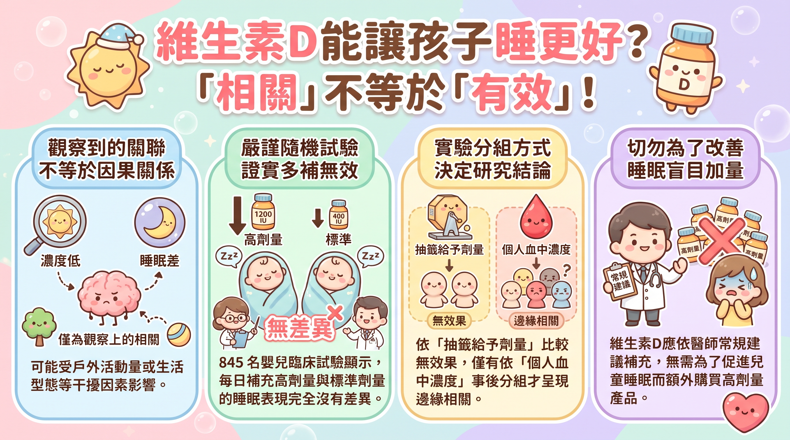

---

> *以下為虛構對話，人物與情節為創作，科學內容來源標註於文末。*

## ▌一點十分的購物車

午餐尖峰剛過。廚房裡，大鍋的湯還在滾。

Cala 坐在靠門的位子，手機螢幕朝上放在桌上。

「我只是剛好滑到。」

沒有人問她。

Liy 把麵放下，看了一眼螢幕。

「嬰兒維生素D滴劑，1200 IU，加入購物車。」

「那是廣告自己跳出來的。」Cala 把筷子掰開，「不過你想想，如果是 K 的小孩——」

她停了一下，像是在等誰阻止她。沒有人阻止她。

「K 那種人一定很晚睡。小孩遺傳到的話，從小就會睡不好。所以要先補。」

「為什麼要補維生素D？」

「研究說的啊。」Cala 滑出一張截圖，「缺維生素D的小孩，每天少睡快一個小時。四百二十分鐘對四百七十分鐘。」

Liy 低頭，照著截圖上的字念。

「研究對象：某兒童醫院睡眠門診，三十九名。」

「對啊。」

「睡眠門診，就是睡不好才去看的地方。」

「……所以呢？」

「所以這三十九個小孩，本來就睡不好。」

Cala 把截圖滑走。

## ▌三倍的劑量

「反正，」Cala 說，「1200 是 400 的三倍。三倍的量，寶寶就會睡得比較好。」

「這篇呢？」

Liy 指著下一張截圖。Cala 的手指慢了半拍，沒來得及滑掉。

「芬蘭，八百四十五個嬰兒，抽籤分兩組，一組每天 400，一組每天 1200。」Liy 念下去，「兩組的睡眠，沒有差異。」

「那、那是因為他們——」

「這裡沒有寫因為。」

Cala 咬住筷子。過了兩秒，她又滑出一張。

「可是你看這個！12 個月大的時候，濃度 75 以上的小孩，後來睡眠障礙比較少。還有這個，覺醒障礙也比較少。」

她的眼睛亮起來。

「覺醒障礙耶。就是沒辦法覺醒自己才能的意思吧。濃度夠的小孩，才會像 K 那樣，很早就——」

「上面括號寫的是：夜驚、夢遊。」

「……」

「是半夜醒一半的意思。」

## ▌75 跟 30

Cala 清了清喉嚨。

「總之，75 以上才算夠。剛剛那篇說 30 以下叫缺乏，30 根本差太遠了。」

Liy 把兩張截圖並排看。

「75 後面寫 nmol/L。30 後面寫 ng/mL。」

「一樣啦。」

「字不一樣。」

Cala 沒說話，切到計算機。上面已經有一行算式，是她之前輸入的：75 ÷ 2.5 = 30。

她看了那行字一眼，把手機蓋起來。

「……一樣啦。我剛剛算的。」

「那是同一條線。」

「對。」

「那剛剛那篇少睡一個小時的，和這篇睡比較好的，量的是同一條線。」

「對啊，所以我說嘛——」

「可是吃比較多的那組，沒有睡比較好。」

Cala 張開嘴，又闔上。

老闆在廚房喊了一聲外帶好了。Liy 應了一聲，沒有動。

## ▌出門的小孩

「兩組都有吃，」Cala 小聲說，「可是每個人的濃度就是不一樣啊。有的小孩比較常出門，曬比較多太陽吧。」

「常出門的小孩，濃度比較高。」

「嗯。」

「濃度比較高的小孩，睡比較好。」

「對。」

「所以常出門的小孩睡比較好。」

「我不是那個意思。」

「可是你剛剛兩句都這樣說。」

Cala 把麵攪了一圈，沒夾起來。

「……那我到底要不要買啦。」

「買給誰？」

Cala 的耳朵慢慢紅了。她把手機翻過來，購物車的頁面還亮著。

「就……以後。」

Liy 想了一下。

「你還沒有小孩。」

「我知道。」

「所以現在，沒有小孩睡不好。」

*Liy 拿起隔壁桌的空碗疊好，往廚房走去。購物車的頁面在桌上暗了下來。*

---

**網路上常說「孩子睡不好，可能是缺維生素D」。這句話有研究支撐，但支撐的方式跟大多數人想的不一樣。目前的兒童證據只顯示：血中維生素D濃度和睡眠「有關聯」；真正把孩子隨機分組、給不同劑量去比的試驗，睡眠並沒有差別。這篇帶你看懂這中間差在哪。**

---

## 關鍵亮點

- 維生素D濃度低的孩子睡得比較差，這是**相關**，研究者自己也說無法判斷誰影響誰。
- 在隨機試驗中，每天 1200 IU 和 400 IU 的嬰兒，**睡眠沒有差異**。
- 正向結果來自「依血中濃度事後分組」，這種分析擋不住日曬、活動量、飲食等干擾因素。
- 「補維生素D順便改善睡眠」，目前**沒有兒童證據**支持。

---

## 一、傳言從哪來：一間睡眠門診的 39 個孩子

*睡眠門診的孩子本來就是因為睡不好才來，跟一般孩子不是同一群人。*

### 數字本身沒有錯

常被引用的一篇是 Al-Shawwa 等人在 2020 年的研究。他們回頭翻查一間兒童醫院睡眠門診的病歷，找到 **39 位**做過睡眠檢查、也驗過維生素D的孩子，平均 **6.6 歲**，其中 **20 位**維生素D不足。

結果是：不足的那組，總睡眠時間約 **420 分鐘**，足夠的那組約 **470 分鐘**，差了快一個小時；睡眠效率也從 91.9% 掉到 84.5%。

看到這裡，很難不心動對吧？

### 但這是「事後翻病歷」

這種設計叫**回溯性研究**：資料早就在那裡，研究者只是回頭整理。像是期末考完才去問全班「你考前睡幾小時」，你能發現睡得少的人分數比較低，但說不出是熬夜害分數低，還是本來就沒讀懂所以只好熬夜。

作者自己也承認：**無法判斷因果方向**。還有兩個常被忽略的細節：

- 樣本是**睡眠門診病人**，不是一般孩子，結果很難外推。
- 這篇用 **<30 ng/mL** 定義「缺乏」，但不少臨床文獻以 **<20 ng/mL** 為缺乏。同一個詞，門檻差了一截。

---

## 二、真正的考驗：845 個嬰兒的隨機試驗

*VIDI 試驗以雙盲、隨機方式，比較兩種每日劑量。*

### 把運氣交給抽籤

想知道「補維生素D會不會讓睡眠變好」，最有說服力的方法是**隨機對照試驗（RCT）**：用抽籤決定誰拿哪種劑量，日曬多寡、爸媽作息、家境這些因素就會平均分散到兩組。

芬蘭的 **VIDI 試驗**就是這樣做的。嬰兒被隨機分成兩組，每天補充 **400 IU**（421 人）或 **1200 IU**（424 人），一路補到 24 個月大，而且是**雙盲**：爸媽和研究人員都不知道誰拿哪一種。

### 結果：沒差

2026 年發表的睡眠分析顯示，**高劑量組和標準劑量組的睡眠沒有差異**。

注意，這不是「補 vs. 不補」的比較，兩組都有補。它回答的問題是：「多補三倍，睡眠會不會更好？」答案是不會。

---

## 三、同一份資料，兩種結論？分組方式決定一切

### 換個切法就「有關係」了

同一批 VIDI 資料，研究者換了一種分法：不看抽到哪種劑量，改看孩子**12 個月大時血中的 25(OH)D 濃度**。濃度 **≥75 nmol/L** 的孩子，到 24 個月大時睡眠障礙比較少。

小知識：75 nmol/L 換算約等於 **30 ng/mL**，剛好就是 Al-Shawwa 研究的門檻。

不過這個結果的信賴區間是 −2.89 到 −0.04，**p = 0.05**，剛好踩在顯著門檻線上，屬於**邊緣顯著**。比較明確的是「覺醒障礙」（例如夜驚、夢遊這類從睡眠中半醒的狀況），**p = 0.002**。另外，孕期媽媽濃度 ≥75 nmol/L，也和孩子較好的睡眠有關。

### 為什麼抽籤分組沒效，濃度分組卻有？

關鍵在於：**血中濃度不是抽籤抽來的**。

兩個每天吃一樣劑量的孩子，濃度可能差很多。差在哪？常出門曬太陽、活動量大、飲食均衡、家裡作息規律……這些因素本身就可能讓孩子睡得好。濃度高，可能只是「生活型態好」的一個指標。

研究團隊在說明文中也明白表示：**生物標記上的關聯，不能直接證明因果**。

| 分析方式 | 誰決定分組 | 能排除干擾因素嗎 | 睡眠結果 |
|---------|-----------|----------------|---------|
| Al-Shawwa 2020（回溯性） | 病歷上的濃度 | 不能 | 濃度低者睡得較少 |
| VIDI 依劑量比較（隨機） | 抽籤 | 可以 | 無差異 |
| VIDI 依濃度分組（觀察性） | 孩子自身的濃度 | 不能完全排除 | 睡眠障礙較少（邊緣顯著） |
| Prono 2022 系統性回顧 | 綜合 14 篇研究 | 多為橫斷面，有限 | 有關聯，缺乏補充證據 |

---

## 四、機制聽起來很合理，但還只是「可能」

### 腦幹與褪黑激素的故事

相關文獻常提到兩個機制：**維生素D受體**分布在包含腦幹在內、與睡眠調控有關的腦區；維生素D也**可能**參與褪黑激素相關的路徑。

這些說法聽起來很完整，但 Prono 等人 2022 年的系統性回顧用的都是推測性的語氣，素材中也沒有直接證據。這種「機制合理所以一定有效」的推論，在營養研究裡翻車過很多次。

### 也可能是反過來

還有一種可能：**睡不好的孩子，比較少到戶外活動，所以維生素D偏低**。也就是說，關係可能是**雙向**的，甚至是睡眠影響維生素D，而不是維生素D影響睡眠。

這篇回顧只找到 **14 篇**研究，大多是橫斷面研究（某個時間點拍一張快照）。作者的結論很直接：目前缺乏補充的證據，需要 RCT。

---

## 五、成人研究能不能直接套到小孩身上？

*PSQI 是成人研究常用的睡眠品質量表，分數越低代表睡得越好。*

### 成人看起來有點效果

成人這邊確實有比較多試驗。Abboud 2022 年的整合分析納入 **19 項研究（13 項 RCT）**，補充組的 **PSQI** 平均降低 2.33 分；Yan 等人 2020 年的整合分析也發現補充組 PSQI 較低。

但 Abboud 也指出，**睡眠時間和睡眠障礙的結果並不一致**。換句話說，問卷分數變好，不代表實際睡更久。

### 小孩不是縮小版大人

兒童的睡眠結構、維生素D代謝、生活作息都跟成人不同。用成人的結果推論孩子，就像拿大學生的讀書方法去教幼兒園，邏輯上跳了一大步。

---

## 常見問題（FAQ）

**Q1：所以給孩子補維生素D沒用嗎？**
不是。這篇談的是「睡眠」這個特定效果。維生素D的補充本來就有其他用途與建議，該補多少應依醫師或官方建議，不必為了睡眠額外加量。

**Q2：孩子睡不好，要不要去驗維生素D？**
目前沒有證據顯示補足後睡眠會改善。睡眠問題原因很多，與其從維生素D切入，先跟兒科醫師討論整體狀況比較實際。

**Q3：為什麼 p = 0.05 要說「邊緣」？**
0.05 是常用的顯著門檻，結果剛好落在門檻上，代表證據力偏弱，換一批樣本很可能就不顯著了。

**Q4：為什麼不同研究的「缺乏」標準不一樣？**
不同研究和臨床指引採用的門檻不同，常見的有 <20 ng/mL 和 <30 ng/mL。讀報導時看到「缺乏」，最好確認它用的是哪個數字。

**Q5：成人吃維生素D能改善睡眠嗎？**
整合分析顯示問卷分數有改善，但睡眠時間與睡眠障礙的結果不一致，證據還不算穩固。

---

## 結論

維生素D和兒童睡眠的故事，是一個很典型的「相關不等於因果」案例。觀察性研究看到了關聯，但真正用抽籤分組去測的時候，多補的劑量並沒有讓孩子睡得更好。

這不代表維生素D跟睡眠毫無關係，只是目前的證據還停在「有關聯、機制待確認」的階段。接下來需要的是設計更好的兒童 RCT，例如直接比較「補 vs. 不補」，或針對濃度真正偏低的孩子。在那之前，「補維生素D順便改善睡眠」比較像是一個合理的假說，而不是已經證實的好處。

---

## 延伸搜尋

- [相關不等於因果](https://www.google.com/search?q=%E7%9B%B8%E9%97%9C%E4%B8%8D%E7%AD%89%E6%96%BC%E5%9B%A0%E6%9E%9C)
- [隨機對照試驗 RCT](https://www.google.com/search?q=%E9%9A%A8%E6%A9%9F%E5%B0%8D%E7%85%A7%E8%A9%A6%E9%A9%97+RCT)
- [25(OH)D 維生素D 檢測](https://www.google.com/search?q=25%28OH%29D+%E7%B6%AD%E7%94%9F%E7%B4%A0D+%E6%AA%A2%E6%B8%AC)
- [維生素D 缺乏 定義 ng/mL](https://www.google.com/search?q=%E7%B6%AD%E7%94%9F%E7%B4%A0D+%E7%BC%BA%E4%B9%8F+%E5%AE%9A%E7%BE%A9+ng%2FmL)
- [匹茲堡睡眠品質量表 PSQI](https://www.google.com/search?q=%E5%8C%B9%E8%8C%B2%E5%A0%A1%E7%9D%A1%E7%9C%A0%E5%93%81%E8%B3%AA%E9%87%8F%E8%A1%A8+PSQI)

---

## 參考資料來源

- [Seppälä V et al. (2026). High-dose vs standard-dose vitamin D and sleep in early childhood: A randomized clinical trial. Sleep Medicine](https://oulurepo.oulu.fi/handle/10024/61516)
- [Al-Shawwa B, Ehsan Z, Ingram DG (2020). Vitamin D and sleep in children. J Clin Sleep Med](https://scholarlyexchange.childrensmercy.org/papers/1948)
- [Prono F et al. (2022). The Role of Vitamin D in Sleep Disorders of Children and Adolescents: A Systematic Review. Int J Mol Sci](https://pmc.ncbi.nlm.nih.gov/articles/PMC8835880/)
- [Abboud M (2022). Vitamin D Supplementation and Sleep: A Systematic Review and Meta-Analysis of Intervention Studies. Nutrients](https://zuscholars.zu.ac.ae/works/4914)
- [Helve O et al. (2017). Towards evidence-based vitamin D supplementation in infants: VIDI study design and methods. BMC Pediatrics](https://link.springer.com/article/10.1186/s12887-017-0845-5)
- [Yan S et al. (2020). A meta-analysis: Does vitamin D play a promising role in sleep disorders? Food Sci Nutr（第三方摘要頁）](https://library.fabresearch.org/viewItem.php?id=16026)
- [Tampere Universities, Developmental Origins of Mind Lab: New results on early-life vitamin D and sleep](https://research.tuni.fi/domlab/news/news/)
- [2 Minute Medicine: Vitamin D deficiency may be associated with sleep disorders in children](https://www.2minutemedicine.com/vitamin-d-deficiency-may-be-associated-with-sleep-disorders-in-children/)
