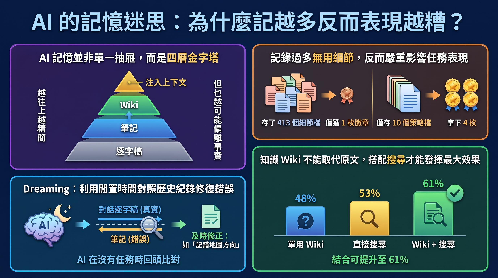

---

> *以下為虛構對話，人物與情節為創作，科學內容來源標註於文末。*

## ▌放下

午餐時段。湯鍋的蒸氣從廚房那頭漫過來。

Cala 把手機立在醋瓶旁邊。

「AI 會做夢了。」

Aon 抬頭。「哪來的？」

「Anthropic 的文章。我只看了標題。」

她用筷子把麵捲成一團，沒吃。

「重點是，記太多的那個反而輸了。四百多個檔案，一個徽章。只記十個檔的，拿四個。」

「寶可夢那段。」

「對。所以你看，人也一樣。記太多就走不出來。要學會放下。」

Aon 放下湯匙。

「那是兩個不同世代的模型。」

「所以？」

「各跑一次。」

「所以？」

「樣本數是一。一對一，你就推到『人要學會放下』。」

「我是在講道理。」

「你是在講感想。」

隔壁桌有人喊加辣。廚房回了一聲。

## ▌四十八比五十三

「還有，」Cala 把手機轉過來，「整理成 wiki 的比直接搜尋準。四十八比五十三。」

「那是搜尋贏。」

她看了螢幕兩秒。

「……整理過的東西比較有溫度，分數低一點很正常。」

「wiki 單用四十八，搜尋單用五十三，兩個一起用六十一。它是拿來搭配搜尋的，不是拿來取代的。」

「你就是想說我記錯。」

「我想知道你是從哪一段看到四十八比較準的。那一段前後在講什麼？還有併購那題，八十七比七十三，那只算需要跨文件的題目，你如果拿全部二十四題來——」

「Aon。」

「——比的話題目就不一樣，然後那個一點七七倍的——」

「你再這樣碎念下去，」Cala 把筷子平放在碗上，「我跟上次一樣，直接走。」

## ▌上次

「上次是你自己先走的。」

Aon 說得很快。

「我那天根本沒碎念。我只問了一個問題。」

「一個？」

「一個。我記得很清楚。」

Cala 沒回話。她滑了幾下手機，把螢幕推到桌子中間。

是 Aon 的訊息。上次那天，從她離開麵店之後算起，連續七則。

第一則是「等一下，你剛剛那個數字的出處是」。

最後一則是「總之目前證據不足以下結論」。

時間戳記一路排下來，沒有一則是她回的。

「記憶會錯。」她把手機收回去，「紀錄不會。」

「……你不是只看了標題？」

「看了標題。」

她低頭吃了一口已經有點糊的麵。

「還有月見山那段。順便。」

Aon 張嘴，又閉上。

*他把剛才在桌上排成一列的免洗筷套一個一個撿起來，對折，塞進筷筒旁的縫裡。手機在口袋裡，他沒拿出來查。*

---

**AI 助理每次開新對話都像失憶？Anthropic 工程團隊把「agent 記憶」拆成四層，並讓 Claude 在閒置時回頭翻自己的工作紀錄、修正記錯的事，這個過程被稱為「dreaming」。實驗結果有點反直覺：記得比較少的 AI 打寶可夢反而拿到更多徽章；花大力氣整理出來的 wiki，單獨使用時反而輸給直接搜尋。**

---

## 關鍵亮點

- **記憶讓成績明顯提升**：在 CL-Bench 資料庫查詢任務中，Opus 5 有記憶後平均得分從 0.564 升到 0.828。
- **記得少反而贏**：打《寶可夢 紅》時，Sonnet 3.7 存了 413 個記憶檔只拿 1 枚徽章；Fable 5 只存 10 個檔，拿到 4 枚。不過這只是各跑一次的比較。
- **Dreaming 能抓出記錯的事**：Claude 在「月見山」把方向記反、反覆掉下斷崖，對照工作紀錄修正後，第 1,935 個動作就走出洞窟。
- **wiki 要搭配搜尋才有用**：單用 wiki 最高 48%，還低於只用搜尋的 53%；兩者合用才到 61%。

---

## 1. AI 的記憶不是一個抽屜，是四層樓

*由下往上：逐字稿、筆記、wiki、開場自動載入的重點。*

### 先講清楚：這裡的「記憶」是什麼

聊到 AI 記憶，很多人會想到「模型學到新東西」。但 Anthropic 這篇文章講的是更具體的東西：**Claude 從經驗中得到、跨對話保留、之後可以再讀出來的知識**。

所以下面這幾件事不算：

- 改動模型本身的權重（那是重新訓練）
- 同一次對話裡臨時學會的東西（in-context learning）
- 對話太長時把舊內容壓縮成摘要（compaction）

換句話說，這裡的記憶比較像你書桌上的資料，不是你腦袋裡的神經連結。

### 四層樓，各有用途

用大學生期末考來比喻會比較好懂：

1. **逐字稿**：整學期的上課錄音。最完整，但要找東西得一段一段翻。
2. **記憶筆記**：你上課時自己抄的筆記。比較精簡，但可能抄錯。
3. **記憶表徵（例如 wiki）**：考前整理好、互相連結的重點講義。
4. **注入上下文**：考試當天寫在手背上的那幾行。不用翻，一眼就看到。

越往上越精簡、越好用，但也越可能偏離原始內容。**Dreaming 的工作就是在這幾層之間來回修正**：從錄音往上更新筆記和講義，也可以讓上層之間互相調整。

---

## 2. 記越多越好？寶可夢實驗說不一定

*Sonnet 3.7 的記憶約 97 萬字元，Fable 5 約 4.3 萬字元，差了二十多倍。*

### 先看好消息：記憶真的有用

在 CL-Bench 1.0 的資料庫查詢任務裡，Claude 每題都開一個全新的對話，唯一能帶過去的就是一個記憶資料夾。答完題會被告知正確答案，可以寫進記憶。30 題下來：

| 模型 | 無記憶 | 有記憶 | 學習迴圈的樣子 |
|------|-------|-------|--------------|
| Opus 5.5 | 0.655 | 0.838 | 完整閉環 |
| Sonnet 5.5 | 0.644 | 0.833 | 完整閉環 |
| Opus 5 | 0.564 | 0.828 | 第一個完整閉環：規則、依據、舊答案、陷阱警告都記 |
| Opus 4.7 | 0.383 | 0.700 | 會整合筆記，標註「已驗證／未驗證」 |
| Sonnet 5 | 0.306 | 0.610 | 批改後會標記確認或寫更正 |
| Sonnet 4.6 | 0.330 | 0.364 | 只會列出沒驗證過的猜測 |

最後一欄很有意思。**差別不只在「有沒有記」，而在「記了之後有沒有回頭驗證」**。Sonnet 4.6 有記憶跟沒記憶差不多，因為它寫下的都是猜測，下次也不會去確認。

### 再看反直覺的部分：打寶可夢

研究團隊讓兩個模型玩《寶可夢 紅》，都在約第 10,000 步時檢查它們的記憶資料夾：

- **Sonnet 3.7**：413 個檔案、225 個資料夾。幾乎每場戰鬥、每個道具、每個路人都開一個檔。結果：**1 枚徽章**。
- **Fable 5**：10 個檔案。結果：**4 枚徽章**。

Sonnet 3.7 慘到什麼程度？大約第 10,000 步時，它開了第四個「總整理」資料夾，接下來 17 步裡新建 6 個檔、刪掉 9 個檔，**完全沒有在玩遊戲**。像是期末考前一直在換筆記本封面的同學。

### 原文的解釋：問題在「記什麼」

遊戲狀態一直在變，鉅細靡遺的紀錄很快就過時。而錢包餘額、目前位置這些資訊，**畫面上本來就看得到**，存進記憶純屬多餘。

Fable 5 只記遊戲不會直接告訴它的東西：**策略、計畫、驗證過的規則**。它的 `global.md` 就像一塊儀表板，寫著目前目標、下一場道館戰的作戰計畫，還有「我自己要怎麼用記憶」的規則。

> ⚠️ **但別急著下結論**：這是兩個不同世代的模型、各只跑一次的比較，不能直接解讀成「記越少表現越好」。原文的說法是兩者「判斷什麼值得記」的能力不同，並以 Opus 5.5 也採用小型記憶、且成功通關作為佐證。

---

## 3. 讓 AI「睡一覺」：dreaming 在做什麼

*人腦的記憶鞏固假說：海馬迴快速記錄，睡眠時重播並整合進新皮質。*

### 名字借自人腦，但這是類比

Dreaming 的靈感來自神經科學的一個經典理論：**海馬迴白天快速記下經驗，睡覺或安靜休息時把經驗「重播」，慢慢整合進新皮質**，變成長期記憶。

注意，原文用的是「被認為」的語氣。這在神經科學裡是有大量研究支持、但細節仍在討論中的理論。AI 版的 dreaming 也不是真的在做夢，而是**在沒有任務的空檔，回頭翻自己的工作紀錄，修正記憶、整理出新的筆記**。

技術上的前身是 Letta 與 UC Berkeley 提出的 **sleep-time compute**：趁使用者沒在問問題的閒置時間，先把上下文消化整理好。論文摘要提到，這樣做可以讓回答時需要的運算量降到約五分之一。

### 一條記錯的筆記，能讓 AI 迷路多久

最戲劇化的例子發生在「月見山」（Mt. Moon）。這個洞窟入口在西、出口在東，入口附近有一道**只能往下跳、爬不回去的斷崖**。

Claude 拿入口的寶可夢中心當地標，卻把中心的位置**記成在東邊**。於是它走出中心後信心滿滿地宣布「月見山已經在我身後了」，還把筆記改成「已完成」。

幾步後，它掉下斷崖。導航工具沒標出落差，它就推論自己「大概往西走過頭了」，仍然覺得方向沒錯。

結果：**掉回同一條路 3 次**。第三次後它其實寫下要停止這個循環，但實驗設定的自動回覆要它繼續，它就一路退回尼比市（Pewter City），始終沒抵達華藍市（Cerulean City）。

### Dreaming 版本：回頭對答案

研究團隊對這份含錯誤的記憶資料夾跑 dreaming。Claude 對照當時的對話逐字稿，**發現自己把方向記反了**，改寫筆記。之後它直接回到洞裡，在**第 1,935 個動作**抵達華藍市。

對照組是完全沒有記憶的版本，同樣沒能抵達。

這個案例的重點是：**逐字稿是「基準事實」**。筆記會錯、講義會錯，但原始紀錄可以拿來驗證。就像考試前發現筆記抄錯，回去聽錄音才能確定老師到底說了什麼。

---

## 4. 地圖與疆域：wiki 不是萬靈丹

*128 次 dreaming 後，wiki 從 103 頁長到 222 頁、連結從 766 條增加到 12,893 條。*

### 把 4.2 億 token 的文件整理成 wiki

研究團隊拿 Stainless 公司的內部文件（約 35 萬個檔案、約 4.2 億 token）做實驗。讓 Opus 5 跑 128 次 dreaming：探索檔案、寫 wiki、合併重複、對照原文查核。然後用 25 道題目測試：

| 做法 | 2 次 dreaming 後 | 128 次 dreaming 後 |
|------|-----------------|-------------------|
| 只用 wiki | 13% | 48% |
| 只用搜尋 | 約 53% | 約 53%（不受影響） |
| wiki + 搜尋 | 54% | 61% |

13% 到 48% 看起來很驚人。但**請把目光移到第二列**：只用搜尋就有 53%。也就是說，wiki 單獨使用時，**整理了 128 次還是輸給直接搜尋**。

wiki 真正的價值在第三列：搭配搜尋，分數更高，每題還省下約 2 萬 token。**它是導覽地圖，不是取代原文的東西。**

### 什麼題目適合 wiki

在法律 AI 公司 Harvey 的評測（LAB）中，有一組併購文件題目，半數以上需要**跨多份文件整合、判斷或計算**。在這類題目上，查 wiki 的準確率 87%，只用搜尋 73%。

但要注意，這個數字只適用於「需要跨文件」的那些題目。另一個任務的答案大多能在單一文件裡直接搜到，wiki 就沒有明顯優勢。

### 波赫士的地圖：比疆域還大

最好笑的是另一個任務：10 份文件共 115 KB，Claude 整理出來的 wiki 有 68 頁、203 KB，**比原文件還大了約 1.77 倍**。

原文引用了阿根廷作家波赫士的短篇〈論科學的精確〉：某個帝國的製圖師精益求精，最後畫出一張跟帝國一樣大的地圖。這張地圖當然完全沒用，因為它沒有做任何**抽象化**。

整理筆記的目的就是取捨。把課本整本重抄一遍，不叫做讀書筆記。

### 修好規則，wiki 就變好

有個合約條款任務，原本多個 agent 同時寫入同一張共用表格，彼此覆蓋，評分用的 57 項事實只剩 41 項（72%）。

讓 Claude 反思失敗原因、改寫建 wiki 的指示（每份合約一頁、單一 agent 負責、條款逐字引用而非摘要）後重建，**57 項全部保留**。

另一個例子是補洞：單次整理時，Claude 有時會連到還沒建立的頁面。第二輪 dreaming 找出 9 條這樣的「死連結」，改指到既有頁面，並補上 3 頁，包括一個索引。

---

## 5. 給目的，不給步驟：怎麼教 AI 記東西

### 規定越細，強的模型反而變弱

研究團隊試了一個看似合理的規則：「只記錄失敗的經驗」。結果記憶帶來的分數增益反而縮水：

- Opus 5：少了 0.234
- Opus 4.7：少了 0.150
- Sonnet 4.6：少了 0.020

越強的模型損失越大。原文的結論是：**告訴它記憶「是做什麼用的」有效，硬性規定「怎麼記」不一定**。對強模型，讓它自己判斷什麼重要，比預設規則好。

### 但較舊的模型需要提醒

Sonnet 4.6 常常不讀記憶、也不驗證自己的猜測。提示它「先讀記憶、測試你的理論」之後，分數從 0.364 跳到 0.641，接近無記憶基線（0.330）的兩倍。相比之下，Sonnet 5 不用提示，10 次裡有 9 次會先讀記憶。

這有點像帶新人：對有經驗的同事講清楚目標就好，細節他自己會安排；對剛入行的人，基本動作還是得提醒。

### 「手背上那幾行」要非常小

Dreaming 也能把最重要的筆記升到最上層，讓每次對話開頭自動載入。Claude 不用搜尋，甚至不用知道有這東西。

聽起來很方便，但有三個風險：

1. 每次載入都佔用 token
2. 寫錯的筆記會被帶進**每一次**對話
3. 載入了不代表會照做，指示越長，遵循度越低

所以頂層一定要很精簡。例如 Claude Code 的自動記憶只載入 `MEMORY.md` 的前 200 行或 25 KB，當作索引用。Dreaming 的工作之一，就是把細節往下層移，只在頂層留一條連結。

---

## 6. 還沒解決的問題

### 什麼時候記？

邊做事邊寫筆記會分心；交給 dreaming 在背景整理，又不保證馬上能用。這個取捨目前沒有標準答案。

### 怎麼保持新鮮？

Claude 可能一開始就記錯，環境變了記憶也會過時。Dreaming 可以修正，但要花運算資源。持續檢查所有記憶不太實際，原文提出的方向是**集中檢查容易變動的資訊**，或依使用頻率調整 dreaming 的頻率。

### 實務工作者的疑慮

技術媒體 The New Stack 訪問了一些開發者，他們擔心的包括：錯誤記憶可能長期留在系統裡、人工審查容易流於形式，以及版本紀錄只能看出「改了什麼」，看不出「哪個版本才對」。

### AI 不能預知未來

原文最後坦白：就算模型越來越會判斷什麼重要，**沒有任何模型能預知之後會遇到什麼**。Dreaming 的意義是讓 AI 能「往回看」，用運算把過去的經驗重新整理一次。

---

## 常見問題（FAQ）

**Q1：Dreaming 是 AI 真的在做夢嗎？**

不是。這是借用人腦睡眠鞏固記憶的比喻。實際上是 AI 在閒置時重讀自己的工作紀錄，修正並重寫記憶檔案。依官方文件說明，dream 的輸入是既有記憶庫加上 1 到 100 個對話紀錄，輸出是一個新的記憶庫，原本的記憶庫不會被直接修改。目前仍是研究預覽。

**Q2：這跟 Google 最近提的「睡眠框架」一樣嗎？**

不一樣。Google Research 的做法是在「睡眠」階段**更新模型權重**；Anthropic 的 dreaming 不改模型本身，只整理模型外部的記憶檔案。兩邊都強調「睡眠」只是借用的名詞。

**Q3：寶可夢實驗是不是證明 AI 記越少越聰明？**

不能這樣解讀。那是不同世代模型、各跑一次的比較。原文的重點是「判斷什麼值得記」，畫面上看得到的資訊不必存，該存的是策略和驗證過的規則。

**Q4：那 wiki 到底該不該建？**

看任務。需要跨多份文件整合的問題，wiki 很有幫助（87% vs 73%）；答案在單一文件就找得到的，直接搜尋就夠。而且 wiki 單獨使用時表現不如搜尋，**最好當作搜尋的輔助**。

**Q5：有記憶的 AI 一定比沒記憶的好嗎？**

不一定。CL-Bench 論文本身就發現，單純保留完整上下文常常比專門設計的記憶系統效果更好。Anthropic 這篇比較的是「有沒有記憶資料夾」，兩個研究的問題不一樣，不宜混為一談。

---

## 結論

這篇研究最有意思的地方，不是 AI 學會了「做夢」，而是它把記憶這件事拆得很清楚：**記錄、整理、驗證、取捨，是四件不同的事**。

記得多不等於記得好；整理得漂亮不等於比原文好用；規則訂得細不等於表現更好。真正讓 AI 進步的，是知道該記什麼，而且能回頭對照原始紀錄，發現自己哪裡記錯。

接下來的挑戰是成本與時機：要花多少運算去整理記憶、多久整理一次、怎麼確保錯誤不會悄悄累積。這些問題目前都還開放著。

---

## 延伸搜尋

- [記憶鞏固 睡眠](https://www.google.com/search?q=%E8%A8%98%E6%86%B6%E9%9E%8F%E5%9B%BA+%E7%9D%A1%E7%9C%A0)
- [sleep-time compute](https://www.google.com/search?q=sleep-time+compute)
- [互補學習系統 海馬迴](https://www.google.com/search?q=%E4%BA%92%E8%A3%9C%E5%AD%B8%E7%BF%92%E7%B3%BB%E7%B5%B1+%E6%B5%B7%E9%A6%AC%E8%BF%B4)
- [倖存者偏差](https://www.google.com/search?q=%E5%80%96%E5%AD%98%E8%80%85%E5%81%8F%E5%B7%AE)
- [波赫士 論科學的精確](https://www.google.com/search?q=%E6%B3%A2%E8%B5%AB%E5%A3%AB+%E8%AB%96%E7%A7%91%E5%AD%B8%E7%9A%84%E7%B2%BE%E7%A2%BA)

---

## 參考資料來源

- [The components of agent memory（Anthropic Engineering, Lance Martin, 2026）](https://www.anthropic.com/research/components-of-agent-memory)
- [Sleep-time Compute: Beyond Inference Scaling at Test-time（Lin et al., 2025, arXiv:2504.13171）](https://arxiv.org/abs/2504.13171)
- [Continual Learning Bench: Evaluating Frontier AI Systems in Real-World Stateful Environments（Asawa et al., 2026, arXiv:2606.05661）](https://arxiv.org/html/2606.05661v1)
- [Why There Are Complementary Learning Systems in the Hippocampus and Neocortex（McClelland, McNaughton & O'Reilly, 1995）](https://stanford.edu/%7Ejlmcc/papers/McCMcNaughtonOReilly95.pdf)
- [Neural reactivation during human sleep（Denis & Cairney, 2023）](https://pmc.ncbi.nlm.nih.gov/articles/PMC10754334)
- [The sleep framework: A new way for LLMs to retain knowledge in continual learning（Google Research, 2026）](https://research.google/blog/the-sleep-framework-a-new-way-for-llms-to-retain-knowledge-in-continual-learning/)
- [Dreams（Claude Platform Docs）](https://platform.claude.com/docs/en/managed-agents/dreams)
- [Sleep-time Compute（Letta Blog）](https://letta.com/blog/sleep-time-compute)
- [Anthropic gave agents the ability to dream. Then developers woke up.（The New Stack, 2026）](https://thenewstack.io/anthropic-agent-memory-dreaming/)
- [On Exactitude in Science（Wikipedia）](https://en.wikipedia.org/wiki/On_Exactitude_in_Science)
