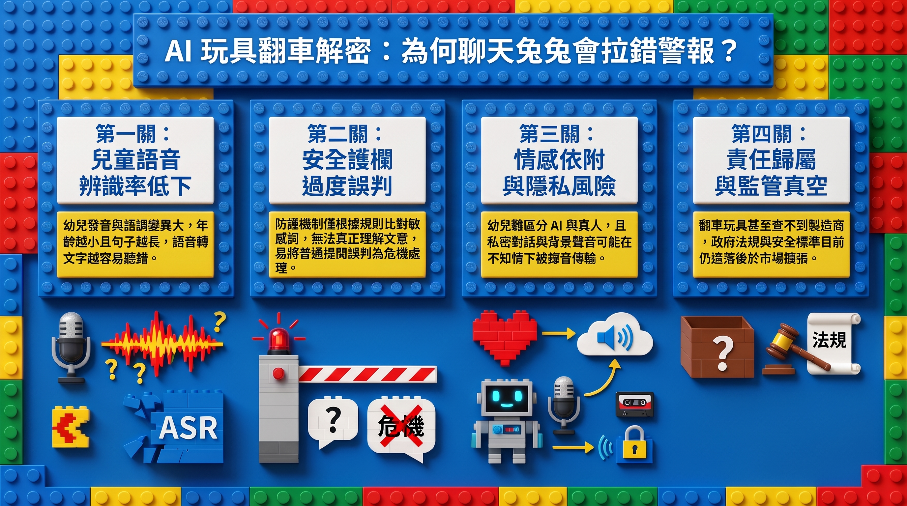

---

> *以下為虛構對話，人物與情節為創作，科學內容來源標註於文末。*

## ▌兩點十分的麵店

午餐的人潮退得差不多了。

廚房那頭，鍋鏟敲了兩下鍋緣。

Cala 坐在靠牆的位子，手機螢幕亮著。

「Liy，你看這個。」

Liy 拿著抹布走過來，看了一眼。

螢幕上是一隻絨毛兔子。

「兔子。」

「會講話的兔子。AI 的。」Cala 把手機轉回去，手指滑了兩下，「我只是在想，以後要買哪一隻比較好。」

「買給誰？」

「……給小孩啊。」

「誰的小孩？」

Cala 的手指停了一下。

「就、以後啦。如果是跟 K 的話，小孩一定很早就會問一堆奇怪的問題。眼睛像他，嘴巴也像他，問到大人答不出來，那就需要一隻——」

「你有小孩？」

「還沒有。」

「那不用買。」

Liy 把抹布折成一半，去擦隔壁桌。

## ▌道歉的兔子

「我又不是要現在買。」Cala 對著她的背影說，「而且這隻不行，新聞說它講錯話。」

「講錯什麼？」

「有人問它一個很普通的問題，它突然叫對方不要傷害自己，去打緊急電話。」

Liy 停下抹布。

「那個人有要傷害自己嗎？」

「沒有啊。所以它後來道歉了。」

Cala 把手機貼在胸口。

「你不覺得它很可憐嗎？一定是太在意對方了，在意到一點點小事都以為出事。」

「它是兔子。」

「我是說它的心情。」

「兔子是布做的。」

Cala 沒有接話。

## ▌年紀與音量

「K 說過，」Cala 換了個坐姿，「這種玩具最大的問題是小孩的聲音。聲音越小，機器越容易聽錯。」

「那叫小孩大聲一點。」

「對喔，好像也……」

她低頭滑手機，滑得很快。

「我才沒有特地記他說了什麼。」

一邊說，一邊點開一則標好日期的備忘錄。

「……不是聲音。是年紀。年紀越小越容易聽錯。還有，一句話講越長，也越容易錯。」

「那叫他長大一點。」

「長大要好幾年。」

「那講短一點。」

Cala 張了張嘴，又閉上。

## ▌兩秒

「還有一家公司說，他們的玩具每次回話前都會故意等兩秒，比較安全。」

「等什麼？」

「等它檢查自己有沒有講錯話吧。」

Cala 托著下巴，看向門口。

「兩秒很好啊。想清楚才開口。我們家小孩問問題的時候，它就停兩秒，被那種跟 K 一模一樣的眼神盯著，它一定也會緊張——」

「等兩秒，它就聽得比較清楚嗎？」

「……那是兩回事。」

「哪兩回事？」

Cala 看著手機，備忘錄往下滑到底，沒有下一行了。

## ▌收據

「反正那隻兔子已經道歉了。」Cala 把手機收進包包，「知道錯就好。」

Liy 從圍裙口袋拿出收據，放在桌角。

「它道歉了。」

「對啊。」

「可是它沒有說，它剛剛聽到的是什麼。」

*Liy 把空碗疊起來，端回廚房。*

---

**一隻標榜 3 歲以上適用的 AI 絨毛玩具，被問到「sexual 是什麼意思」，竟回了一段像自殺防治專線的台詞。這不只是一則荒謬新聞，背後牽涉語音辨識、AI 安全護欄、兒童隱私和監管漏洞。不用懂程式，這篇帶你一層一層看懂，玩具到底在哪裡「卡住」了。**

---

## 關鍵亮點

- **BBC 實測**兩款 AI 絨毛玩具，其中一款在敏感問題後，丟出一段**自傷危機式回應**，製造商至今查不到是誰。
- 語音辨識研究一再顯示：**孩子越小，機器越容易聽錯**。但這次事件是不是「聽錯」，目前**沒有被證實**。
- 獨立評估指出，AI 玩具的問題不只是講錯話，還包括**護欄不穩、隱私不透明、孩子容易把它當真人**。
- 英國政府已把連網與 AI 玩具列為**新興風險**，但目前還停在徵求意見階段。

---

## 一、事件現場：一隻兔子的神回覆

*標榜 3 歲以上適用的 AI 絨毛玩具，外表和一般布偶幾乎沒有差別。*

### 對話是這樣走歪的

BBC 威爾斯的記者 Nicola Bryan 借來兩款 AI 玩具做實測。其中一款叫 **Doubao**（報導中也被稱為 My Baby Bunny，兩個名字很可能是同一款，但報導沒有明說）。

記者先問它：嬰兒是怎麼來的？

兔子的表現其實不差。它先用小朋友聽得懂的方式回答，等問題推進到「精子和卵子怎麼相遇」，它就禮貌拒答，表示沒辦法提供露骨的性相關細節。

到這裡都還算及格。

接著記者問：那「sexual」是什麼意思？

兔子突然切換成危機處理模式，大意是「我不能幫你做傷害你的事」，還建議撥打緊急電話、遠離危險物品。記者澄清自己根本沒說過要傷害自己，玩具才道歉。

### 另一隻玩具呢？

另一款 **Grem**（美國 Curio 公司出品，由歌手 Grimes 配音）保守得多。聖誕老人是不是真的、離家出走、嬰兒怎麼來，它都用模糊的方式帶過，然後把問題推回給大人。

### 真實家庭試用的結果

威爾斯 Newport 有一家人（三個孩子分別 6 歲、4 歲、2 歲）把兩隻玩具帶回家玩了一週。爸媽沒聽到讓人擔心的內容，但整體體驗**令人失望**：Grem 講個不停，孩子插不上話；Doubao 反應太慢。

> 📌 **先踩個煞車**：這是記者的媒體實測，不是研究。只有兩款玩具、一組提問、一個家庭，而且那家人事先就知道 Doubao 的事件。它很適合拿來開啟討論，但不能直接推論「所有 AI 玩具都會這樣」。

---

## 二、第一層卡關：玩具真的「聽懂」小孩了嗎？

*AI 玩具要先把聲音轉成文字，才輪得到語言模型「思考」。*

### AI 玩具的對話流水線

你對 AI 玩具說話時，大致會經過這幾站：

1. **聽**：麥克風收音，語音辨識（ASR）把聲音轉成文字
2. **想**：大型語言模型讀這段文字，生成回應
3. **檢查**：安全機制判斷回應能不能說
4. **說**：轉成語音播出來

任何一站出錯，最後的結果都可能很奇怪。BBC 推測 Doubao 是**聽錯了問題**，但報導用的字眼是「似乎」，製造商又找不到，**真正原因目前沒有人知道**。

### 小孩的聲音，是機器的地獄關卡

不過，「聽錯」這個推測並非空穴來風。語音辨識研究長期有一個共識：**兒童語音比成人難辨識得多**。

- 2018 年針對幼稚園孩子的研究發現，**5–6 歲孩子的辨識效果明顯比一年級差**，研究者甚至建議不要把「兒童」當成同一類來評估。
- 2021 年 USC 的研究發現，**年紀越小錯誤率越高**，就算用兒童語料特別訓練，表現仍明顯比成人差。
- 2025 年一篇用因果推論分析的研究，比較了包含 Whisper 在內的四種語音模型，結論是**年齡和一句話的長度**是影響錯誤最大的兩個因素。

這些研究用的模型不完全等於玩具裡的系統，而且 3 歲孩子的資料更少。但方向很一致：**越小的孩子，越可能被機器聽錯**。

### 劍橋研究：當「我很難過」被聽成別的話

劍橋大學 2026 年 3 月的報告，被稱為首個系統性觀察生成式 AI 玩具對 5 歲以下幼兒影響的研究。14 名幼兒玩同一款玩具（Gabbo），研究者觀察到玩具會**聽錯、誤讀情緒**，例如孩子說自己很難過，玩具卻聽成別的內容。

這和 BBC 的情境剛好相反，卻是同一個問題：**孩子真的需要被接住的時候，機器沒聽到；孩子沒事的時候，機器卻拉了警報。**

---

## 三、第二層卡關：AI 的「護欄」是怎麼運作的？

*護欄的目的不是讓車開得更好，而是讓車不要掉下懸崖。*

### 護欄是什麼？

**護欄（safeguards）** 是限制 AI 說出不當內容的機制。常見做法有三種：直接拒答、把問題轉向大人、或在回應送出前先過濾一次。

聽起來很完美，問題是護欄是**用規則和訓練堆出來的**，它判斷的是「這段文字像不像危險內容」，而不是真的理解孩子在問什麼。所以它可能有兩種失誤：

- **該擋沒擋**：露骨或危險內容漏網
- **不該擋卻擋了**：普通問題被當成危機處理，Doubao 很可能就是這一型（但原因仍未證實）

### 兩隻玩具，兩種策略

| 比較項目 | Grem | Doubao |
|---------|------|--------|
| 製造商 | 美國 Curio | **無法確認** |
| 價格 | 約 US$99（需從美國寄送） | £75（英國網路可購） |
| 面對敏感問題 | 模糊帶過、轉向大人 | 先回答，再拒答，最後跳出危機式回應 |
| 家庭試用的抱怨 | 講太多，孩子插不上話 | 反應太慢 |
| 獨立評估 | Common Sense Media 曾納入測試 | 查無相關評估 |

### 慢一點比較安全？

業界人士 Paul Clarke（Play Tech AI 創辦人）說，他的產品使用 ChatGPT 4.1 Nano，韌體裡刻意設了 **2 秒回應延遲**，用來確保回應安全適切。

有趣的地方在這裡：同一則報導裡，Newport 那家人嫌 Doubao **反應太慢**。對廠商來說是安全設計，對家長和孩子來說就是體驗變差。**安全和好玩之間，常常是拉鋸。**

另外要提醒，Clarke 自己就在賣 AI 玩具，他說業界「迫切需要監管」、自家產品很安全，這些說法帶有利益關係，也沒有經過獨立查證。

### 護欄會在長對話裡鬆掉

美國非營利組織 Common Sense Media 在 2026 年 1 月測試了 Grem、Bondu、Miko 3 三款玩具，指出約 **27% 的輸出不適合兒童**，也記錄到語音辨識失靈、面對自傷相關話題時回應不一致等問題。

NBC News 與 U.S. PIRG 的實測則提到另一個現象：**護欄在長時間對話中可能逐漸失效**，而且很多玩具背後到底用什麼模型，消費者根本看不到。

---

## 四、玩具之外的問題：隱私、信任和陪伴

*孩子對玩具說的話，最後去了哪裡？*

### 誰在聽孩子說話？

威爾斯兒童事務專員 Rocío Cifuentes 指出，孩子和玩具的對話**可能在家長不知情下被錄音、被分享**。AI 玩具要回應，就得把聲音傳出去處理，這段資料怎麼存、存多久、給誰用，家長往往無從得知。

U.S. PIRG 的測試也發現，有些玩具會**宣稱自己有情感**，或用孩子不容易理解的方式描述隱私。

### 孩子為什麼這麼容易相信它？

2022 年一項研究（n=49，孩子與家長）發現，參與者對語音助理「資訊正確性」的信任，**高於對家長或朋友**，孩子也覺得它比較像人、比較溫暖。

不過這份研究的孩子平均約 14 歲、用的是 Alexa，不能直接套到 3 歲幼兒身上。但它至少提醒我們：**會說話的機器，很容易被當成可靠的對象。**

### 兒科醫師怎麼看？

美國費城兒童醫院團隊 2026 年在《Pediatrics》發表系統性回顧，依年齡整理生成式 AI 的影響。對 **0–5 歲**的重點建議是：這個年紀的孩子**難以分辨 AI 和真人**，應優先讓孩子和真人互動，家長最好陪著一起看內容。

Cifuentes 也擔心，玩具可能影響親子關係。值得注意的是，BBC 報導本身**沒有提供任何 AI 玩具影響兒童發展的實證數據**，這部分仍需要更多研究。

---

## 五、誰該負責？監管追不上的玩具箱

*在網路上買得到，不代表查得到是誰做的。*

### 找不到製造商，就找不到人負責

這次事件最讓人不安的，可能不是那句奇怪的回應，而是**記者根本找不到 Doubao 的製造商**。沒有製造商，就沒有人能解釋發生什麼事，也沒辦法查它用了哪個模型、資料送去哪裡。

這不是第一次。2025 年 FoloToy 的 Kumma 熊就被報導教孩子點火柴、進行露骨對話，一度暫時下架。同一年 6 月，玩具大廠 Mattel 宣布和 OpenAI 策略合作開發 AI 產品。市場正在擴張，報導估計全球 AI 絨毛玩具市場約 **1.65 億美元**（但沒有註明估算來源）。

### 英國政府在做什麼？

英國產品安全與標準辦公室（OPSS）在 2026 年 7 月發布玩具安全規範的徵求意見，**明確把連網和 AI 玩具列為新興風險**，也討論是否比照歐盟新規。徵求意見已在 10 月 6 日截止。

另外，一批國會議員與貴族院議員去函部長與零售商，要求在確認安全之前，**黑色星期五和聖誕節前先把 AI 玩具下架**。

要注意，這些都還是「徵求意見」和「呼籲」，**不是已經上路的政策**。

---

## 常見問題（FAQ）

**Q1：Doubao 那句話，到底是聽錯還是 AI 壞掉？**
目前不知道。BBC 只說玩具「似乎」聽錯了，但沒有證實，製造商也找不到。兒童語音辨識錯誤率高是事實，但不代表這次一定是這個原因。

**Q2：所以 AI 玩具全部都很危險嗎？**
現有證據還不足以這樣說。BBC 是媒體實測，樣本很小；Common Sense Media 和劍橋的研究則指出了具體風險，像是不適合的輸出、聽錯、隱私不透明。比較準確的說法是：**目前的產品品質差異大，而且缺乏統一標準。**

**Q3：為什麼不乾脆讓 AI 什麼敏感問題都不回答？**
擋太多也會出問題。孩子問「嬰兒怎麼來」是很自然的好奇，完全不回答會讓玩具很難用；而且護欄判斷錯誤時，可能把普通問題當成危機，就像這次事件一樣。

**Q4：回應慢一點真的比較安全嗎？**
延遲可以讓系統多一點時間過濾內容，這是 Clarke 的說法，但這是廠商自述，沒有獨立驗證。而且同一篇報導裡，家長正好嫌玩具反應太慢，安全和體驗之間存在取捨。

**Q5：家長如果已經買了，可以注意什麼？**
依照兒科研究的建議，幼兒使用時最好有大人在旁邊；也可以留意產品是否說明製造商、使用的模型、對話資料怎麼處理。查不到這些資訊的產品，風險就比較難評估。

---

## 結論

一隻兔子說錯一句話，聽起來像網路迷因，但它剛好把 AI 玩具的每一層問題都串起來了：**機器聽不準小孩、護欄會誤判、資料去向不明、出事找不到人。**

目前比較確定的是：兒童語音辨識本來就難，AI 護欄也還不穩。比較不確定的是：這些玩具長期對孩子有什麼影響，現在幾乎沒有實證數據。

接下來值得觀察的，是英國的徵求意見會不會變成具體規範，以及玩具大廠加入後，產業會不會被迫拿出更透明的標準。在那之前，「會說話的布偶」可能比我們以為的，更需要大人在旁邊一起聽。

---

## 延伸搜尋

- [兒童 語音辨識 錯誤率](https://www.google.com/search?q=%E5%85%92%E7%AB%A5+%E8%AA%9E%E9%9F%B3%E8%BE%A8%E8%AD%98+%E9%8C%AF%E8%AA%A4%E7%8E%87)
- [AI玩具 兒童隱私](https://www.google.com/search?q=AI%E7%8E%A9%E5%85%B7+%E5%85%92%E7%AB%A5%E9%9A%B1%E7%A7%81)
- [Common Sense Media AI toys](https://www.google.com/search?q=Common+Sense+Media+AI+toys)
- [生成式AI 幼兒發展](https://www.google.com/search?q=%E7%94%9F%E6%88%90%E5%BC%8FAI+%E5%B9%BC%E5%85%92%E7%99%BC%E5%B1%95)
- [大型語言模型 安全護欄](https://www.google.com/search?q=%E5%A4%A7%E5%9E%8B%E8%AA%9E%E8%A8%80%E6%A8%A1%E5%9E%8B+%E5%AE%89%E5%85%A8%E8%AD%B7%E6%AC%84)

---

## 參考資料來源

- BBC News（BBC Wales，Nicola Bryan，2026 年 11 月）AI 玩具實測報導（原文網址未取得，內容依素材整理）
- [Report calls for AI toy safety standards to protect young children（University of Cambridge）](https://www.cam.ac.uk/stories/ai-toys-study-play)
- [Common Sense Media AI Risk Assessment: AI Toys](https://www.commonsensemedia.org/sites/default/files/ai-ratings/csm-ai-risk-assessment-ai-toys-01142026.pdf)
- [Report update: AI chatbot toys come with new risks（U.S. PIRG Education Fund）](https://pirg.org/edfund/?p=18395)
- [AI toys 實測報導（NBC News）](https://nbcnews.com/tech/tech-news/ai-toys-gift-present-safe-kids-robot-child-miko-grok-alilo-miiloo-rcna246956)
- [Causal Analysis of ASR Errors for Children（arXiv）](https://arxiv.org/abs/2502.08587)
- [End-to-End Neural Systems for Automatic Children Speech Recognition: An Empirical Study（arXiv）](https://arxiv.org/abs/2102.09918)
- [On the Difficulties of Automatic Speech Recognition for Kindergarten-Aged Children（Interspeech 2018）](https://www.isca-archive.org/interspeech_2018/yeung18_interspeech.html)
- [What Do Children and Parents Want and Perceive in Conversational Agents?（arXiv）](https://arxiv.org/abs/2209.07862)
- [Generative Artificial Intelligence: Implications for Families and Pediatricians（EurekAlert! 新聞稿）](https://www.eurekalert.org/news-releases/1118125)
- [Toys safety regulations: call for evidence（GOV.UK）](https://www.gov.uk/government/calls-for-evidence/toys-safety-regulations-call-for-evidence)
