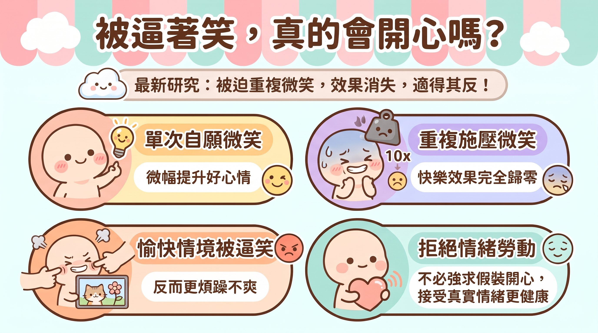

---

> *以下為虛構對話，人物與情節為創作，科學內容來源標註於文末。*

## ▌靠窗的熟客

下午三點，咖啡廳只剩冷氣聲。

陽光斜斜切過長桌，停在 Vay 的筆電邊緣。

Dg 抱著筆電坐到他對面。插座、Wi-Fi、免費續水。完美。

「Vay 哥，我在考慮去飲料店打工。」

「好事啊。」

「可是面試說，要『隨時保持笑容』。」

Vay 把耳機拿下來。

「我以前也是這樣。」

Dg 坐直了。

「剛出社會做客服，主管規定上線要笑。對著電話笑，客人聽得出來。而且笑久了，你自己也會開心。」

「真的假的。」

「有研究的。咬筆實驗，聽過沒？嘴巴咬一支筆，嘴角被撐上去，像在笑。這樣看漫畫，會覺得比較好笑。」

Dg 沒聽過。但他點頭的速度像是聽過。

「所以『笑一笑，十年少』是有科學根據的！」

「差不多那個意思。後來我帶團隊，也這樣要求。」

Vay 喝了一口美式。

「伸手不打笑臉人。笑，是對自己最便宜的投資。」

Dg 打開筆記本，寫下「最便宜的投資」。

## ▌K 的資料夾

寫到一半，筆停了。

「等一下。」

Dg 點開一個資料夾。K 上週丟給他整理的。

「咬筆實驗……後來有十七個國家——不對，十七個實驗室重做。」

「然後？」

「沒做出來。差距幾乎是零。」

Vay 挑眉。

「那是實驗室。我帶的是真的人。」

「這篇就是在講真的人。」Dg 把螢幕轉過去。「今年十月的研究。一千多人看圖片，被要求笑一次或笑十次。一半的人還被警告，笑不好扣兩塊美金。」

「扣錢？」

「假的啦，最後全都有拿到。但他們當下不知道。」

Vay 沒說話，往前湊了一點。

「看可怕的圖，笑一次會好一點點。笑十次，效果變小。笑十次又怕被扣錢——」

Dg 比了一個歸零的手勢。

「沒了。」

「那看開心的圖呢？」

「更慘。被要求一直笑的人，比自己隨便反應的人還不開心，也比較煩躁。」

冷氣聲填滿了接下來那幾秒。

## ▌兩行字

「所以不是笑沒用。」

Dg 盯著自己的筆記本。

「是自己想笑的笑，跟被規定的笑，不是同一種笑。後面那種，笑越多次，越像在上班。」

說完他自己愣了一下。

這句話沒有出處。是他自己的。

Vay 轉著咖啡杯。

「我們那時候，教科書就是這樣寫的。」

「我知道。」

「整個團隊都在笑。業績也不差。」

「嗯。」

Dg 沒有反駁。他不確定能怎麼反駁。

筆記本上，「最便宜的投資」還在。下面多了一行：「被逼的不算」。

兩行字擠在一起，誰也沒劃掉誰。

Vay 把螢幕轉回去，看了一眼那篇研究，又推回來。

「你查一下最新的告訴我。」

「蛤？」

「那個扣兩塊的。看他們後來有沒有追蹤真的在上班的人。」

*Vay 戴回耳機，點開下一個會議視窗。鏡頭亮起的那一刻，他的嘴角習慣性地往上提——停住，又慢慢放平。*

---

**「心情不好就笑一笑吧！」這句話你一定聽過。心理學界也真的研究了好幾十年，結論大致是：擺出微笑，確實能讓人稍微快樂一點點。但佛羅里達大學的最新研究把實驗搬到更接近真實工作的情境，結果很不一樣。只笑一次，還有一點效果；要你一直笑、笑不好還要扣錢，效果就消失，甚至讓人更不開心。**

---

## 關鍵亮點

- **單次微笑有小效果**：在沒有壓力的情況下擺出一次微笑，看負面圖片時會比自然表情稍微快樂一點。
- **重複加壓力就失效**：要求重複微笑 10 次，再加上「笑不好扣錢」的威脅，正面效果完全消失。
- **好心情反而被拖累**：看小貓、花朵這類愉快圖片時，被要求重複微笑或受到懲罰威脅的人，反而比自然反應的人更不快樂，也傾向更煩躁。
- **對服務業的提醒**：研究者認為，硬性規定員工「一直保持微笑」可能適得其反。

---

## 一、先講結論：這次研究發現了什麼？

*被要求的笑容和自然的笑容，對心情的影響可能完全不同。*

### 研究的基本資訊

這篇研究由佛羅里達大學心理學系的 **Nicholas A. Coles** 領軍，與 Annabel V. Dang、Joao Francisco Goes Braga Takayanagi 合作，於 2026 年 10 月線上發表在《實驗社會心理學期刊》（*Journal of Experimental Social Psychology*）。

值得注意的是，這是一篇**預先註冊報告（Registered Report）**。簡單講就是：研究者先把「我打算怎麼做實驗、怎麼分析」交給期刊審查，審查通過後才開始收資料，而且不管結果好不好看，期刊都會刊登。這樣一來，研究者就比較沒有空間「挑好看的結果來發表」。

### 一句話版本

**微笑能不能讓你開心，要看你笑了幾次，還有是不是被逼的。**

這跟我們熟悉的「笑一笑心情就會變好」不太一樣。比較精確的說法是：教科書上的結論在實驗室裡大致成立，但換到「得一直笑、笑不好會被罰」的情境，就不一定了。

---

## 二、「笑一笑就開心」從哪裡來？一段很曲折的研究史

### 臉部回饋假說：表情會反過來影響情緒

心理學有個概念叫**臉部回饋假說（facial feedback hypothesis）**：一般我們以為是「開心所以笑」，但這個假說主張反過來也成立，「笑了所以開心」。也就是說，臉部肌肉的動作會回傳訊號給大腦，影響你的情緒。

### 經典咬筆實驗：從明星到翻車

1988 年，Strack 等人做了一個超有名的實驗：讓受試者用牙齒咬住一支筆（嘴角被迫上揚，像在笑），或用嘴唇含住筆（嘴角被迫下壓），再請他們評分漫畫有多好笑。結果「咬筆組」覺得漫畫比較好笑。這個實驗後來被寫進無數教科書。

但到了 2016 年，**17 個實驗室**聯手重做這個實驗。原研究兩組的差異是 0.82，這次合併起來只剩 **0.03**，信賴區間還跨過零。白話說就是：**沒重現出來**。

### 有沒有被看著，結果就不同？

2018 年，Noah 等人提出一個有趣的解釋：重現實驗時加了**攝影機**錄影，而受試者「感覺被觀察」這件事，本身就可能讓效果消失。原研究和重現研究可能都沒錯，只是條件不一樣。

這個發現其實已經埋下這次新研究的伏筆：**情境的細節，會改變表情對情緒的影響。**

### 2022 年的大型合作：效果小，但存在

為了解決爭議，Coles 參與主導了「**Many Smiles Collaboration**」，找來 **19 個國家、3,878 名受試者**，而且讓支持與懷疑這個假說的學者一起設計實驗。結果發現：模仿笑臉照片或自主擺出微笑，確實能提升快樂感；但咬筆法的結果仍然不明確。

Coles 在 2019 年受訪時也曾估計，這個效果大概是**每 100 個人微笑，約有 7 個人會因此更快樂**。效果確實存在，但幅度不大。

*臉部回饋效果的研究經歷了「發現、重現失敗、大型合作再確認」的過程。*

---

## 三、實驗怎麼做？把實驗室搬進「客服人生」

### 實驗設計一覽

研究團隊在線上招募了 **1,201 人**，最後納入分析的有 **1,174 人**。受試者會看兩類圖片：

- **愉快的圖**：小貓、花朵
- **不愉快的圖**：竊盜、虐待動物的畫面

接著，研究者操弄了三個條件：

1. **要不要笑**：被指示擺出微笑 vs. 維持自然表情
2. **笑幾次**：1 次 vs. 10 次（模擬客服一整天反覆面對客人）
3. **有沒有壓力**：一半的人被警告「沒笑好會被扣 2 美元」（總酬勞 6 美元）

偷偷爆個料：這個扣錢威脅是**假的**，最後所有人都拿到全額。但受試者在實驗當下並不知道。

每完成一項任務，受試者都要自己評分有多快樂，研究者另外也分析了憤怒與煩躁的程度。

### 結果整理

| 情境 | 單次微笑、無壓力 | 重複微笑 | 重複微笑＋扣錢威脅 |
|------|----------------|---------|------------------|
| 看**不愉快**的圖 | 比自然表情組稍微快樂 | 正面效果變弱 | 正面效果完全消失 |
| 看**愉快**的圖 | 幾乎沒變化 | 比自然表情組**更不快樂** | 比自然表情組**更不快樂** |
| 副作用 | — | 看愉快圖片時，煩躁與憤怒傾向增加 | 同左 |

注意一個細節：新聞報導常說效果「反轉」，但仔細看會發現，**看不愉快圖片時是效果「消失」**，只有**看愉快圖片時才真的變成「更不快樂」**。這兩種情況程度不同，不宜混為一談。

---

## 四、為什麼越笑越不開心？研究的意義與疑點

### 從實驗室到真實世界的落差

心理學有個概念叫**生態效度（ecological validity）**，指的是實驗結果能不能推到真實生活。過去的微笑研究多半是「在實驗室裡笑一次」，但現實中，需要一直笑的人通常是一整天、反覆笑，而且笑不好可能會被主管念、被客人客訴。

這次研究就是在補這一塊。Coles 的解讀是：**傳統實驗室的結論沒錯，但放進「重複」加「被迫」的情境，方向可能就變了。**

### 早有跡象：笑太多不一定好

其實 2014 年就有研究提出類似的警訊。Labroo 等人發現，對於把微笑當成「讓自己快樂的手段」的人來說，**頻繁微笑反而會降低幸福感**。這次的新研究，等於是從另一個角度呼應這個方向。

### 讀這篇研究時要留意的地方

研究有意思，但也有幾個需要保留的地方：

- **新聞稿沒有給效果量**：目前公開的報導沒有提供效果大小、信賴區間等數字，「小幅提升」或「變得更不快樂」到底差多少，需要看原論文才知道。
- **扣錢是假的**：被警告扣 2 美元，跟真實職場上被主管盯、被客訴的壓力，強度可能不一樣。
- **線上實驗難確認有沒有真的笑**：受試者在家對著螢幕做實驗，研究者很難直接確認每個人都照指示笑了。
- **只有自評**：快樂程度是受試者自己打分數，而且連續笑 10 次之後，可能也混入了疲勞或無聊感。
- **長期效果未知**：未參與研究的學者 Norman Farb 在受訪時就指出，這項研究無法回答「長期在職場被要求微笑」會造成什麼影響。

*實驗室裡的一次微笑，跟工作上一整天的微笑，可能是兩回事。*

---

## 五、這對工作現場代表什麼？

### 「微笑服務」規定可能有反效果

很多服務業都會要求員工「隨時保持笑容」。Coles 認為，這類規定可能會帶來反效果，並舉了美國零售商 Target 的微笑規定曾遭批評為例。

這也連結到一個社會學概念：**情緒勞動（emotional labor）**，指的是工作要求你持續表現出特定情緒，例如客服的親切、空服員的笑容。這次研究雖然沒用這個詞，但結果正好提醒我們：**表情不只是給客人看的，它也會反過來影響做表情的人。**

### 不用硬逼自己開心

Coles 也提到，社會常常過度強調「要變得更快樂」，但有時候接受自己當下的狀態，可能也是一種選擇。換句話說，心情不好的時候，不一定要逼自己擠出笑容。

---

## 常見問題 FAQ

**Q1：所以「笑一笑會變開心」是假的嗎？**
不完全是。大型研究顯示，在沒有壓力的情況下擺出微笑，確實可能讓人稍微快樂一點，只是效果不大。這次研究的重點是：**重複**和**被迫**會讓這個效果減弱或消失。

**Q2：我平常自然笑出來，會不會也越笑越不開心？**
這次研究比較的是「被指示擺出的微笑」和「自然表情」，並沒有研究自然流露的笑容。所以目前的結果，不能直接套用到你自然笑出來的情況。

**Q3：為什麼看可愛小貓時，被要求微笑反而更不快樂？**
新聞稿沒有詳細說明原因。一種可能的解讀是，原本就會自然產生的好心情，被「必須笑」的要求干擾了，同時還增加了煩躁感，但這需要後續研究確認。

**Q4：預先註冊報告為什麼比較可信？**
因為研究設計在收資料前就經過審查，而且無論結果如何都會被刊登，研究者比較沒有動機去調整分析方法、只挑漂亮的結果發表。這是心理學界面對「重現危機」後推動的改革之一。

**Q5：這研究能證明微笑服務規定有害嗎？**
還不能。實驗用的是假的扣錢威脅、線上短時間任務，跟真實職場差很多。它提供的是一個警訊，至於長期影響，還需要在真實工作環境中研究。

---

## 結論

「笑一笑就會開心」這句話，在心理學的研究史裡走了一段很長的路：從經典實驗成為教科書內容，到重現失敗、引發爭議，再到大型國際合作確認「效果小但存在」。這次的新研究則往前多走一步，把問題從「微笑有沒有用」改成「**在什麼情況下有用**」。

答案是：偶爾、自願的微笑，可能讓你好過一點；但一直笑、被逼著笑，可能只會讓你更累。

未來值得關注的方向，包括在真實職場中追蹤長期被要求微笑的員工、比較不同文化與工作類型的差異，以及釐清「被迫」這件事究竟是透過什麼機制影響情緒。在那之前，下次有人叫你「笑一個嘛」，你可以理直氣壯地說：研究顯示，被逼的笑容不一定有用。

---

## 延伸搜尋

- [臉部回饋假說](https://www.google.com/search?q=%E8%87%89%E9%83%A8%E5%9B%9E%E9%A5%8B%E5%81%87%E8%AA%AA)
- [情緒勞動](https://www.google.com/search?q=%E6%83%85%E7%B7%92%E5%8B%9E%E5%8B%95)
- [Many Smiles Collaboration](https://www.google.com/search?q=Many+Smiles+Collaboration)
- [預先註冊報告 心理學](https://www.google.com/search?q=%E9%A0%90%E5%85%88%E8%A8%BB%E5%86%8A%E5%A0%B1%E5%91%8A+%E5%BF%83%E7%90%86%E5%AD%B8)
- [心理學 再現性危機](https://www.google.com/search?q=%E5%BF%83%E7%90%86%E5%AD%B8+%E5%86%8D%E7%8F%BE%E6%80%A7%E5%8D%B1%E6%A9%9F)

---

## 參考資料來源

- [Smiling your way to happiness or misery?（Coles, Dang, & Takayanagi, 2026, *JESP*）](https://doi.org/10.1016/j.jesp.2026.105011)
- [Smiling can make you happier — unless someone forces you to do it（EurekAlert!，佛羅里達大學新聞稿）](https://www.eurekalert.org/news-releases/1150435)
- [Scientists had people try a happiness trick—something unexpected happened（Newsweek）](https://newsweek.com/forcing-a-smile-has-surprising-effect-on-happiness-study-12668924)
- [A multi-lab test of the facial feedback hypothesis by the Many Smiles Collaboration（Coles et al., 2022, *Nature Human Behaviour*）](https://munin.uit.no/handle/10037/28709)
- [Registered Replication Report: Strack, Martin, & Stepper (1988)（Wagenmakers et al., 2016）](https://pure.uva.nl/ws/files/14872420/Registered_Replication_Report.pdf)
- [When both the original study and its failed replication are correct: Feeling observed eliminates the facial-feedback effect（Noah et al., 2018）](https://www2.psych.ubc.ca/%7Eschaller/528Readings/NoahSchulMayo2018.pdf)
- [Not always the best medicine: Why frequent smiling can reduce wellbeing（Labroo et al., 2014）](https://www.kellogg.northwestern.edu/academics-research/research/detail/2014/not-always-the-best-medicine-why-frequent-smiling-can/)
- [Global collaboration led by Stanford researcher shows that a posed smile can improve your mood（Stanford News）](https://news.stanford.edu/2022/10/20/posing-smiles-can-brighten-mood/)
- [Can faking a smile make you feel happier?（Live Science）](https://www.livescience.com/health/mind/can-faking-a-smile-make-you-feel-happier)
- [The Science Of Smiles, Real And Fake（NPR）](https://www.npr.org/transcripts/735822187)
