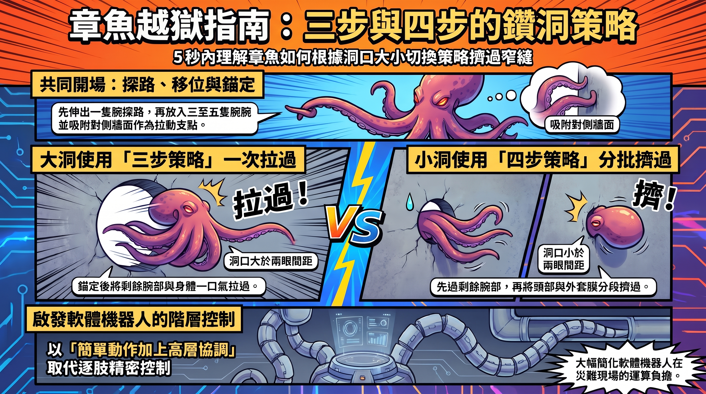

---

> *以下為虛構對話，人物與情節為創作，科學內容來源標註於文末。*

## ▌三十次，三隻

雨從傍晚下到現在。

K 的螢幕上開著一份草稿，標題是《章魚越獄指南》。

辦公室的門沒敲就開了。

「你這邊有沒有多的傘——」Aon 停在 K 背後，「等一下。『章魚依洞口大小切換策略』？」

K 繼續打字。

「依。」Aon 把這個字念了兩遍，「依，就是因果。你確定是因果？」

鍵盤聲沒停。

「誰說的？研究顯示？哪篇？」

「J Exp Biol。這個月。」

「好。幾隻？」

「三隻。」

「三隻。」Aon 拉了張椅子坐下，傘的事顯然已經不重要了，「試驗幾次？」

「三十。」

「三十次，三隻。所以不是三十個樣本，是三隻各做十次左右。你知道這差多少嗎？同一隻章魚第二次鑽洞，跟第一次鑽洞，牠記得欸。牠會學。那第二次跟第一次就不是各自獨立的——」

K 喝了一口咖啡。咖啡已經冷了。

「——你有在聽嗎？」

K 把杯子放回去。

## ▌十四比零

「好，那看數字。」Aon 湊近螢幕，「大洞十四次，全部三步。小洞十五次四步、一次三步。」

他安靜了大約兩秒。

「切得很乾淨。」

K 沒抬頭。

「太乾淨了。」Aon 往後靠，「格子裡有零，次數又少，一般的算法會不準。他們用什麼？」

「精確檢定。P 小於零點零零一。」

「嗯。」Aon 點頭，「這個選得對。」

然後他又湊回去。

「但是。」

K 的手指在鍵盤上停了半拍，又繼續。

「洞口大小是怎麼分配的？每隻章魚都試大洞也試小洞，還是——」

「一號只試大洞。二號三號只試小洞。」

Aon 張著嘴。

「那不就——」

「第五章。」

Aon 往下捲。捲了很久。

「……你寫了。」

K 沒回。

「你寫了，那標題為什麼還寫『依』？洞口大小跟『是哪一隻章魚』完全綁在一起。眼距小的那隻剛好拿到大洞，眼距大的兩隻剛好拿到小洞。你怎麼知道不是那兩隻本來就比較喜歡分兩段過？你連對照都——」

K 按下存檔。

## ▌鐵網底下的洞

「還有左撇子那段。」

Aon 沒有要停的意思。

「探路的腕，左邊第二隻用了快一半。作者說可能是水槽某一邊視野比較好。可能。那為什麼不把水槽轉過來再測一次？轉個方向而已啊。還有那隻馬雅章魚，先試小洞，卡住，再換大洞。一隻。一隻欸。一隻就可以推到『章魚沒辦法預判』？」

K 打字。

「『目前只能算線索』。」Aon 唸出螢幕上的字，「好。這句我接受。」

他靠回椅背，盯著天花板。

「不過說到不會預判。」

K 的手沒停。

「國小那次，網球滾到鐵網外面，你說底下那個洞，頭過得去身體就過得去。」

鍵盤聲停了。

「你卡在那裡二十分鐘。是我跑去叫警衛的。」

K 沒說話。

雨聲填滿了那段空白。

「所以你看，」Aon 指著螢幕，「卡住的不一定是你以為的那個地方。論文也說，章魚卡關可能不只是口器的問題，是所有腕的根部加起來——」

「你的傘在門後。」

*凌晨一點，K 的手機亮了。Aon 傳來一大段訊息，滑到最後一行：「標題那個『依』，建議刪掉。」*

*K 回了一個字：「不。」*

---

**一隻沒有骨頭的章魚，碰上一個比自己身體還小的洞，會怎麼做？新加坡、義大利與奧地利的研究團隊用攝影機拍下答案：章魚不是隨便亂擠，而是依洞口大小切換「三步」或「四步」策略。這套看似簡單的動作順序，可能正是下一代軟體機器人鑽進災難現場的關鍵。**

---

## 關鍵亮點

- 章魚鑽洞有固定流程：**一隻腕探路 → 再伸入 3–5 隻腕 → 在另一側錨定 → 把身體拉過去**。
- 洞口比兩眼間距大，用**三步策略**，身體一口氣拉過；洞口比較小，改用**四步策略**，頭和外套膜分開過。
- 小章魚會先挑大洞試，也有章魚先試小洞失敗才換洞，暗示章魚**未必能事先算準**自己鑽不鑽得過。
- 研究者認為，機器人可以學章魚用「**簡單動作＋高層協調**」取代逐一控制每條肢體。

---

## 一、實驗現場：一塊壓克力板和一個洞

*研究團隊在透明隔板上開洞，從旁拍下章魚穿越的每一個動作。*

### 研究團隊怎麼設局

這項研究發表於 2026 年 11 月 5 日的《實驗生物學期刊》（*Journal of Experimental Biology*），第一作者是新加坡國立大學的 Wenci Xin，合作單位還有義大利拿坡里費德里科二世大學，以及奧地利維也納的 Haus des Meeres 水族館。

實驗設計說穿了很樸素：水槽中間立一塊**透明壓克力隔板**，板上開一個洞，然後等章魚自己決定要不要鑽過去。因為隔板是透明的，攝影機可以從頭到尾記錄下每一隻腕的位置。

洞要開多大？團隊拿章魚的**兩眼間距**當尺。參與實驗的章魚眼距約 15 到 35 公釐，洞口則設計成略大於眼距，或比眼距小約 5 公釐。換句話說，「大洞」和「小洞」不是絕對尺寸，而是相對於每隻章魚自己的頭有多寬。

### 主角有誰

主要的觀察對象是 **3 隻真蛸**（*Octopus vulgaris*），也就是最常見的那種「普通章魚」。團隊總共錄到 33 次穿越，其中 3 次因為章魚改走別的路線、把裝置弄壞而排除，最後有 **30 次**進入分析。

另外還有 **4 隻幼年馬雅章魚**（*Octopus maya*）作為補充觀察，這部分的故事放在第三章。

---

## 二、三步還是四步？章魚的鑽洞 SOP

### 共同開場：探路、移位、錨定

不管洞多大，章魚的開場動作都很一致：

1. **探路**：先伸一隻腕過去，像在黑暗中摸門把。
2. **移位**：確認那邊沒問題，再陸續伸入另外 3 到 5 隻腕。
3. **錨定**：已經過去的腕在另一側抓牢，變成拉動身體的支點。

接下來的關鍵，在於最難縮小的部位，也就是包著內臟的囊狀身體「**外套膜**」，以及頭部，要怎麼通過。

### 三步策略：一口氣拉過去

如果洞口**比兩眼間距大**，章魚會把剩下的腕連同身體一次拉過去，整個流程三步收工。

### 四步策略：先過手，再過頭

如果洞口**比兩眼間距小**，章魚會多拆一步：先讓剩下的腕過去，然後頭和外套膜**分開**依序擠過。等於把一件大行李拆成兩件，一件一件塞進窄門。

### 數字怎麼說

| 洞口條件 | 三步策略 | 四步策略 | 合計 |
|---|---|---|---|
| 大洞（比眼距大） | 14 次 | 0 次 | 14 次 |
| 小洞（比眼距小） | 1 次 | 15 次 | 16 次 |

四步策略**只出現在小洞**，大洞一律用三步。研究團隊用**費雪精確檢定**（Fisher's exact test）分析策略與洞口大小的關聯，結果 *P*<0.001；論文說明，選這個檢定是因為部分組別的次數太少。

---

## 三、偏心的手臂與不太會估算的小章魚

*章魚探路時偏愛前側的腕，尤其是左邊第一、第二隻。*

### 章魚是左撇子？先別急

觀察發現，章魚探路時偏好用**前側的腕**，特別是**左側第二隻和第一隻**，但每隻章魚的習慣不太一樣。

看到「偏左」，很容易聯想到「章魚也有慣用手」。但研究者自己先踩了煞車：他們推測這可能跟**實驗設置**有關，例如水槽某一側的視野比較好。換言之，章魚可能只是往看得比較清楚的那邊伸手，不見得是天生左撇子。

### 小章魚：小洞？不了，謝謝

4 隻幼年馬雅章魚的表現很有趣：牠們一開始**全都不去嘗試最小的洞**。後來其中 2 隻用三步策略穿過了比較大的洞。

### 先試了再說

在同時提供多個洞的測試中，一隻馬雅章魚**先挑了小洞**。牠照樣完成探路，也送過去兩隻腕，但接下來的腕就是擠不進去。失敗幾次之後，牠才轉向中間的大洞，用完整的三步策略過關。

研究者據此推測，章魚**可能無法準確預判**洞口過不過得去。卡關的也不一定只是傳統認為的口器大小，所有腕的根部加起來有多粗，可能也是限制。不過這只來自一隻個體的觀察，目前只能算線索，還不是結論。

---

## 四、從章魚到機器人：少管一點，反而更靈活

*狹窄的災難現場，正是軟體機器人最想派上用場的地方。*

### 逐肢控制的難題

想像你要寫程式控制一隻八條腿、而且每條腿都能任意彎曲的機器人。如果每個關節、每一段都要中央大腦精準下指令，計算量會大到爆炸。

章魚給的啟示是：**不必管得那麼細**。研究團隊認為，軟體機器人可以學章魚，用幾個**簡單、重複的動作**當積木，再由**高層協調**決定何時用哪個積木，而不是逐一控制每條肢體。這樣的機器人有機會進入**崩塌建築**等人類和傳統機器難以進入的狹窄空間。

### 章魚本來就是這樣分工的

這個想法並非憑空而來。2015 年，耶路撒冷希伯來大學的 Levy、Flash 與 Hochner 在《當代生物學》（*Current Biology*）發表研究，首次詳細分析章魚爬行時的腕部協調。他們發現章魚爬行**沒有固定節律**，比較像是中樞每一刻挑選要用哪幾隻腕來推動身體。

另一個例子是「**CyberOctopus**」研究。它參考章魚約**三分之二神經元都長在腕上**的分散式結構，把軟體多臂的控制拆成三層：**高層決策、腕層運動、局部反射**。上層只說「往那邊去」，細節交給下層自己處理。

### 兩種控制思路比一比

| 比較項目 | 逐肢控制 | 簡單動作＋高層協調 |
|---|---|---|
| 中央要算的量 | 每條肢體、每個部位都要算 | 只決定用哪個動作模組 |
| 面對陌生環境 | 需要大量預先建模 | 用固定動作順序試探、調整 |
| 對應章魚行為 | — | 探路 → 移位 → 錨定 → 擠過 |
| 主要挑戰 | 計算量大、反應慢 | 如何設計好用的動作模組 |

要提醒的是，機器人應用目前是研究者的**展望**，這篇論文並沒有實際造出機器人來測試。

---

## 五、先別急著下結論：這項研究的限制

### 樣本真的很小

主要數據來自 **3 隻真蛸**。30 次試驗聽起來不少，但都出自同樣 3 隻章魚，不能當成 30 個獨立樣本。顯著性結果應保守解讀。

更關鍵的是，每隻章魚**只測了一種洞口條件**：1 號章魚（眼距 15–20 公釐）只鑽 20 公釐的「大洞」，2、3 號（眼距 30–35 公釐）只鑽 30 公釐的「小洞」。換句話說，「洞口大小」和「是哪一隻章魚」完全綁在一起。

作者在論文中也承認，因為遵循動物實驗的減量原則，樣本數很小，目前無法判斷策略差異來自洞口相對大小，還是個體自己的偏好。他們建議後續研究增加個體數，並讓每隻章魚都測試多種洞口。

### 還沒看清楚的部分

- **外套膜怎麼變形**：記錄並不完整，論文尚未系統分析。
- **洞的形狀**：舊金山州立大學的章魚研究者 Robyn Crook 提醒，實驗用的是圓洞，換成**細縫或管狀通道**，策略可能不同。
- **實驗室與野外的差距**：壓克力板上的洞很規整，海底岩縫則千奇百怪。

---

## 常見問題 FAQ

**Q1：章魚真的能像液體一樣鑽過任何縫隙嗎？**
不是「任何」縫隙。這項研究顯示，章魚鑽洞有固定的動作順序，碰到小洞還得把頭和外套膜分開處理，而且也有試了小洞失敗、改走大洞的例子。

**Q2：為什麼用「兩眼間距」當判斷標準？**
因為頭部和外套膜是章魚最難縮小的部位，眼距大致反映包住中樞神經的軟骨囊有多大。研究中，洞口比眼距大的章魚用三步、比眼距小的用四步；但每隻章魚只測一種洞口，這個對應關係還無法和個體差異分開。

**Q3：章魚會先判斷自己鑽不鑽得過嗎？**
目前還不確定。幼年章魚一開始會避開最小的洞，但也有章魚先試小洞、伸不進去才換洞，研究者認為章魚可能無法準確預判。這仍只是少數觀察。

**Q4：章魚偏好用左邊的腕，代表牠們是左撇子嗎？**
不一定。研究者自己推測，這可能跟水槽某一側視野較好有關，且每隻章魚習慣不同，目前不宜解讀為天生偏好。

**Q5：這項研究多快能變成真的機器人？**
論文本身沒有機器人實測。它提供的是一套「動作順序」的參考藍圖，要變成能進災難現場的機器人，還需要工程端另外驗證。

---

## 結論

章魚鑽洞看起來像魔術，拆開來看卻是一套很務實的流程：先摸路、再搬家、找支點、最後擠過去；洞太小，就把頭和身體分批送過去。真正有意思的地方在於，這套策略不需要精密地計算每條腕的位置，只要幾個簡單動作加上「現在該用哪一招」的判斷。

這也是機器人學家最感興趣的地方。與其讓中央電腦管到每一個關節，不如學章魚把細節交給局部，讓高層只負責調度。當然，3 隻章魚、一種圓洞、一塊壓克力板，離真實世界還有一段距離。下一步值得期待的，是更多個體、更多洞形，以及真的照這套順序動起來的軟體機器人。

---

## 延伸搜尋

- [章魚 神經系統](https://www.google.com/search?q=%E7%AB%A0%E9%AD%9A+%E7%A5%9E%E7%B6%93%E7%B3%BB%E7%B5%B1)
- [軟體機器人 搜救](https://www.google.com/search?q=%E8%BB%9F%E9%AB%94%E6%A9%9F%E5%99%A8%E4%BA%BA+%E6%90%9C%E6%95%91)
- [octopus arm coordination](https://www.google.com/search?q=octopus+arm+coordination)
- [CyberOctopus hierarchical control](https://www.google.com/search?q=CyberOctopus+hierarchical+control)

---

## 參考資料來源

- [Xin et al. (2026). Overcoming environmental constraints: octopus uses 3-step or 4-step strategies to squeeze through small holes. *Journal of Experimental Biology* 229(21): jeb252825](https://doi.org/10.1242/jeb.252825)
- [How octopuses squeeze through too small gaps｜EurekAlert!](https://www.eurekalert.org/news-releases/1149776)
- [How Octopuses Squeeze Through Hole Smaller Than Their Body｜Sci.News](https://www.sci.news/biology/octopus-squeezing-behavior-15183.html)
- [How octopuses squeeze through tiny openings, step by step｜Science News](https://www.sciencenews.org/article/octopuses-squeeze-escape-steps-video?mi=391)
- [Researchers reveal how octopuses squeeze and escape through tiny holes｜The Brighter Side of News](https://www.thebrighterside.news/post/researchers-reveal-how-octopuses-squeeze-and-escape-through-tiny-holes/)
- [How do octopuses squeeze through tiny holes?｜Popular Science](https://www.popsci.com/environment/how-does-octopus-squeeze-through-small-hole/)
- [Levy, Flash & Hochner (2015). Arm coordination in octopus crawling involves unique motor control strategies. *Current Biology* 25(9)](https://cris.huji.ac.il/en/publications/arm-coordination-in-octopus-crawling-involves-unique-motor-contro/)
- [Shih et al. Hierarchical control and learning of a foraging CyberOctopus｜arXiv](https://arxiv.org/abs/2302.05811)
