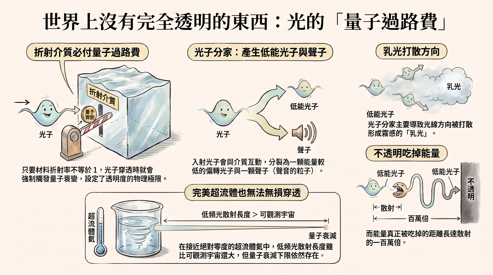

---

> *以下為虛構對話,人物與情節為創作,科學內容來源標註於文末。*

## ▌過路費

照明燈亮起來的時候,飛蟲就來了。

一圈一圈,繞著燈罩打轉。

Dg 蹲在鐵網邊,把第十二顆球丟進籃子。

「K 說去器材室拿新球。」他對著空蕩蕩的球場宣布,「十分鐘。」

已經過了二十五分鐘。

鐵門嘎一聲被推開。

「外送。」

Liy 提著塑膠袋走進來。兩碗麵,一杯冬瓜茶。

「K 訂的。他人呢?」

「器材室。」Dg 站起來,拍掉膝蓋上的灰,順手把瀏海往後撥。「不過妳來得正好。」

「我是來送麵的。」

「我知道。」

Dg 接過冬瓜茶,舉到燈下。透明的塑膠杯,琥珀色的茶。

「妳覺得這個杯子透明嗎?」

「透明啊。看得到茶。」

「錯。」他的聲音忽然低了八度,「世界上沒有任何東西是完全透明的。光每穿過一樣東西,都要付一筆過路費。」

Liy 看著杯子。

「誰收?」

「……什麼?」

「過路費。誰收?收多少?」

## ▌分家

「是量子收的。」Dg 清了清喉嚨,「光子進到材料裡,會分家。一顆光子,分成一顆小一號的光子,跟一顆聲子。」

「聲子是什麼?」

「聲音的粒子。」

Liy 把杯子拿回去,湊到耳邊。

過了三秒。

「我沒聽到。」

「不是那種聽——」Dg 抓抓頭,「總之,分家之後,光就被吃掉一點。所以不可能百分之百透明。」

「被吃掉?」

「對。」

「可是你說分家。」Liy 把杯子放回他手上,「分家的人都還在啊。只是住到不同地方。」

Dg 張嘴,又閉上。

燈罩上,一隻飛蟲撞了一下,彈開,換個方向繼續繞。

## ▌水至清

「好,不是吃掉。」Dg 重新站直。「古人說,水至清則無魚。太清的東西,本來就不存在——」

「網球場有魚嗎?」

「這是比喻。」

「喔。」Liy 點頭,「那比喻裡有魚嗎?」

Dg 跳過這一題。

「重點是,就算是超流體氦——全世界最乾淨的東西,冷到快要絕對零度——光也要走比整個宇宙還遠的距離,才看得出它不透明。」

「比宇宙還遠?」

「對。」

「那它就是透明啊。」

「不是,它是『幾乎』——」

Dg 停住了。他低頭看著杯子。

「……所以看起來霧霧的,不一定是光不見了。」他慢慢說,「是光走歪了。分出去的那一份,跑到別的方向。」

Liy 站在原地,手裡還提著兩碗麵。

Dg 沒有再往下說。

「那你怎麼知道?」

「知道什麼?」

「要走比宇宙還遠。」Liy 說,「你又沒走過。有人走過嗎?」

鐵門那頭傳來腳步聲。

*Dg 把杯子舉到燈下,對著光看了很久。茶還是琥珀色的,看起來什麼也沒有少。*

---

**再乾淨的玻璃、再完美的晶體,光穿過去時都會被收一筆小小的「過路費」。一篇 2026 年 10 月發表的理論預印本主張:只要材料會讓光轉彎(折射率不等於 1),光子就有機會在裡面「分裂」出一個聲子,帶走一點能量。這筆損失是量子力學本身規定的,工程技術再厲害也消除不了。**

---

## 關鍵亮點

- **透明有天花板**:論文主張,任何折射率不等於 1 的材料,都存在「光子 → 較低能量光子 + 聲子」的衰變過程,所以透明度有一個無法消除的量子下限。
- **不是工程問題**:就算材料完美無瑕、沒有雜質、冷到絕對零度,這個損失管道依然存在。
- **日常完全感覺不到**:在超流體氦中,能量 0.1 meV 的光子,散射長度約 8 × 10²⁸ 公尺,比可觀測宇宙還大。
- **目前只算了一種材料**:論文實際計算的是超流體;「所有材料都適用」是作者的推論主張,還沒有人算出其他材料的數值。

---

## 1. 透明到底是什麼?先把「透明」講清楚

*光遇到材料時,會穿過去、被彈回來,或被吃掉轉成其他能量。*

### 光的三條路

想像一束光是一群要過河的旅人。走到材料面前時,他們有三種命運:**直接穿過去**(穿透)、**被擋回來**(反射),或是**被材料留下來,化成熱或聲波等其他形式的能量**(吸收)。

物理學上的「透明度」,說穿了就是**有多少光能量成功穿過去**。只要旅途中有任何一點能量被留下,就不可能是 100% 透明。能量損失和透明度,是同一枚硬幣的兩面。

### 平常的損失,都能「修」

我們熟悉的不透明原因,大多是材料的「瑕疵」:雜質、晶格缺陷、電子吸收特定顏色的光而躍遷等等。這些原則上都可以靠更好的材料工程壓低,例如把玻璃做得更純、把晶體長得更完美。

這篇論文問的是更狠的問題:**如果把所有能修的都修好了——完美、零溫、毫無雜質——還剩下什麼?**

### 唯一的例外:根本不理光的東西

論文先打了個預防針:如果某種材料完全不和光作用(例如假想由暗物質組成的介質),那它當然可以無限透明,因為光根本「看不到」它。但這種材料也不會讓光轉彎,也就是折射率剛好等於 1。

所以問題被收斂成一句話:**只要材料會折射光(n ≠ 1),透明度有沒有一個基本極限?** 答案是:有。

---

## 2. 光子分家:一顆光子變成「小一號的光子 + 一顆聲子」

*論文的核心圖像:一顆光子在材料中「分家」,分出一顆聲子帶走部分能量。*

### 什麼是聲子?

材料不是一團靜止的果凍,而是由大量粒子組成。這些粒子可以一起「集體晃動」,就像體育場觀眾一起玩波浪舞。在量子力學裡,這種集體振動也被量子化,一份一份地出現,每一份就叫做**聲子(phonon)**——可以把它想成「聲音的粒子」。

### 光子的「分家」過程

論文指出,射進材料的光子,可以和材料的組成成分互動,激發出聲子。具體來說:

> **一顆光子 → 一顆能量較低的光子 + 一顆聲子**

光子把一小部分能量分給了聲子,自己變「小一號」繼續前進。這一小部分能量,就從光束裡被抽走了。

### 為什麼這件事「躲不掉」?

這個過程類似**契忍可夫輻射**——當某個東西在介質中跑得比該介質裡的某種「波速」還快,就會甩出波來,有點像快艇在湖面拖出 V 形浪,或超音速飛機產生音爆。

在這裡,「比賽」的雙方是**光在材料中的速度**和**聲音在材料中的速度**。光就算在材料裡變慢,還是遠遠快過聲音,所以運動學條件幾乎永遠滿足,這個過程就被允許發生。

更關鍵的是:**這件事在零溫、無雜質的純絕緣體中依然存在**。它不是材料「沒做好」,而是光與物質互動本身附帶的量子效應。這就是為什麼作者稱它為「量子極限」。

---

## 3. 最乾淨的考場:超流體氦

*超流體氦是物理學家最愛的「理想材料」之一:極冷、極純、幾乎沒有內部摩擦。*

### 為什麼挑超流體?

要證明「就算完美也躲不掉」,最好的辦法就是挑一個最接近完美的材料來算。根據科技新報的報導,氦被冷卻到接近絕對零度後會變成**超流體**,內部沒有摩擦,清澈度驚人,因此研究團隊選它作為極限情境。

報導也提到一段有趣的研究背景:第一作者 Esposito 原本在研究「暗光子撞進超流體氦會不會產生聲子」,後來才把同一套想法,套用到我們熟悉的普通光子上。

### 物理學家的工具箱:有效場論

論文用的方法叫**有效場論**。白話來說,就是「不管材料內部所有原子的細節,只抓住在低能量下真正重要的少數規則」,像是只看城市地圖的主要幹道,不管每條小巷。

在超流體裡,聲子有一個特別的身分:它是**Goldstone 玻色子**,源自超流體某種對稱性的「自發破缺」。這個身分很重要,因為對稱性會嚴格限制聲子能用什麼方式和光(電磁場)互動。結果是:兩者耦合的強度,取決於**材料的介電常數如何隨密度改變**。換句話說,材料被壓縮、放鬆時,它對光的反應變化越大,光子分家的機率就越高。

### 算出來的數字:大到誇張

論文得出,單一光子的衰變率大致與**頻率的五次方**成正比(Γ ∝ ω⁵)。五次方是什麼概念?頻率只要變成兩倍,衰變率就暴增 32 倍。所以**低頻光幾乎毫髮無傷,高頻光才可能感受到影響**。

把超流體氦-4 的實際參數代進去(聲速約 238 公尺/秒、質量密度約 0.14 g/cm³ 等),結果如下:

| 光子能量 | 散射長度(光走多遠才會明顯被散射) | 白話解讀 |
|---|---|---|
| 0.1 meV(低頻) | 約 8 × 10²⁸ 公尺 | 比可觀測宇宙還大,實際上永遠感覺不到 |
| 0.1 keV(高頻) | 上限約 8 公分 | 開始進入實驗室尺度 |

有趣的是,0.1 keV 的光在氦中**實測**的衰減長度只有 862 微米,比計算值短得多。作者的解釋是:這個實測值主要來自**光游離**(光把原子的電子打出去),那是另一種機制,不在這次聲子計算的範圍內。換句話說,量子極限是「地板」,真實材料往往還沒走到地板,就先被其他因素擋住了。

### 和愛因斯坦的意外重逢

論文還發現一個漂亮的巧合:這個結果的數學形式,和愛因斯坦當年計算「熱造成的密度起伏如何散射光」的結果一模一樣,只是把**溫度 T** 換成了**典型聲子能量**。

作者的詮釋很有詩意:溫度高時,讓光散射的是「熱聲子」;溫度降到絕對零度,熱聲子消失了,但量子世界的**零點漲落**接手了這個角色。就算世界冷到不能再冷,真空般的寂靜裡依然有細微的量子顫動。

---

## 4. 霧濛濛和看不見,是兩回事:乳光 vs. 不透明

*乳光是光被打散,不透明是光被吃掉,兩者的尺度相差約一百萬倍。*

### 兩種「不透明感」

日常生活中,「看不清楚」可能有兩種原因,論文把它們分得很清楚:

- **乳光(opalescence)**:光沒有消失,只是被**打散**到各個方向,而且大部分往後方散射。就像霧裡的車燈,光還在,但不再整齊地往前走。
- **不透明(opacity)**:光的**能量真的被吃掉**,轉成其他形式。

### 一百萬倍的差距

這兩種效應的強度差非常多。論文估算,能量損失率約是散射率乘上一個非常小的係數(和聲速有關),所以**「真的被吃掉」所需的距離,比「被打散」所需的距離長約一百萬倍**。

因此,論文把「透明」定義為「乳光」的反面:決定透明度的,主要是**散射長度**。光子分家後雖然大部分能量還在,但方向亂了,影像也就糊了。

| 比較項目 | 乳光(散射) | 不透明(能量損失) |
|---|---|---|
| 發生什麼事 | 光被打散,多數往後方跑 | 光的能量被轉成其他形式 |
| 光還在嗎 | 在,只是方向亂了 | 部分消失 |
| 特徵距離 | 散射長度 | 約為散射長度的一百萬倍 |
| 論文用哪個定義透明 | ✅ 以此為準 | — |

---

## 5. 雷射會讓情況變糟嗎?

*強雷射是「一大群步調一致的光子」,會讓聲子的產生方式出現非線性變化。*

### 強光的非線性放大

雷射和一般光不同:它是大量光子步調一致的「相干光」。論文把強雷射場當成古典的電磁場來處理,發現它產生聲子的功率,隨**電場強度的四次方**增長,也就是和光強度呈**非線性**關係。光越強,效應增加得越不成比例。

另外,這種古典衰減率與**光子數量成正比**,與**光束有效尺寸的四次方成反比**。也就是說,光子越多、光束越集中,效應越明顯。

### 雷射沒有「乳光」問題

不過有個好消息:對高度集中的相干光束,聲子帶走的動量和能量,比例和光束本身一樣。結果是動量和能量以相同速率損失,光束不會被「打散」——**古典雷射場沒有乳光**,只有微小的能量損失。

### 實例比一比

論文估了兩種雷射:

- **紅寶石雷射**(波長 694 nm、峰值約 10 MW、脈衝約 10 ns):光束集中,相干效應確實讓不透明長度縮短。但即便如此,古典不透明長度仍約 **10¹⁹ 公尺**量級——光要跑這麼遠,才會明顯失去能量。
- **CO₂ 雷射**(波長 10 μm、約 3.8 J):光束較大,相干效應反而不是主導因素。

結論是:強雷射會放大效應,但放大後的距離依然大到天文數字,實驗室裡還是看不出來。

---

## 6. 先別急著下結論:這篇研究的邊界

*好的理論會清楚標出自己的地圖邊界,這篇論文也不例外。*

### 這是預印本,而且只算了超流體

這篇論文是發表在 arXiv 的**理論預印本**,目前未見同儕審查紀錄。作者實際計算的只有**超流體**。他們主張 Goldstone 聲子在各種材料中普遍存在,所以結論應該適用於所有材料——但這是**論點**,不是已完成的計算。新聞標題的「任何材料都不可能 100% 透明」,比論文實際算過的範圍更廣。

### 條件很理想

計算限定在**零溫、低頻、弱場**,並使用多項簡化:聲速遠小於光速、假設磁導率為 1、材料具有平移對稱性等。

### 算出來的是「下限」

有效理論有它的適用範圍。在較高能量下,還有其他衰變管道會加入,所以論文給出的是**下限**——真實損失只會更多,不會更少。能量再高到某個門檻以上,有效理論就無法計算了。

此外,論文中有幾個常數在有效理論內無法算出,真正可靠的預測只有其中特定項的係數。

### 真實世界會撞到這個天花板嗎?

作者自己也說,真實系統是否會被這個下限實際限制,仍是**開放問題**。目前的現實材料,往往在碰到量子地板之前,就先被雜質、吸收等其他因素限制了。

順帶一提,根據金氏世界紀錄網站,目前登錄的「最透明材料」是一種名為 MOCHI 的材料,可見光穿透率約 99.5%–99.7%。離 100% 很近,但量子極限告訴我們:那最後一點點,原則上永遠到不了。

---

## 常見問題(FAQ)

**Q1:所以我家的窗戶玻璃,是因為這個量子效應才不夠透明嗎?**
不是。日常玻璃的損失主要來自雜質、表面反射和材料吸收,這些都比量子極限大上許多個數量級。量子極限是「就算一切完美也拿不掉的最後一層」,在日常尺度完全感覺不到。

**Q2:聲子是真的粒子嗎?**
聲子是「準粒子」:它不是獨立存在的基本粒子,而是材料集體振動被量子化後的一份份能量。但在計算上,它的行為很像粒子,可以被產生、帶走能量和動量。

**Q3:為什麼頻率越高,效應越明顯?**
論文算出衰變率大致和頻率的五次方成正比,頻率加倍,衰變率就變成 32 倍。所以低頻光幾乎不受影響,高頻光才可能在可測量的距離內感受到。

**Q4:這個結論已經被實驗證實了嗎?**
還沒有。這是理論預印本,而且作者也承認,真實系統是否實際被這個下限限制,仍是開放問題。在超流體氦的高頻例子中,實測衰減主要由其他機制(光游離)主導。

**Q5:「任何材料都不可能 100% 透明」這句話準確嗎?**
是作者的推論主張。論文只具體計算了超流體,並主張同類聲子普遍存在於各種材料;其他材料的實際數值,目前還沒有人算出來。

---

## 結論

這篇研究把一個看似工程問題的「透明度」,推到了物理定律的層次:只要材料會讓光轉彎,光子就有機會在裡面分出一顆聲子,帶走一點點能量、打亂一點點方向。這筆「量子過路費」在低頻下小到比可觀測宇宙還不明顯,但它的存在本身,意味著「完全透明」只能無限趨近,無法真正抵達。

下一步值得關注的,是其他材料能不能算出具體數值,以及有沒有哪種實驗能在高頻或強光條件下,真正碰觸到這道量子天花板。在那之前,「完美透明」依然是一個漂亮、但只存在於理想中的極限。

---

## 延伸搜尋

- [量子透明度極限](https://www.google.com/search?q=%E9%87%8F%E5%AD%90+%E9%80%8F%E6%98%8E%E5%BA%A6+%E6%A5%B5%E9%99%90)
- [契忍可夫輻射](https://www.google.com/search?q=%E5%A5%91%E5%BF%8D%E5%8F%AF%E5%A4%AB%E8%BC%BB%E5%B0%84)
- [超流體氦-4](https://www.google.com/search?q=%E8%B6%85%E6%B5%81%E9%AB%94+%E6%B0%A6-4)
- [聲子 Goldstone 玻色子](https://www.google.com/search?q=%E8%81%B2%E5%AD%90+Goldstone+%E7%8E%BB%E8%89%B2%E5%AD%90)
- [有效場論 凝聚態](https://www.google.com/search?q=%E6%9C%89%E6%95%88%E5%A0%B4%E8%AB%96+%E5%87%9D%E8%81%9A%E6%85%8B)

---

## 參考資料來源

- [Quantum limit to transparency(arXiv:2610.12560)](https://arxiv.org/abs/2610.12560)
- [Quantum limit to transparency(arXiv HTML 全文)](https://arxiv.org/html/2610.12560)
- [材料透明度永遠無法達到 100%,物理學家:量子過程設下極限(科技新報)](https://technews.tw/2026/11/15/light-transparent-material/)
- [Limit of light: US scientists reveal why no material can ever be 100% transparent(Interesting Engineering,經 Yahoo News 轉載)](https://www.yahoo.com/news/science/articles/limit-light-us-scientists-reveal-161300779.html)
- [Dark Matter, Dark Photon and Superfluid He-4 from Effective Field Theory(arXiv:1911.04511)](https://arxiv.org/abs/1911.04511)
- [Sub-GeV dark matter in superfluid He-4: an effective theory approach(PMC)](https://pmc.ncbi.nlm.nih.gov/articles/PMC6598953/)
- [Most transparent material(Guinness World Records)](https://www.guinnessworldrecords.com/world-records/568265-most-transparent-material)
