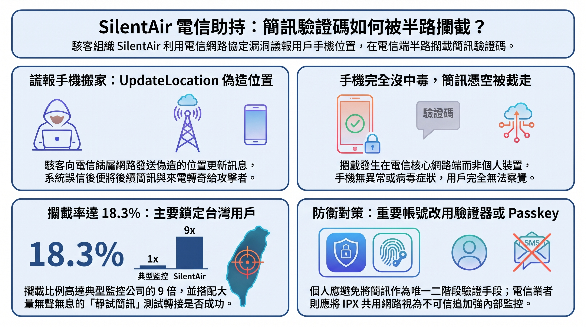

---

> *以下為虛構對話，人物與情節為創作，科學內容來源標註於文末。*

## ▌要不要學

星期天晚上，咖啡廳的中間長桌坐滿趕報告的學生。

奶泡機噴了一聲。

Dg 搶到最後一個插座，筆電上開著一篇資安新聞。

「Vay 哥，我在想要不要去學電信資安。」

Vay 的手從觸控板上移開了。

「電信？」他把杯子推到一邊，「我以前接過電信業的專案。」

Dg 坐直。

「那東西很穩。」Vay 說，「業者之間交換訊號用 SS7，那是一個封閉的俱樂部。就那幾家，大家都認識，外人根本接不進去。」

「封閉的俱樂部……」

「所以那時候我們推簡訊驗證碼，客戶一聽就買單。密碼會被猜，簡訊要拿到你的門號才收得到。駭客得先偷你的手機。」

Dg 在筆記裡打下「封閉的俱樂部」，加粗。

「所以說，」他抬頭，「最危險的地方就是最安全的地方。」

「呃，也可以這樣講啦。」

「那要學的話，從哪裡開始？」

「先去大電信蹲三年。」Vay 說，「底層的東西學起來，一輩子用得到。」

Dg 把這句也存了進去。

## ▌俱樂部裡面

Dg 繼續往下捲。

「可是這篇說，有個叫 SilentAir 的組織，從至少六個亞洲國家的業者網路裡面發動攻擊。」

「裡面？」

「瑞典一家叫 Enea 的公司抓到的。他們一開始也以為是外面有人冒用業者的位址。後來看到某家業者的內部設備同時在發送跟接收攻擊指令，才確定是設備被接管了。」

Vay 沒說話。

「它們發一種叫 UpdateLocation 的訊息給用戶的歸屬網路，說『這支手機現在由我服務』。歸屬網路一信，之後的簡訊跟來電就轉過去了。手機本身不用被入侵。」

「那是那幾家業者自己的設備出問題。」Vay 說，「跟協定沒關係。」

「還有一種手機不會顯示的靜默簡訊，拿來測試轉接有沒有成功。測試簡訊跑到它們的設備，不是跑到手機，就代表收得到了。」

Dg 停在下一行。

「它說，全世界有八百多家行動業者，透過一個叫 IPX 的共用網路互連。」

八百多家。

Dg 盯著那個數字。

「Vay 哥，你那時候的俱樂部有幾家？」

「……沒幾家吧。」

## ▌搬家通知

對面的學生把耳機戴回去。

Dg 的手指停在觸控板上。

「所以不是門被撬開。」他慢慢說，「是大家本來就不檢查進門的人。人少的時候每個都認識，不用檢查。現在八百多家，只要裡面有一台被換掉，它講什麼，其他人都照單全收。」

他又看了一眼螢幕。

「就像有人跑去郵局說你搬家了，郵局沒打電話問你，就把信全寄過去。」

「被攔的是誰？」

「主要是台灣的用戶，但不只台灣，還有十幾個國家跟地區。有些人的驗證碼一轉過去就被攔走。」Dg 往下找，「不過目前沒有證據顯示有帳號真的被盜。」

Vay 端起杯子，發現已經空了。

Dg 回到筆記，把「封閉的俱樂部」那一行刪掉。

「先去大電信蹲三年」還留在下面。

「欸，」Vay 說，「你上次講那家麵店，禮拜天有開嗎？」

*Vay 闔上筆電，把空杯拿去回收台，回來時已經在手機上查那家麵店的營業時間。*

---

**瑞典電信安全公司 Enea 發現一個新的國家級駭客組織 SilentAir。它不碰你的手機，而是在電信業者的內部設備上，偽造「這支手機現在由我服務」的位置更新，把特定用戶的簡訊與來電轉到攻擊者手上。主要目標是台灣用戶，包含政治與政府相關人士。**

---

## 關鍵亮點

- **不是手機被駭**：攔截發生在電信網路端，不需要入侵手機。
- **設備是從內部被接管的**：Enea 看到某業者的內部設備同時發送與接收攻擊指令，確認流量不是偽造的。
- **主打攔截，不做追蹤**：SilentAir 的「通話與簡訊攔截」占 18.30%，遠高於典型監控公司的 2.07%。
- **目前沒有證據顯示帳號被接管**：驗證碼被攔截，代表攻擊者很可能在嘗試登入，不等於登入成功。

---

## 1. 事件速覽：誰發現的、發現了什麼

*示意圖：攻擊來自電信業者網路「內部」的設備，而不是外面的陌生人。*

### 一句話版本

Enea 在 2026 年 11 月 11 日發布研究，指出一個名為 **SilentAir** 的組織入侵亞洲多國電信業者的信令設備，從內部發出偽造的位置更新訊息，把特定用戶的來電與簡訊轉走。**主要目標是台灣，但不只台灣**：另有至少十多個國家與地區的網路受影響，涵蓋東南亞、東亞、東非、中亞、中東與歐洲。Enea 認為實際規模可能涵蓋數十個國家與業者。

### 他們怎麼知道的？

Enea 自 2025 年初起，就注意到某些亞洲業者出現不尋常的 SS7（部分為 Diameter）攻擊，回頭翻舊紀錄，還找到更早的可疑活動。攻擊來源至少涵蓋 **6 個亞洲國家**的業者網路，部分國家甚至有不只一家業者發出攻擊。

一開始有兩種解釋：外部有人偽造這些網路的位址，或是網路內部的設備被接管了。後來 Enea 看到某業者的內部設備**同時發送與接收攻擊指令**，才確認是後者。這就像監視器拍到「壞人本人就在大樓裡」，不是有人冒用住戶的名字。

### 先放一個提醒

Enea 本身是電信信令安全廠商，研究結果也牽涉自家產品領域，所以本文凡是引用，都會寫「Enea 指出」。

---

## 2. 簡訊是怎麼被「改寄」的

### 電信業者的「暗號本」：SS7 與 Diameter

電信業者之間要互相傳話：這通電話該送到哪？這則簡訊該往哪寄？你出國漫遊時，哪家業者負責服務你？這些都靠**信令協定**。

- **SS7**：1970 年代發展的老系統。設計時假設所有連線者都是自己人，所以信任度很高。
- **Diameter**：4G 時代對應 SS7 的接班協定。
- **IPX**：業者之間互連的共用網路，同樣以高度信任為前提。全球有 800 多家行動業者透過它互連，入侵其中一家，就可能成為通往其他業者的跳板。

### 謊報搬家：UpdateLocation

攻擊者用被接管的內部設備，向目標用戶的「歸屬網路」（可以想成存放你註冊位置的資料庫，也就是 HLR/HSS）發送 **UpdateLocation**（Diameter 版叫 Update-Location-Request），宣稱：「這支手機現在是我在服務。」

歸屬網路如果信了，之後打給你的電話和簡訊，就會被導向攻擊者的設備。

> 比喻（本文自擬，非來源內容）：有人跟郵局謊報「這個人搬家了」，之後你的信全都寄到他那裡，而你家信箱一點事也沒有。

### 為什麼手機不用被駭？

因為整件事都在電信網路端完成。你的手機沒有中毒、沒有裝奇怪的 App，只是「系統裡登記的位置」被改了。這也是這類攻擊麻煩的地方：**簡訊驗證碼的安全性，取決於整個電信網路，而這部分用戶完全無法控制。**

---

## 3. 看不見的簡訊：靜默簡訊的小把戲

*示意圖：靜默簡訊不會顯示、不會響鈴，使用者完全沒感覺。*

### 什麼是靜默簡訊？

手機不會顯示、也不會響鈴提示的簡訊。它本來是網路測試用的，也會被拿來「探測」。

### 白天與夜間，用途不同

- **白天**：多半發給其他網路的用戶（例如東南亞網路）。推測用途是**檢查轉接是否成功**：測試簡訊如果到了攻擊者的設備而不是手機，就代表攻擊者收得到這個人的簡訊。
- **夜間**：數量大得多，多數發給台灣用戶。**目的未獲證實**。Enea 提出兩種可能：批次確認既有的轉接還有效（夜間手機最不容易重新註冊回真實位置），或確認發送端號碼的連線。

### 偽裝成垃圾簡訊

這些簡訊內容是勵志或促銷語句，常為英文。Enea 認為這是偽裝：萬一途中有業者把「靜默」設定拿掉，收件人看到只會當垃圾簡訊滑掉。

---

## 4. 從數據看 SilentAir 的「個性」

Enea 把 SilentAir 的攻擊類型，拿去跟先前研究中典型的監控公司比較：

| 類型 | SilentAir | 典型監控公司 |
|---|---|---|
| 資訊蒐集 | 7.21% | 61.89% |
| 通話與簡訊攔截 | 18.30% | 2.07% |
| 位置追蹤 | 0.22% | 30.90% |
| 其他（主要為靜默簡訊） | 74.27% | 5.13% |

### 怎麼讀這張表？

- 攔截比例約是典型監控公司的 **8.8 倍**（18.30 ÷ 2.07，本文自行換算，約 9 倍）。
- 位置追蹤是監控產業的主力商品，SilentAir 卻幾乎不做（0.22%）。Enea 據此認為，它的目的是**攔截而不是追蹤**。
- 提醒：74.27% 是「其他」，其中以靜默簡訊為主。**不能寫成「74% 都是靜默簡訊」。**

攻擊還呈現波浪式：每月受影響的用戶從個位數到數千人不等，波次之間可能相隔數月以上。不同國家的 SilentAir 設備偶爾會鎖定同一個人，Enea 認為這顯示背後是**單一指揮控制**。

---

## 5. 幕後是誰？一層一層看信心程度

歸因最容易寫過頭，所以先把每一層的信心程度列出來：

| 說法 | 信心程度 | 依據或限制 |
|---|---|---|
| 國家級行為者 | **高信心度** | Enea 評估不是犯罪集團或商業監控公司 |
| 與中國相關 | **低信心度** | 以台灣為焦點、不攻擊中國網路與用戶；活動遵循 UTC+8 工作日（約上午 9 點開始、週末幾乎停止、中國假期期間暫停或減少） |
| 與 Liminal Panda 有關 | **可能，但未證實** | 見下方說明 |
| 與 SCTPE／SIGweaver 有關 | **可能，但未證實** | SCTPE 只處理自己發起的交易，SilentAir 卻會回應不是自己發起的交易，無法完全解釋 |
| 夜間靜默簡訊的目的 | **未證實** | 只有 Enea 的推測 |

### 與 Liminal Panda 的關聯

- **支持的線索**：部分被入侵業者同時有 Liminal Panda 感染、攻擊時間有重疊、都攻擊亞洲同區域業者、使用類似工具。
- **反對的線索**：Liminal Panda 沒有已知的台灣焦點，SilentAir 的作業安全明顯更好，時間模式也不同。

Enea 目前**不將兩者直接連結**。

### 順帶一提：SCTPE

SCTPE 是少見的 Linux 核心層木馬，能在既有的 SCTP 連線中注入 SS7 與 Diameter 流量。新加坡資通訊媒體發展局（IMDA）的公告稱它為 SIGweaver，並指 CrowdStrike 以中等信心度連結到 Liminal Panda。

### 還有哪些事不知道？

- 受害國家、業者與個別目標都沒有公開。
- Enea 拿不到 SilentAir 的惡意程式本體，歸因靠的是攻擊遙測與殘留痕跡。
- 被入侵的設備是否已清除，未確認。Enea 已通知相關業者，SilentAir 目前被干擾，但可能捲土重來。

---

## 6. 一般人要慌嗎？該做什麼

### 先深呼吸

從 Enea 描述的樣貌看，這是**目標明確、規模小而精準**的行動，也沒有看到帳號被接管的證據，更沒有確認語音通話被攔截。「一般人不必恐慌」是本文依此做的判斷，**不是 Enea 的結論**。政府人員、政治人物、記者、企業主管這類高風險族群，才需要更謹慎。

### 實用小對策

以下是一般資安建議，**不是 Enea 提出的**（Enea 的頁面沒有給一般用戶的建議）：

1. 重要帳號改用**驗證器 App 或 passkey**，不要依賴簡訊驗證碼。
2. 不要把手機號碼當成唯一的帳號救援方式。
3. 銀行或政府服務還只支援簡訊時，若有 App 推播確認或裝置綁定，就把它打開。

### 電信業者該做什麼？

Enea 給業者的建議包括：部署 GTP-C 與 GTP-U 防火牆並與 SS7、Diameter 防火牆共享資訊；不要只做業界基本建議；把整個 IPX 介面視為不可信；偵測業者**內部**的信令流量，而不只看邊界；把信令安全納入整體資訊安全管理；外包核心網路時，留意調查困難與數位主權問題。

---

## 常見問題 FAQ

### Q1：我的手機被駭了嗎？
這類攻擊發生在電信網路端，不需要入侵手機。手機沒有異狀，也不代表沒被攔截，但以目前資訊看，被鎖定的是特定目標。

### Q2：驗證碼被攔截，帳號就被偷走了嗎？
不一定。目前**沒有證據顯示有帳號因此被接管**。Enea 看到的是部分目標的驗證碼在轉接生效後立即被攔截，這代表攻擊者很可能在嘗試登入其他帳號，不等於登入成功。

### Q3：通話也被偷聽了嗎？
目前**沒有確認語音通話被攔截的證據**。已確認的是簡訊攔截。

### Q4：為什麼說 SilentAir 是國家級？
Enea 以高信心度評估它是國家級行為者，而不是犯罪集團或商業監控公司。至於「與中國相關」，只是低信心度的推測。

### Q5：簡訊驗證碼是不是就不能用了？
不必這麼極端，但它的安全性確實取決於整個電信網路。能換成驗證器 App 或 passkey 的重要帳號，建議換。

---

## 結論

SilentAir 事件提醒我們：簡訊驗證碼看似是「手機上的東西」，其實一路依賴電信網路背後那套靠信任運作的老系統。這次的研究者發現，攻擊者能從業者內部設備發出偽造的位置更新，而且已經盯上特定目標好一段時間。

不過，目前沒有帳號被接管的證據，攻擊也偏向小而精準。歸因方面，國家級是高信心度，其餘都要打折扣。未來要觀察的是 Enea 通知業者後，SilentAir 是否捲土重來，以及夜間靜默簡訊的目的能否被查清。

---

## 延伸搜尋

- [SS7 信令漏洞](https://www.google.com/search?q=SS7+%E4%BF%A1%E4%BB%A4%E6%BC%8F%E6%B4%9E)
- [靜默簡訊](https://www.google.com/search?q=%E9%9D%9C%E9%BB%98%E7%B0%A1%E8%A8%8A)
- [IPX 電信互連](https://www.google.com/search?q=IPX+%E9%9B%BB%E4%BF%A1%E4%BA%92%E9%80%A3)
- [驗證器 App](https://www.google.com/search?q=%E9%A9%97%E8%AD%89%E5%99%A8+app)
- [passkey](https://www.google.com/search?q=passkey+%E6%98%AF%E4%BB%80%E9%BA%BC)

---

## 參考資料來源

- [The Enemy Within. Tracking LIMINAL PANDA and SilentAir through Mobile Networks（Enea，2026/11/11）](https://www.enea.com/insights/the-enemy-within-tracking-liminal-panda-and-silentair-through-mobile-networks/)
- [SilentAir Hijacks Asian Telecom Networks to Intercept SMS 2FA Codes and Spy on Taiwanese Users（The Hacker News，2026/11/13）](https://thehackernews.com/2026/11/silentair-hijacks-asian-telecom.html)
- [Liminal Panda uses SIGweaver to target 4G Mobile Diameter protocols（新加坡 IMDA，2026/1/21）](https://www.imda.gov.sg/assets/23f23bba-57ca-42b6-92f8-90e207bf8c46.pdf)
- [SMS-based 2-Factor Authentication is insecure!（cylab.be，2021/9/1）](https://cylab.be/blog/171/sms-based-2-factor-authentication-is-insecure)
