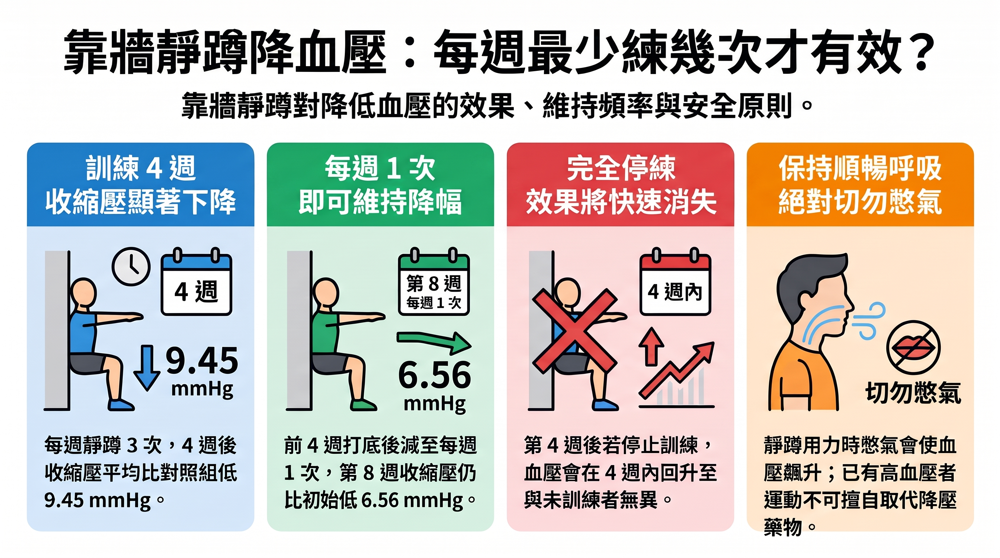

---

> *以下為虛構對話，人物與情節為創作，科學內容來源標註於文末。*

## ▌靜坐也算運動

下午三點的咖啡廳，人不多。
陽光從窗邊斜進來，在長桌上切出一塊亮面。

Vay 把筆電推到一邊，盯著手機上的健檢報告。

「收縮壓一百三十六。」他嘖了一聲。「還沒到要吃藥，醫生說，多運動。」

隔壁桌的 Cala 抬起頭。

「我又沒有在聽。」

她的手機螢幕亮著，是一篇部落格文章。作者欄那一行，有個「K」。

「我只是剛好滑到。」她把手機轉過去一點，又轉回來。「上面說，靠牆靜坐可以降血壓。」

「靜坐？」Vay 皺眉。「那是冥想吧。」

「不是那個靜坐。」Cala 低頭確認螢幕，耳朵有點紅。「……靜蹲。背靠牆蹲著，像坐在看不見的椅子上，撐住不動。」

「那更不行。」

Vay 的語氣篤定起來。

「我以前帶團隊的時候，公司每年健檢，醫生講得很清楚。血壓偏高，就去慢跑、游泳。那種憋著用力、撐住不動的——蹲馬步、伏地挺身撐著不下去——避開。用力的那一下，血壓會往上衝。」

他說得很順，像這段話已經講過很多次。

當年，確實很多醫生都這樣講。

## ▌用力但不動

「文章說這叫等長收縮。」Cala 念出來。「肌肉用力，但關節不動。」

她停了一下。

「用力但不動……」

「怎樣？」

「就是明明很在意，表面上裝作沒事吧。」

Vay 看著她。

「這是在講大腿。」

「我知道是在講大腿！」Cala 把手機拉近，像要擋住那句話。「我是說，那個，肌肉一定很累。」

她清了清喉嚨，換回朗讀的語氣。

「研究找了一百個久坐的人，平均三十七歲，血壓正常偏高，沒有高血壓，也沒在吃藥。八十個人在家靠牆靜蹲，一次四組，每組兩分鐘，中間坐著休息兩分鐘，一週三次。」

「然後？」

「四週後，收縮壓比沒練的對照組低了九點多。」

Vay 沒有馬上接話。
九點多，比他記憶中慢跑能降的還多。

「網路文章誰都能寫。」

「又不是隨便誰寫的。」

Cala 說得太快，自己先愣了一下。

## ▌一週一次

「後面還有。」她繼續往下滑。「四週之後，他們把練的人分成四組。繼續一週三次的、減成兩次的、減成一次的，還有完全停掉的。」

「停掉的呢？」

「再過四週，血壓就跟對照組沒差了。」

Cala 盯著那一行，聲音低了一點。

「所以，不見面，就會被打回原形。」

「這也是在講大腿。」

「我知道！」

她把手機翻過去，又翻回來。

「一週一次那組，收縮壓還是比一開始低了六點多，跟一週兩次的差不多。不過文章說，維持期只追了四週，之後能撐多久還不知道。受試者也不是高血壓的人，不能直接套。」

她頓了頓。

「還有，蹲的時候不能憋氣。憋氣血壓會飆。」

Vay 抬起眼。

「這句我剛剛說過。」

「這句你說對了。」

Cala 站起來，走到窗邊那面空牆前。

「我才沒有要試。」

她背貼著牆，慢慢往下滑。

「只是想知道兩分鐘有多長。」

四十秒後，她的膝蓋開始發抖。她咬著牙，嘴唇卻一直在動，小聲地數著呼吸。

*Vay 低頭在手機上打了幾個字。二〇二三年的一篇統合分析，兩百七十項試驗、一萬五千多人，等長運動的平均降幅排在有氧運動前面。他往下滑了很久，然後把手機螢幕朝下，扣在桌上，沒有再說話。*

---

**不用跑步機、不用健身房，只要一面牆和 14 分鐘。2026 年 9 月，英國《BMJ Open Sport & Exercise Medicine》刊出一項隨機對照試驗：一群久坐的成年人每週做 3 次靠牆靜蹲，4 週後收縮壓明顯下降。更讓人意外的是，之後就算減到每週只蹲 1 次，接下來 4 週內仍保住了一部分降幅。這篇用不需要醫學背景的方式，說明這項研究做了什麼、發現了什麼，以及哪些地方還不能說得太滿。**

---

## 關鍵亮點

- **4 週見效**：每週靠牆靜蹲 3 次、持續 4 週後，訓練組的收縮壓平均比對照組低約 **9.45 mmHg**。
- **每週一次也有用**：之後減為每週 1 次，第 8 週收縮壓仍比起始值低約 **6.56 mmHg**，而且仍顯著低於對照組。
- **完全停練就打回原形**：停止訓練的那組，第 8 週血壓已和對照組沒有顯著差異。
- **適用對象有限**：受試者是平均 37 歲、**血壓正常偏高但沒有高血壓**的久坐成人，結果不能直接套用到高血壓患者或長者身上。

---

## 一、先搞懂血壓：那兩個數字在講什麼？

*血壓計上的兩個數字，分別代表心臟用力擠壓和放鬆時，血液對血管壁的壓力。*

### 把血管想成澆花的水管

量血壓時會看到「125/80」這種兩個數字的寫法。可以想像你在院子裡用水管澆花：

- **收縮壓**（上面那個數字）：心臟用力收縮、把血液「擠」出去那一瞬間，血管壁承受的壓力。就像你突然把水龍頭開到最大。
- **舒張壓**（下面那個數字）：心臟放鬆、準備下一次跳動時，血管裡還剩下的壓力。也就是水龍頭關小之後，水管裡的基本水壓。

單位 **mmHg**（毫米汞柱）是一個古老的壓力單位，來自早期用水銀柱量血壓的方法。你只要知道：數字越高，代表血管被撐得越緊。

### 「正常偏高」是什麼狀態？

這次研究的受試者，收縮壓落在 **120 到 140 mmHg** 之間。這個範圍還沒到需要吃藥的高血壓，但已經離理想值有點距離，像是黃燈閃爍的路口。長期血壓偏高會增加心血管疾病的風險，所以如果能在**還沒變成高血壓之前**就把數字壓下來，很值得注意。

---

## 二、實驗怎麼做：100 個人和一面牆

*靠牆靜蹲：背貼牆、膝蓋彎曲，像坐在一張看不見的椅子上，然後撐住不動。*

### 「等長收縮運動」是什麼？

先介紹一個名詞：**等長收縮運動**（isometric exercise）。一般運動像跑步、深蹲，肌肉會一伸一縮地動；等長收縮則是**肌肉用力，但關節不動**，例如棒式（平板支撐）或今天的主角**靠牆靜蹲**。

靠牆靜蹲的做法：背靠牆往下滑，讓膝蓋彎曲，好像坐在一張隱形椅子上，然後撐著。撐過的人都知道，大腿大概 30 秒就開始抗議。

### 研究設計：先一起練，再分道揚鑣

研究團隊找來 **100 位久坐、沒有規律運動習慣的成人**，平均年齡 37.4 歲。為了讓結果乾淨一點，他們排除了正在吃或曾經吃過降血壓藥的人、吸菸者、受傷或生病的人，以及每週喝酒超過 14 單位的人。

這 100 人分成 5 組：**20 人當對照組**（照常生活），**80 人分成 4 個訓練組**。實驗分成兩個階段：

**第 1 階段（第 0～4 週）**：四個訓練組做一樣的事，在家靠牆靜蹲，每次 **4 組、每組撐 2 分鐘**，組間坐著休息 2 分鐘，每週 3 次。算一算，每次大約 14 分鐘。

**第 2 階段（第 4～8 週）**：四個訓練組開始走不同的路：

- A 組：維持每週 3 次
- B 組：減為每週 2 次
- C 組：減為每週 1 次
- D 組：完全停止

這個設計想回答一個很實際的問題：**練出效果之後，最少要練多少才能維持？**

---

## 三、結果出爐：蹲 4 週之後發生什麼事？

*第 8 週時，訓練頻率越高的組別，收縮壓下降越多；完全停練的組別則回到與對照組相近的水準。*

### 第 4 週：大家都降了

前 4 週結束時，四個訓練組的**收縮壓、舒張壓和平均動脈壓**都顯著低於對照組。其中收縮壓平均比對照組低約 **9.45 mmHg**（部分媒體四捨五入寫成 9.5）。

9 mmHg 有多少？2023 年一篇大型統合分析算出，各種運動的平均降幅大約落在 4～8 mmHg 之間，所以這個數字在運動研究裡相當亮眼。

### 第 8 週：頻率決定能保住多少

到了第 8 週，四組的表現開始分化：

| 第 2 階段訓練頻率 | 第 8 週收縮壓變化（相對起始值） | 與對照組相比 |
|---|---|---|
| 每週 3 次 | 降 **13.73** mmHg | 降幅最大，周邊血管阻力與心率變異度的改善也維持住 |
| 每週 2 次 | 降 **6.95** mmHg | 收縮壓、平均動脈壓仍顯著較低；舒張壓沒有顯著差異 |
| 每週 1 次 | 降 **6.56** mmHg | 收縮壓、平均動脈壓仍顯著較低；舒張壓沒有顯著差異 |
| 完全停止 | 回到與對照組無顯著差異 | 效果消失 |

有兩點要特別注意：

**第一，基準不一樣。** 第 4 週的 9.45 mmHg 是「**跟對照組比**」，第 8 週的數字是「**跟自己一開始比**」。兩種算法基準不同，不能直接拿來比大小，例如說「從 9.45 進步到 13.73」並不正確。

**第二，每週 1 次和 2 次的結果幾乎一樣。** 6.95 和 6.56 只差不到 0.4 mmHg，這也是研究最吸引人的地方：如果你很忙，**每週 1 次可能就夠用來「續命」**，至少在接下來 4 週內是如此。

### 不只是血壓數字

研究也追蹤了兩個比較少見的指標：

- **總周邊血管阻力**：全身血管對血流的「阻力」總和。阻力越低，心臟推血越輕鬆。
- **心率變異度（HRV）**：每次心跳間隔的細微差異。聽起來違反直覺，但健康的心臟跳動不是像節拍器那樣死板，間隔有一點變化，通常代表自律神經調節比較靈活。

注意，這裡改善的是「心率**變異度**」，不是心率本身。有些中文報導寫成「心率改善」，意思就跑掉了。

---

## 四、為什麼「不動」的運動會有效？

*目前對等長收縮運動降血壓的機制，多數仍屬推論，例如血管調節能力改善。*

### 先說清楚：機制還在猜

這項研究測到的是「**血壓降了**」，但「**為什麼會降**」並不是它直接證明的結論。以下的解釋屬於研究者和專家的推論，讀的時候要打個問號。

### 推論一：血管學會放鬆

作者在報導中提到，等長收縮可能幫助血管放鬆。一個常見的說法是：當你撐著靠牆靜蹲，大腿肌肉持續用力、壓迫裡面的血管，血流暫時受限；一放鬆，血液就湧回去。反覆經歷這種「憋住、放開」，血管可能慢慢變得更會調節。不過這只是對機制的推想，不是本研究測量到的東西。

### 推論二：心臟變得更有效率

長期規律運動有助提升心臟效率，並改善血管面對血流變化時的調節能力。研究測到周邊血管阻力下降、HRV 改善，跟這個方向一致，但「一致」不代表「證明」。

### 背景證據：不是第一次有人發現

2023 年，英國 Canterbury Christ Church University 的團隊在《英國運動醫學期刊》（BJSM）發表大型統合分析，整理 1990 到 2023 年間的 **270 項隨機對照試驗、約 15,827 人**：

| 運動類型 | 平均收縮壓降幅 | 平均舒張壓降幅 |
|---|---|---|
| 等長收縮運動 | 8.24 mmHg | 4.00 mmHg |
| 有氧運動 | 4.49 mmHg | 2.53 mmHg |

在這份分析中，等長收縮運動是降幅最大的類型。也有報導指出，靠牆靜蹲在細項中對收縮壓的效果最好，但這一點最好回到論文全文的分項分析再核對。換句話說，Swift 團隊的新研究不是突然冒出來的發現，而是沿著已知的方向，再多問一個問題：**最少要練多少？**

---

## 五、先別急著轉發：這項研究的限制

*一項研究的結論，永遠要搭配它的限制一起看。*

### 限制一：受試者範圍很窄

受試者平均 37 歲、**沒有高血壓、沒有吃藥、久坐**。所以結果不能直接推到：

- 已經確診高血壓的人
- 長者
- 正在服用降血壓藥的人

如果你看到標題寫「靠牆蹲能治高血壓」，那就說過頭了。這群人本來就不是高血壓患者，比較準確的說法是：**在血壓正常偏高的人身上，觀察到血壓下降**。

### 限制二：時間太短

維持期只有 **4 週**。每週蹲 1 次能撐多久？3 個月？半年？目前不知道，作者自己也說需要更長期的研究。

### 限制三：樣本不大，也不是盲測

100 人在運動研究裡不算少，但分成 5 組後每組只有 20 人左右。另外，有報導提到參與者**知道自己被分到哪一組**。運動研究很難做到「受試者不知道自己有沒有運動」，但這仍可能影響結果。

### 限制四：診間血壓不等於全天血壓

另一篇 2023 年發表於《Current Hypertension Reports》的統合分析（12 項研究、415 人）發現，等長阻力訓練能讓**診間收縮壓**降約 7.47 mmHg，但 **24 小時動態血壓**沒有顯著下降。也就是說，坐在診間量到的數字降了，不代表一整天的血壓都跟著降。這不是在否定新研究，而是提醒我們「血壓降了」這句話還可以問得更細。

### 補充：同一批人？

同一研究團隊在 2025 年發表過另一篇論文，比較男女對靠牆靜蹲訓練的反應，同樣是 100 人、80 人訓練、4 週，第 4 週降幅也是 9.45 mmHg。兩篇很可能來自同一批受試者的不同階段，但這點仍需對照論文全文確認。

---

## 六、想試試看？安全第一的靠牆靜蹲指南

*蹲越深強度越高；初學者可以從較淺的角度開始。*

### 基本動作

1. 背部貼牆，雙腳打開與肩同寬，往前站出約一步的距離。
2. 背沿著牆慢慢往下滑，直到膝蓋彎曲。
3. 撐住，**正常呼吸**。
4. 時間到了，慢慢站起來。

### 專家提醒的幾件事

接受媒體採訪的專家提醒：

- **千萬不要憋氣。** 用力時憋氣可能讓血壓明顯飆高，這跟我們想要的效果剛好相反。
- **蹲越深越吃力。** 大腿接近與地面平行（膝蓋約 90 度）時強度最高。新手可以蹲淺一點。
- **不要只做這一種。** 等長收縮運動不建議單獨進行，最好搭配走路、騎車等動態運動。
- **有狀況先問醫生。** 已有高血壓或慢性病的人，開始高強度運動前先諮詢醫師。
- **不能取代藥物。** 如果醫生開了降血壓藥，不要因為開始靠牆蹲就自己停藥。

---

## 常見問題（FAQ）

**Q1：我血壓很正常，做靠牆靜蹲還有意義嗎？**
這項研究的受試者血壓落在 120～140 mmHg 的正常偏高範圍，所以研究無法直接回答「血壓已經很理想的人會不會再降」。不過靠牆靜蹲本身也是訓練下肢肌力的動作，就一般運動而言仍有好處。

**Q2：每週只做 1 次真的夠嗎？**
在這項研究中，先以每週 3 次練滿 4 週後，再改成每週 1 次，第 8 週收縮壓仍比起始值低約 6.56 mmHg。但重點是「**先練 4 週打底**」，而且維持期只觀察了 4 週。一開始就每週只做 1 次會怎樣，這項研究沒有測試。

**Q3：高血壓患者可以用靠牆靜蹲代替吃藥嗎？**
不行。研究受試者都沒有高血壓，也沒有服藥。專家也明確提醒，運動不能取代降血壓藥物。有高血壓的人想加入運動，請先和醫師討論。

**Q4：棒式（平板支撐）也是等長收縮，效果一樣嗎？**
棒式確實也屬於等長收縮運動。但這項研究只測了靠牆靜蹲，2023 年的統合分析則是把各種等長運動合併計算。不同動作的效果是否相同，本文引用的資料無法給出明確結論。

**Q5：停練之後效果會馬上消失嗎？**
在研究中，完全停止的組別到第 8 週（也就是停練 4 週後），血壓已回到與對照組沒有顯著差異。所以「練了就一勞永逸」不成立，但維持的門檻可能比想像中低。

---

## 結論：一面牆的實驗，還有很多問題沒回答

這項研究最有趣的地方，不只是「靠牆靜蹲能降血壓」，而是它問了一個很接地氣的問題：**練出效果後，最少要做多少才不會白練？** 答案目前是：在這群血壓正常偏高、平均 37 歲的久坐成人身上，先每週 3 次練 4 週，之後減到每週 1 次，至少接下來 4 週內還能保住一部分降幅。

但它也留下一長串待解的問題：效果能維持多久？對高血壓患者、長者是否適用？全天的動態血壓會不會跟著降？這些都需要更大、更長期的研究。

在答案出來之前，比較穩妥的看法是：靠牆靜蹲是一個門檻低、不佔空間、**很可能有助於**血壓管理的運動選項，但它是工具箱裡的其中一項，不是萬靈丹。

---

## 延伸搜尋

- [等長收縮運動 血壓](https://www.google.com/search?q=%E7%AD%89%E9%95%B7%E6%94%B6%E7%B8%AE%E9%81%8B%E5%8B%95+%E8%A1%80%E5%A3%93)
- [靠牆靜蹲 正確姿勢](https://www.google.com/search?q=%E9%9D%A0%E7%89%86%E9%9D%9C%E8%B9%B2+%E6%AD%A3%E7%A2%BA%E5%A7%BF%E5%8B%A2)
- [isometric exercise blood pressure](https://www.google.com/search?q=isometric+exercise+blood+pressure)
- [心率變異度 HRV](https://www.google.com/search?q=%E5%BF%83%E7%8E%87%E8%AE%8A%E7%95%B0%E5%BA%A6+HRV)
- [24小時動態血壓 診間血壓](https://www.google.com/search?q=24%E5%B0%8F%E6%99%82%E5%8B%95%E6%85%8B%E8%A1%80%E5%A3%93+%E8%A8%BA%E9%96%93%E8%A1%80%E5%A3%93)

## 參考資料來源

- [Swift H. T. et al.（2026）. Isometric exercise training and blood pressure control: exploring the dose-response to training frequency in a randomised controlled trial. BMJ Open Sport & Exercise Medicine](https://doi.org/10.1136/bmjsem-2025-003172)
- [Swift H. et al.（2025）. Sex-based comparison of the blood pressure, haemodynamic and cardiac autonomic adaptations following isometric exercise training in sedentary adults](https://research.stmarys.ac.uk/id/eprint/6812/1/e002431.full-2.pdf)
- [Edwards J. J. et al.（2023）. Exercise training and resting blood pressure: a large-scale pairwise and network meta-analysis of randomised controlled trials. BJSM](https://bjsm.bmj.com/content/bjsports/57/20/1317.full.pdf)
- [Isometric Resistance Training to Manage Hypertension: Systematic Review and Meta-analysis（2023）. Current Hypertension Reports](https://pmc.ncbi.nlm.nih.gov/articles/PMC10014822)
- [Barbosa R. M. et al.（2025）. Effect of isometric resistance exercise on blood pressure in normotensive adults. Annals of Translational Medicine](https://pmc.ncbi.nlm.nih.gov/articles/PMC12106110/)
- [BMJ Group 新聞稿：A weekly session of isometric exercise training may maintain lower blood pressure](https://bmjgroup.com/a-weekly-session-of-isometric-exercise-training-may-maintain-lower-blood-pressure/)
- [ScienceDaily：The surprisingly simple exercise that could lower your blood pressure](https://www.sciencedaily.com/releases/2026/10/261025073045.htm)
- [HealthDay：Wall Sits Just Once A Week May Help Maintain Lower Blood Pressure](https://www.powershealth.org/about-us/newsroom/health-library/2026/10/01/wall-sits-just-once-a-week-may-help-maintain-lower-blood-pressure)
- [ScienceAlert：This one exercise 3x a week could keep your blood pressure down](https://www.sciencealert.com/this-one-exercise-3x-a-week-could-keep-your-blood-pressure-down-and-it-doesnt-take-long)
- [Fox News：Simple exercise done just once a week could help lower blood pressure](https://www.foxnews.com/health/simple-exercise-done-once-week-help-lower-blood-pressure.print)
