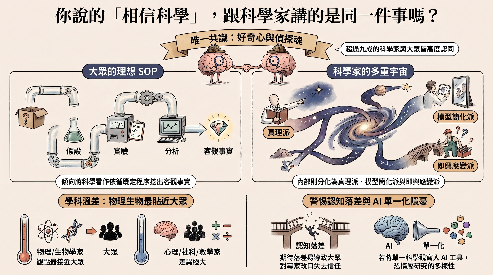

---

> *以下為虛構對話，人物與情節為創作，科學內容來源標註於文末。*

## ▌鏡子不想當鏡子

下午三點，咖啡廳只剩咖啡機偶爾的嘆氣聲。

Cala 推開門，視線在店裡繞了一圈。

靠窗那張桌子，坐著的不是 K。

「……怎麼是你。」

「這裡是公共場所。」Aon 沒抬頭，手指還在筆電上。

她說了句「我才沒有要坐這裡」，然後在他對面坐下，把一疊釘好的 A4 放上桌面。

紙上有螢光筆畫線，邊角還有便利貼。

「剛好路過？」Aon 瞄了一眼。「還順便印了論文。」

「公司印表機剛好有開。」

她把紙轉向他，指著一張表。

「這篇在講，科學家對『科學是什麼』，比一般人還要喬不攏。你看這題——『科學像一面鏡子，反映大自然』。一般人七成二同意，科學家只有四成二。」

「嗯。」

「所以科學家不想當鏡子。」

Cala 看向窗外。

「他們不想只是映出別人的樣子。他們想被看見。」

停了一下。

「難怪有些人講話那麼冷。不是冷漠，是不想當鏡子。」

Aon 闔上筆電。

「等一下。」

聲音沒有變大，但整個人坐直了。

「『有些人』是誰。」

「……一般論。」

「論文哪一段寫到『想被看見』？」

## ▌分母是一

「沒寫啊。那是解讀。」

「解讀要有根據。」Aon 把那疊紙拉過來，翻到後面。「他們有請受試者寫理由。科學家不同意鏡子，是因為——你看這裡——一面完美複製現實的鏡子沒什麼用。他們要找的是結構，不是複製品。」

「跟想不想被看見有什麼差。」

「差在一個有證據，一個沒有。」

Cala 抽回紙。

「好啦。反正重點是科學家比較團結嘛，大家一致覺得不是鏡子。」

「相反。」

「蛤？」

「科學家才是比較分散的那一邊。」Aon 指著另一段。「他們算了每兩個人之間評分模式的相關。一般民眾平均大概 0.37，科學家只有 0.23。」

「所以……」

「所以連同一個領域的人都吵不攏。」

Cala 眨了眨眼。

「那 K 跟其他科學家也一定合不來。」

話題繞回去的速度，比 Aon 的反應還快。

「K 從小就這樣。」他脫口而出，「他國小就跟全班合不來，大家都知道。」

Cala 慢慢抬起頭。

「大家是誰？」

「……」

「分母是多少？」

咖啡機剛好在這時候噴了一口氣。

「你剛剛的樣本，」她用螢光筆的筆蓋敲了敲桌面，「是一個人吧。」

## ▌安靜一下

Aon 沉默了大約兩秒。

然後他重新打開筆電。

「好，那我們回到論文本身。科學家九十二人，九成是從聖塔菲研究所招來的，一般民眾九十九人，來自美國的線上平台——這是便利樣本，所以不能說『全世界的科學家都這樣』。學科比較那段，有些領域只有個位數的人，作者自己也說是探索性的。還有那個『科學是在建構現實』，一般人只有一成九同意，科學家有四成二，可是同樣勾『同意』，理由可能完全不一樣，所以要看文字說明才——」

「Aon。」

「還有 AI 那段，那是作者的擔心，不是實驗結果，報導如果寫成——」

「Aon。」

「嗯？」

「安靜一下。」

他停住了。

Cala 低頭翻到第一頁，用指尖壓著某一行。

「這裡寫，大家唯一都同意的，是好奇心。」

「九成九跟九成——」

「我沒問你數字。」

她把那疊紙對折，收進包包，拉鍊拉到一半又停下來，確認紙角沒有被折到。

*Aon 闔上嘴。他看了窗外一眼，起身走向櫃台，去拿那杯早就叫過號、已經不太熱的拿鐵。*

---

**「要相信科學！」這句話大家都很會說，但科學到底是什麼？一項發表在《Royal Society Open Science》的研究，請 92 位科學家和 99 位一般民眾替 18 種「科學是什麼」的描述打分數，結果出乎意料：一般大眾的看法相當整齊，反而是科學家內部吵成一團——就算是同一個專業領域的人，也各有各的答案。這不只是哲學課上的問題，它還牽動我們怎麼看待「專家改口」，以及未來 AI 會幫我們做哪一種科學。**

---

## 關鍵亮點

- **大家都同意的只有兩件事**：科學是「好奇心驅動的探索」，也是「偵探式的推理」，兩組受試者的同意度都超過九成。
- **其餘幾乎全是分歧**：在能做統計檢定的 15 個描述中，科學家和大眾有 14 個出現顯著差異。
- **大眾比科學家更一致**：一般人傾向把科學看成「照著既定程序，挖出客觀事實」；科學家則有人重視真理、有人重視假設與簡化、有人強調不確定性與即興應變。
- **AI 的隱憂**：研究者擔心，如果 AI 研究工具只被訓練成獎勵某一種做科學的方式，可能會把一種狹窄的科學觀「自動化」。

---

## 一個聽起來很蠢、其實很難的問題

先來個小測驗：如果有人問你「科學是什麼？」你會怎麼回答？

「就是做實驗、驗證假設啊。」「找出世界的真相？」「國中理化課本第一章那個『科學方法』？」——如果你腦中冒出的是這類答案，恭喜，你和研究裡大多數的一般民眾想法差不多。但如果你去問一群真的在做研究的科學家，事情就沒那麼單純了。

*同一個「科學」，在不同人腦中可能是完全不同的畫面。*

### 研究怎麼做的？

這項研究由 **Marina Dubova**（研究進行時在聖塔菲研究所擔任博士後，現為加州大學柏克萊分校心理學助理教授）與普林斯頓大學的 **Qiawen E. Liu** 合作完成，論文發表在《Royal Society Open Science》。

研究團隊找來兩組人：

- **92 位科學家**，九成來自造訪聖塔菲研究所的研究者，其餘來自 SciFoo 學術營的郵寄名單。領域橫跨生物、心理與認知科學、物理、社會科學、工程、數學等。
- **99 位一般民眾**，來自美國的線上受試者平台 Prolific，全部住在美國。

接著，他們拿出 **18 種對科學的描述**，請每個人用七點量表打分數，從「非常不同意」到「非常同意」。除了打分數，受試者也要寫下自己的理由（一般民眾必填、科學家選填）——這一步很聰明，因為兩個人可能都給「同意」，背後的想法卻完全不同。
### 這 18 種描述從哪來？

這些描述不是研究者隨便亂想的，而是從**科學史、科學哲學的文獻**，以及**科學家平常怎麼形容自己的工作**裡蒐集來的。其中包括把科學比喻成：

- 🔍 **偵探辦案**：蒐集線索、推理出真相
- 🪞 **一面鏡子**：如實反映外在的現實
- 🎯 **追求真理**：一步步逼近世界的真實樣貌

換句話說，這份問卷就像一份「科學人格測驗」，看看每個人心中的科學長什麼樣子。

---

## 唯一的共識：科學就是好奇心加偵探魂

先講好消息：在某些地方，大家是有共識的。

*「跟著線索走」是科學家與大眾少數的共同語言。*

### 兩個幾乎全票通過的描述

根據論文數據，有兩個描述幾乎沒有爭議：

| 對科學的描述 | 科學家同意比例 | 一般大眾同意比例 |
|---|---|---|
| 好奇心驅動的探索 | 約 96% | 約 99% |
| 偵探式的推理 | 約 92% | 約 99% |

也就是說，不管你是實驗室裡的研究員，還是滑手機填問卷的上班族，大家都認同科學有一種「**好奇 → 找線索 → 推理 → 破案**」的精神。這兩個描述強調的，是追著線索走、看它會帶你去哪裡。

### 共識太強，強到沒辦法統計

有趣的是，有 3 個描述——好奇心驅動的探索、偵探式推理，再加上把科學比喻成**手電筒**——同意度實在太高，兩組幾乎都在「同意」那一端，研究者反而**沒辦法做統計檢定**——沒有差異可以比。所以 18 個描述裡，真正能拿來比較的只剩 15 個。

而這 15 個，才是好戲上場的地方。

---

## 分歧大爆發：大眾整齊劃一，科學家各說各話

在這 15 個可以檢定的描述中，**有 14 個在科學家與大眾之間出現顯著差異**。換句話說，除了「好奇心」和「偵探」這類共識，雙方幾乎在每一題都看法不同。差距最大的幾題，包括把科學看成**追求真理**、**大自然的鏡子**、**一磚一瓦的建築工程**，以及**在既有典範內解題**。

來看幾個數字：

- 「科學是追求真理」：大眾 96% 同意，科學家只有 83%。很多科學家補充，科學得到的「真理」是有限的、看情境的。
- 「科學像一面鏡子，反映大自然」：大眾 72% 同意，科學家只有 42%。有科學家吐槽，一面完美複製現實的鏡子，其實沒什麼用。
- 「科學是在閱讀大自然這本書」：大眾 60% 同意，科學家只有 30%，是科學家最不認同的一題。有位工程博士生的說法是：科學比較像在「寫」這本書。
- 「科學是在建構現實，而不是發現現實」：大眾只有 19% 同意，科學家卻有 42%。
但更反直覺的是接下來這一點。

### 大眾版的科學：一條標準作業流程

一般民眾的評分模式**相當一致**：論文計算兩兩受試者評分模式的相關程度，大眾的平均相關約 0.37，科學家只有約 0.23，差距具統計顯著性。他們心中的科學比較像這樣：

> 科學家按照**既定的程序**，一步步操作，最後挖出**客觀的事實**。

有點像在工廠生產線上做品管：流程對了，結果就會是對的。Dubova 在接受《Nautilus》訪談時也提到，大眾對科學的想像比科學家**更理想化**。

### 科學家版的科學：多重宇宙

科學家的答案則**分散得多**。研究者發現，至少可以看到幾種不同的路線：

- **真理派**：科學就是在追求真理，我們越來越接近世界的真相。
- **模型派**：科學靠的是假設和簡化，我們做的模型本來就不是現實本身，而是好用的近似。
- **不確定派**：科學充滿不確定性，很多時候要靠判斷力和即興應變，不是照表操課。

報導也指出，雙方的差異集中在：科學到底有多仰賴**創意**、**個人判斷**，以及**既定方法**。

### 同一個領域也喬不攏

如果你以為「那是因為物理學家和社會學家本來就不同掛」，研究的結論會讓你再嚇一跳：Dubova 指出，**就算是同一個子領域的科學家，彼此之間也有相當多的分歧**。

這就好像同一間餐廳的廚師，對「什麼叫做好吃」各有一套標準——大家每天都在同一個廚房出菜，卻沒人真的確認過彼此的定義一樣。

### 一張表看懂兩邊的差別

| 面向 | 一般大眾（研究中的樣本） | 科學家（研究中的樣本） |
|---|---|---|
| 看法一致程度 | 較一致 | 較分散，同領域內也有分歧 |
| 對科學的主要想像 | 依循既定程序，發掘客觀事實 | 追求真理、假設與簡化、不確定與即興應變，各有所重 |
| 對「方法」的態度 | 方法是固定的標準流程 | 方法會因問題而調整，也需要判斷 |
| 對科學的想像 | 較理想化 | 較貼近研究現場的實際體驗 |
| 共識之處 | 好奇心驅動、偵探式推理 | 好奇心驅動、偵探式推理 |

---

## 物理、生物 vs. 心理、社科：學科之間也有溫差

研究者也初步比較了不同學科的科學家。

*不同學科的研究者，對科學的想像也不太一樣。*

### 誰比較接近大眾？

結果顯示，**生物學家和物理學家**的評分模式，和一般大眾的平均最接近；而**數學、社會科學、心理與認知科學**領域的研究者，跟大眾的吻合度明顯低得多。

為什麼會這樣？論文提出兩個可能的解釋：

- **教育曝光度**：高中科學課常用物理和生物當經典範例，所以大眾腦中的「科學」形象，很可能就是以這兩個學科為範本。
- **科學實在論**：過去研究發現，自然科學家比社會科學家更傾向相信科學在揭露客觀實在，這剛好也是大眾的主流看法。

不過研究者也強調，這些連結還需要更多研究來檢驗。
### 先別急著下結論

這部分要特別打個問號：有些領域的參與人數**非常少**，所以學科之間的比較只能算是**初步觀察**，不能直接說「心理學家都比較不確定」或「物理學家都比較像一般人」。

---

## 為什麼這很重要？期待落差與「專家怎麼又改口了」

看到這裡你可能會想：好啦，大家對科學的定義不一樣，那又怎樣？

### 同一份研究結果，不同的期待

研究者認為，關鍵在於**期待**。當人們面對同一個研究結果，心裡其實帶著不同的預設：

- 如果你相信科學是「照程序挖出客觀事實」，那麼當兩份研究結果互相矛盾，或是專家修正了先前的結論，你很可能會覺得：「蛤？所以之前是錯的？那還能信嗎？」
- 但如果你認為科學本來就充滿假設、簡化和不確定性，那麼結論被修正，反而是科學正常運作的證明。

Dubova 在《Nautilus》訪談中也談到，大眾對科學的期待偏高，這可能讓人們對那些**附帶但書**的專家建議失去信任。

換句話說，大眾期待的是「確定、客觀」的科學，而科學家實際感受到的是「不確定、需要即興」的科學。這中間的落差，可能是「專家前後說法不同就被當成不可信」的原因之一。

### 先問一句：「你覺得科學是什麼？」

Dubova 給的建議很樸實：**不要預設大家對科學的想法都一樣**。下次討論科學議題時，不妨先問問對方怎麼看科學，對彼此的差異保持好奇。

說到底，這正是研究裡唯一的共識——好奇心——最好用的地方。

---

## AI 來了：我們要它做哪一種科學？

這項研究還有一個很有時代感的延伸：AI。

*當 AI 開始協助科學研究，「什麼算科學進步」就不再只是哲學問題。*

### 獎勵什麼，就會得到什麼

現在越來越多人希望用 AI 來輔助、甚至自動化科學研究。但研究者指出一個根本問題：要決定 AI 研究工具該優先做什麼，**必然牽涉到「什麼才算科學進步」的判斷**。

舉例來說：

- 如果 AI 的獎勵設計偏向**遵循標準程序**，它偏好的研究，就會長得像大眾心中那種「SOP 科學」。
- 如果另一套系統獎勵的是**探索非常規的解釋**，它偏好的研究方向就可能完全不同。

這就像訓練一隻狗：你獎勵牠坐下，牠就學會坐下；你獎勵牠到處嗅聞，牠就學會探險。AI 不會自己決定「科學是什麼」，是設計它的人替它決定的。

### 會寫報告，不等於會判斷

報導還點出另一個細節：**撰寫一份報告**，和**判斷哪些主張值得更嚴格的檢驗**，是兩種不同的任務。AI 生成的論文也有同樣的問題——寫得出來，不代表知道哪裡該追問。

研究者擔心的是，AI 可能會把**某一種狹窄的科學觀自動化**，擠壓掉其他做科學的方式。在《Nautilus》訪談中，Dubova 也提到 AI 可能讓研究變得更「單一化」。要注意的是，這是研究者提出的**擔憂**，不是這項研究的實證結果。

### Dubova 的其他研究也在問同一件事

其實 Dubova 一直在挑戰「教科書版科學方法」。她和合作者先前的一項模擬研究發現，**隨機選擇實驗**的模擬研究者，產出的理論反而比「專門為了驗證或推翻理論而設計實驗」的更好；另一項發表在 PNAS 的研究則檢視了**奧坎剃刀**（簡約原則），指出過度依賴「越簡單越好」，可能讓模型產生偏誤。

這些研究和本篇的發現指向同一個方向：科學的做法可能比我們想像的更多元，而這種多元，正是 AI 時代最需要被保護的東西。

### 下一步

研究團隊接下來想檢驗：**科學家自己對科學的描述，能不能預測他們看重哪些問題、方法和結果？**如果可以，「你怎麼定義科學」就不只是想法，而會實際影響一個人做出什麼樣的研究。

---

## 常見問題（FAQ）

**Q1：這是不是代表科學家很不專業，連自己在做什麼都說不清楚？**

不是。這項研究顯示的是：科學家對「科學的本質與目的」有不同的哲學立場，不代表他們做研究的能力有問題。研究者反而認為，這種多元可能是科學的一部分，大眾想像中那種單一、標準化的科學，才比較偏離研究現場。

**Q2：可以說「全世界的科學家都比大眾更分歧」嗎？**

不行。這項研究總共 191 人，科學家九成經由聖塔菲研究所招募，大眾來自美國線上受試者平台，兩組都是便利樣本。結果只能代表這些參與者，不能直接推論到所有科學家或所有民眾。

**Q3：那「科學方法」到底存不存在？**

研究沒有否定科學方法，而是指出不同的人對「科學怎麼運作」重點放在不同地方：有人看重程序，有人看重追求真理，有人看重不確定性和即興判斷。大家唯一高度一致的，是好奇心和偵探式推理。

**Q4：專家改口，到底該不該信？**

研究者的觀點是，如果把科學想成「照程序挖出客觀事實」，結論修正就很容易被解讀成「之前錯了、不可信」。但如果理解科學本來就含有假設與不確定性，修正反而是科學持續運作的一部分。這是作者的解讀，研究本身沒有直接測量「信任度」。

**Q5：AI 真的會把科學變得單一化嗎？**

目前這是研究者的擔憂，不是實證結果。他們的論點是：AI 研究工具的獎勵設計，必然會反映某一種「什麼算科學進步」的判斷，所以在開發之前，應該先想清楚要讓 AI 做哪一種科學。

---

## 結論

「相信科學」這句話，聽起來像是大家都站在同一邊，但這項研究提醒我們：每個人口中的「科學」，可能根本不是同一件事。

一般大眾心中的科學比較整齊、比較理想化，像一條可靠的生產線；科學家心中的科學則五花八門，有人追真理、有人玩模型、有人跟不確定性共處，連同一個領域的人都喬不攏。唯一的最大公約數，是好奇心和偵探魂。

這個落差不只是學術上的趣味，它可能影響我們如何面對專家改口，也會影響未來的 AI 研究工具被設計成什麼樣子。當我們準備把科學交給 AI 加速時，或許該先停下來問一句：**我們要的，是哪一種科學？**

當然，這項研究的樣本不大、學科比較也只是初步，後續還需要更多研究來確認。但它至少提供了一個很好的開場白——下次有人跟你說「要相信科學」，你可以笑著回問：「你說的科學，是哪一種？」

---

## 延伸搜尋

- [科學哲學 入門](https://www.google.com/search?q=%E7%A7%91%E5%AD%B8%E5%93%B2%E5%AD%B8+%E5%85%A5%E9%96%80)
- [奧坎剃刀](https://www.google.com/search?q=%E5%A5%A7%E5%9D%8E%E5%89%83%E5%88%80)
- [科學溝通 不確定性](https://www.google.com/search?q=%E7%A7%91%E5%AD%B8%E6%BA%9D%E9%80%9A+%E4%B8%8D%E7%A2%BA%E5%AE%9A%E6%80%A7)
- [Marina Dubova what is science](https://www.google.com/search?q=Marina+Dubova+what+is+science)

---

## 參考資料來源

- [Everyone knows what science is…until you ask（Royal Society Open Science, DOI）](https://doi.org/10.1098/rsos.260933)
- [What is science? Even scientists can't agree（EurekAlert, 聖塔菲研究所新聞稿）](https://www.eurekalert.org/news-releases/1151528)
- [What Is Science, Really? Even Scientists Can't Agree（SciTechDaily）](https://scitechdaily.com/what-is-science-really-even-scientists-cant-agree/)
- [Scientists and the general public define science very differently（The Brighter Side of News）](https://www.thebrighterside.news/post/scientists-and-the-general-public-define-science-very-differently/)
- [Is Science a Mirror, a Game, or a Conversation?（Nautilus）](https://nautil.us/is-science-a-mirror-a-game-or-a-conversation-1286671)
- [Reassessing the scientific method（聖塔菲研究所）](https://www.santafe.edu/news-center/news/reassessing-the-scientific-method)
- [A sharp look into Ockham's razor（聖塔菲研究所）](https://santafe.edu/news-center/news/sharp-look-into-ockhams-razor)
