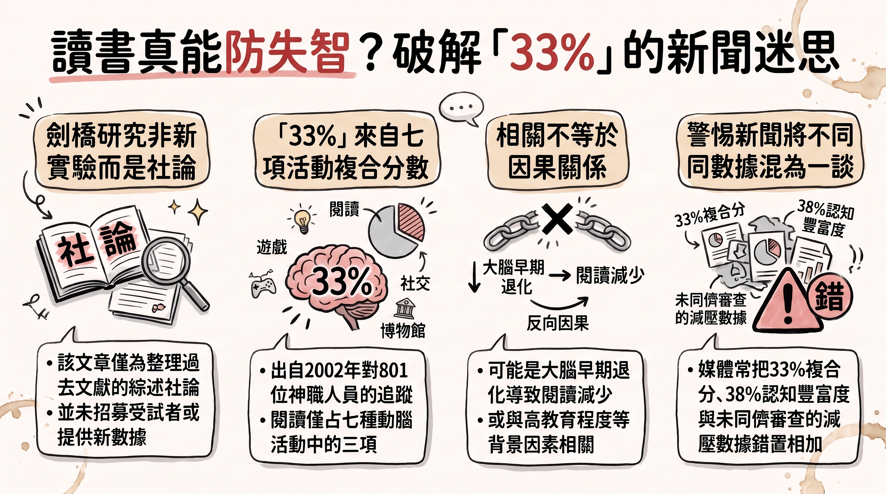

---

> *以下為虛構對話，人物與情節為創作，科學內容來源標註於文末。*

## ▌三十三趴的分母

雨從傍晚就沒停過。

K 的螢幕亮著一則英文新聞。旁邊的咖啡早就涼了。

門沒敲就被推開。

「借一下你那本書……」Aon 的視線停在螢幕上。「等等。『簡單習慣與阿茲海默症風險降低 33% 相關』？」

「嗯。」

「哪個習慣？」

「閱讀。」

「研究顯示的？」

K 沒抬頭。「33% 不是閱讀。」

「你又跳步驟了。」Aon 拉了張椅子坐下。「從頭來。誰做的？」

「劍橋。期刊上的社論，整理別人的研究。」

「所以沒有新數據。那 33% 是從哪一篇搬過來的？」

「2002 年，JAMA。801 個人。」

「801 個什麼人？」

「天主教的修女、神父和修士。」

Aon 停了一下。「……作息幾乎一模一樣的一群人。」

「平均追蹤四年半。」

「好，對象有了。那 33% 是誰跟誰比？」

## ▌七分之三

「七種動腦活動算成一個分數。」K 說。「分數每多一分，風險比 0.67。」

「七種裡面幾種是閱讀？」

「三種。報紙、雜誌、書。」

「其他四種？」

「看電視、聽廣播、玩遊戲、去博物館。」

Aon 靠回椅背。「所以標題的『閱讀』，其實是七分之三的閱讀，加上電視跟博物館，每多一分低 33%。這跟『讀書的人少 33%』差很遠。」

「我說過了。」

「你說的是結論。我在講它怎麼變成那個結論。」

K 喝了一口涼咖啡，皺眉。

「有單看閱讀的嗎？」

「2003 年 NEJM。469 個 75 歲以上的人，閱讀的風險比 0.65。」

「信賴區間？」

「0.43 到 0.97。」

「上限 0.97。」Aon 用指節敲了一下桌面。「差一點就碰到 1，碰到 1 就是沒差。範圍這麼寬，誰敢說效果多大？」

「我沒說。」

「標題說了。」

「囉唆。」

「囉唆是因為有人寫得太短。」Aon 完全沒有要停的意思。「而且這是觀察性研究，你知道接下來要問什麼。」

## ▌待查清單

「反向因果。作者自己寫了。」

「對。快要失智的人，本來就讀不下去。」Aon 頓了頓。「再加上教育程度、收入。會讀書的人，可能本來就有別的保護條件。」

「2012 年有一篇。1,076 個長者。活動能預測隔年的認知，反過來不行。」

「方向偏向活動影響認知。」Aon 點頭，又搖頭。「但作者也承認退化會讓人不想參與。傾斜，沒有翻盤。」

「報導還說，8 週訓練後腦灰質變多。」

「幾個人？」

「11 個。閱讀障礙的小孩，矯正訓練。」

「11 個，還是矯正課程，不是休閒閱讀。灰質跟閱讀進步有關係嗎？」

「多重比較校正後不顯著。」

「腦有變，跟讀得好不好說不出關係。」

「讀小說五分鐘，壓力降兩成。」

「誰量的？怎麼量？幾個人？」

「沒寫。」

Aon 安靜了兩秒。「……還有嗎？」

「38% 的成人說閱讀是最愛的放鬆方式，來源不明。今年 Neurology 另一篇也有個 38%，那是風險，不同研究。」

「兩個 38% 放在同一個話題裡，」Aon 揉了揉眉心，「一定會有人拿來相加。」

「所以？」

「常讀書的人，失智風險比較低。閱讀能不能預防，目前證據不足以下結論。」

K 轉回螢幕。「我一開始就說了。」

「你說的是一句話。我說的是怎麼知道。」

雨聲大了一點。

*Aon 從 K 桌上撕下一張便條紙，寫下「5,500 人／5 年：出處？」「5 分鐘：自評還是生理指標？」「38%：哪份調查？」，折成四折，收進襯衫口袋。走到門口才想起來，又折回書架，把那本書抽走了。*

---

**劍橋大學團隊在《Psychological Medicine》發表一篇綜述,把「休閒閱讀」和大腦、認知、心理健康的研究串在一起看。新聞標題那句「阿茲海默症風險降低 33%」很吸睛,但追回原始研究就會發現:這個 33% 測的不只是閱讀,也不是「讀了就會降低」的因果證明。這篇帶你拆開數字,看看閱讀和大腦到底有多少關係,哪些地方還說不準。**

---

## 關鍵亮點

- 劍橋這篇刊在期刊上的是**綜述型社論(Editorial)**,不是新做的實驗,也不是系統性回顧。
- 「33%」出自 2002 年的 JAMA 研究,算的是**七項認知活動合起來的分數**,閱讀報紙、雜誌、書籍只占其中三項,受試者是 801 位天主教修女、神父與修士。
- 從兒童到長者,閱讀都和認知、心理健康有**正向關聯**,但大多數證據只能說「一起出現」,還不能說「閱讀造成」。
- 新聞裡有好幾個數字(33%、38%、20%)來自完全不同的研究,混在一起看很容易誤會。

---

## 一、這篇「劍橋研究」其實是什麼?

*閱讀和大腦健康的關係,這次是被「整理」出來的,不是「實驗」出來的。*

### 不是新實驗,是一篇綜述型社論

先把主角介紹清楚。這篇文章叫〈Reading and associations with brain health, cognition, well-being, and mental health〉,作者是劍橋大學精神醫學的 **Barbara Sahakian** 教授、**Christelle Langley** 博士,以及慈善機構 The Queen's Reading Room 的執行長 **Vicki Perrin**,2026 年刊登在《Psychological Medicine》第 56 卷。

很多報導把它稱為「研究」或「文獻回顧」,但期刊頁面標示的類型是 **Editorial(社論)**。白話說,這是一篇作者把過去的調查研究、大型追蹤研究、腦造影研究挑出來、串成一個論點的文章。它**沒有招募新受試者,也沒有新數據**,更不是那種用嚴格流程把所有相關論文一網打盡的系統性回顧。

### 標題的「關聯」二字最重要

注意標題用的是 **associations(關聯)**。作者自己也坦白,因為寫書才發現這個領域的研究數量**其實有限**,他們呼籲需要更多研究來確立因果。換句話說,連作者都沒有宣稱「閱讀能預防失智」,這個說法是新聞標題自己加上去的。

---

## 二、追查 33%:這個數字到底是什麼的 33%?

*看到百分比,第一個問題永遠是:「誰跟誰比?」*

### 原始出處:801 位神職人員的追蹤研究

ScienceDaily 標題的「33%」,追到底是 **Wilson 等人 2002 年發表在《JAMA》的研究**。研究對象是 801 位年長的天主教修女、神父與修士,平均追蹤 4.5 年。

研究團隊問受試者平常多常做七種「動腦」的活動,其中三項是**閱讀報紙、閱讀雜誌、閱讀書籍**,其他還包括看電視、聽廣播、玩遊戲、去博物館。把七項的頻率算成一個**認知活動複合分數**,結果發現:**分數每增加 1 分,阿茲海默症的風險比(HR)是 0.67**,也就是風險低了約 33%。

### 所以這個 33%……

- **不是單指閱讀**,是七項活動加總的分數。
- **不是「讀了就降 33%」**,是分數每差 1 分的相對風險差異。
- **不是一般人**,是生活型態相對單純、教育程度普遍較高的神職人員,能不能套用到其他族群要打個問號。
- 作者自己在論文裡提到,**有可能是反過來**:大腦已經開始悄悄退化的人,本來就比較不想做這些活動。

### 另一個常被引用的研究:專門看閱讀

如果想找「單看閱讀」的數據,可以看 **Verghese 等人 2003 年的《NEJM》研究**:469 位 75 歲以上長者,中位追蹤 5.1 年,閱讀的失智風險比為 **0.65**,95% 信賴區間是 **0.43 到 0.97**。

信賴區間可以想成「真實數值很可能落在這個範圍內」。這個區間很寬,上限 0.97 已經非常接近 1(1 代表完全沒差),表示效果的大小還相當不確定。作者同樣明寫:**這不能確立因果關係**。

| 項目 | Wilson 2002(JAMA) | Verghese 2003(NEJM) |
|---|---|---|
| 樣本 | 801 位天主教神職人員 | 469 位 75 歲以上長者 |
| 追蹤時間 | 平均 4.5 年 | 中位 5.1 年 |
| 測的是什麼 | 七項認知活動的複合分數 | 單一活動(含閱讀) |
| 結果 | 分數每 +1 分,HR 0.67 | 閱讀 HR 0.65(0.43–0.97) |
| 研究類型 | 觀察性追蹤 | 觀察性追蹤 |
| 作者對因果的態度 | 提到反向因果可能 | 明寫不能確立因果 |

---

## 三、從小孩到長輩:各年齡層的閱讀證據

*從繪本到報紙,閱讀陪著大腦走過每個階段。*

### 兒童與青少年:越早開始,表現越好?

綜述引用了美國 **ABCD 世代研究**的資料,分析超過 1 萬名(10,243 人)青少年,2023 年發表於《Psychological Medicine》。結果是:從小就養成休閒閱讀習慣的孩子,進入青春期後在**注意力、記憶、執行功能**上表現較好,心理健康狀態較佳,**睡得比較多、螢幕時間比較少**。

聽起來很美好,但一樣要記得:會從小讀書的家庭,可能本來就有比較多藏書、比較規律的作息,這些都可能同時影響孩子的表現。

### 閱讀障礙兒童:那 11 個人的故事

報導提到「8 週訓練後腦灰質增加」,出處是 **Krafnick 等人發表在《NeuroImage》的研究**:11 名 7 到 11 歲的閱讀障礙兒童接受 8 週的**矯正訓練**,部分腦區灰質體積增加約 2.6% 到 3.5%。

這裡有三件事要注意:

- **只有 11 人**,樣本非常小。
- 那是**專門設計的矯正課程**,不是下課後翻小說的休閒閱讀。
- 灰質變化和閱讀能力進步之間的關聯,在統計上做了多重比較校正後**沒有達到顯著**。

所以它頂多說明「大腦在密集訓練後會有變化」,不能拿來證明「看書會讓腦變大」。

### 成人:放鬆、減壓、同理心

在成人身上,閱讀和**情緒健康、放鬆、壓力降低**相關,也和較高的**同理心**相關。報導還提到兩個數字:

- 2024 年 The Queen's Reading Room 委託的研究指出,**讀小說 5 分鐘可降低最多約 20% 的壓力**。⚠️ 這份研究公開在該慈善機構自家網站,頁面沒有寫樣本數、沒有說明壓力怎麼量(自評問卷還是生理指標),也沒有提到是否經過同儕審查。
- 約 **38% 的成人**表示閱讀是自己偏好的放鬆方式。⚠️ 這項調查的原始來源目前仍未查證。

### 長者:動腦活動與較慢的認知衰退

在長者身上,閱讀這類刺激性的休閒活動,和**認知衰退較慢、失智風險較低**相關,也就是前面 Wilson 與 Verghese 研究談的那些。綜述另外提到一項約 5,500 名 55 歲以上成人、追蹤 5 年的研究。⚠️ 這項研究的原始出處與結論目前尚未確認。

### 不只是一個人讀:讀書會的社交加分

作者也特別提到**共讀和讀書會**。一群人一起讀、一起聊,可能額外帶來社交上的好處,減少孤立感。這也是他們推廣閱讀的重點之一:不只鼓勵大家讀,還鼓勵大家「一起讀」。

---

## 四、相關不等於因果:雞生蛋還是蛋生雞?

*閱讀讓大腦變好,還是大腦好的人比較愛閱讀?*

### 三種可能的解釋

當研究發現「常閱讀的人失智風險較低」,至少有三種解釋:

1. **閱讀真的保護大腦**(大家最想聽的版本)。
2. **反向因果**:大腦已經開始退化的人,本來就比較讀不下去,所以看起來「不讀的人比較容易失智」。阿茲海默症在確診前可能已經悄悄發展好幾年,這段期間的改變很可能就會影響閱讀習慣。
3. **干擾因素**:教育程度較高、經濟條件較好的人,本來就比較常閱讀,也可能有其他保護大腦的條件,例如較好的醫療資源或生活型態。閱讀只是剛好跟著出現。

觀察性研究很難把這三種情況完全拆開。

### 有沒有研究試著拆開?

有。**Wilson 等人 2012 年在《Neurology》的研究**追蹤 1,076 位長者,發現**認知活動能預測隔年的認知功能,但反過來,認知功能並不能預測隔年的活動量**。這個結果比較支持「活動影響認知」的方向。

不過作者還是承認,認知衰退確實會降低人們參與活動的意願。這篇研究讓天平稍微傾斜,但還沒到可以拍板定案的程度。

### 要怎麼才能證明因果?

最有力的方法是**隨機對照試驗**:隨機把人分成「每天閱讀」和「不特別閱讀」兩組,追蹤很多年,再比較失智發生率。問題是,失智要很多年才會出現,很難要求一群人維持固定習慣十幾年,所以這類研究非常難做。這也是作者呼籲需要更多研究的原因。

---

## 五、新聞數字撞名事件簿

*同樣是百分比,出處可能天差地遠。*

### 33% 和 38%:長得很像,其實是兩件事

2026 年美國神經學會(AAN)發布了另一項刊在《Neurology》的研究:1,939 人當中,**一生認知豐富度最高的 10% 和最低的 10% 相比,阿茲海默症風險低 38%**。這同樣是相關性研究,而且**跟劍橋綜述的 33% 完全是不同研究**。

更容易混淆的是,劍橋報導裡也有另一個 38%:「約 38% 成人以閱讀為偏好的放鬆方式」。兩個 38%,一個是**風險差異**,一個是**問卷裡的人數比例**,意義完全不同。

### 讀新聞百分比的三個問題

下次看到「降低 XX%」的標題,可以先問自己:

- **誰跟誰比?** 是最高 10% 對最低 10%,還是分數每差 1 分?
- **測的是什麼?** 是單一行為,還是一整包活動?
- **是什麼類型的研究?** 觀察性研究只能說「相關」,實驗才比較接近「因果」。

---

## 常見問題 FAQ

**Q1:所以每天讀書到底能不能預防阿茲海默症?**
目前的證據只能說,常閱讀的人失智風險**較低**,但無法證明是閱讀**造成**的。可能有反向因果或其他因素在背後作用。

**Q2:33% 是讀書的人比不讀書的人風險低 33% 嗎?**
不是。這是 2002 年 JAMA 研究中,七項認知活動複合分數每增加 1 分的相對風險差異,閱讀只是其中三項,而且受試者是天主教神職人員。

**Q3:「讀小說 5 分鐘減壓 20%」可以相信嗎?**
這是慈善機構委託的研究,公開資料沒有說明樣本數、測量方式,也沒提到同儕審查,目前很難評估可信度。

**Q4:看書會讓大腦灰質變多嗎?**
相關研究只有 11 名閱讀障礙兒童,而且是專門的矯正訓練,不是休閒閱讀;灰質變化與閱讀進步的關聯在統計校正後也不顯著。不能直接推論到一般人看書。

**Q5:既然證據還不夠,還需要鼓勵閱讀嗎?**
作者的立場是:因果還需要更多研究確認,但閱讀本身和放鬆、同理心、社交連結都有正向關聯,他們仍然主張從小養成閱讀習慣,並推廣讀書會這類一起讀的方式。

---

## 結論

劍橋這篇綜述把閱讀和大腦健康的研究整理在一起,畫出一張很吸引人的圖:從小讀書的孩子注意力比較好,讀書的成人比較放鬆,常動腦的長者失智風險比較低。但把每一塊拼圖翻過來看,背面幾乎都寫著同一行字:**「相關,尚未證明因果。」**

新聞標題的 33%,是一群神職人員、七項活動加總後的數字,不是「翻開書就少 33% 風險」的保證書。這不代表閱讀沒有價值,而是提醒我們,科學證據和新聞標題之間常常隔著好幾層簡化。

接下來真正需要的,是設計更嚴謹、追蹤更久的研究,把「閱讀保護大腦」和「健康大腦比較愛閱讀」這兩種解釋拆開。在那之前,把閱讀當成一件讓自己放鬆、和人連結的好事就夠了,不必把它當成防失智的特效藥。

---

## 延伸搜尋

- [相關不等於因果](https://www.google.com/search?q=%E7%9B%B8%E9%97%9C%E4%B8%8D%E7%AD%89%E6%96%BC%E5%9B%A0%E6%9E%9C)
- [反向因果 研究方法](https://www.google.com/search?q=%E5%8F%8D%E5%90%91%E5%9B%A0%E6%9E%9C+%E7%A0%94%E7%A9%B6%E6%96%B9%E6%B3%95)
- [風險比 hazard ratio 解讀](https://www.google.com/search?q=%E9%A2%A8%E9%9A%AA%E6%AF%94+hazard+ratio+%E8%A7%A3%E8%AE%80)
- [ABCD Study 青少年 閱讀](https://www.google.com/search?q=ABCD+Study+%E9%9D%92%E5%B0%91%E5%B9%B4+%E9%96%B1%E8%AE%80)
- [閱讀障礙 介入 灰質](https://www.google.com/search?q=%E9%96%B1%E8%AE%80%E9%9A%9C%E7%A4%99+%E4%BB%8B%E5%85%A5+%E7%81%B0%E8%B3%AA)

---

## 參考資料來源

- [Sahakian, Perrin & Langley (2026). Reading and associations with brain health, cognition, well-being, and mental health. *Psychological Medicine*, 56, e262](https://www.cambridge.org/core/journals/psychological-medicine/article/reading-and-associations-with-brain-health-cognition-wellbeing-and-mental-health/1A3565FA61831A975813113DE1AB2B09)
- [Wilson et al. (2002). Participation in Cognitively Stimulating Activities and Risk of Incident Alzheimer Disease. *JAMA*, 287, 742–748(第三方轉載全文)](https://www.activeminds.com/docs/JAMA%20020213.pdf)
- [Verghese et al. (2003). Leisure Activities and the Risk of Dementia in the Elderly. *NEJM*, 348, 2508–2516](https://einsteinmed.edu/uploadedfiles/departments/neurology/divisions/cognitive_and_motor_aging/paper3.pdf)
- [Krafnick et al. Gray matter volume changes following reading intervention in dyslexic children. *NeuroImage*, 57(3)](https://pmc.ncbi.nlm.nih.gov/articles/PMC3073149)
- [Wilson et al. (2012). Influence of late-life cognitive activity on cognitive health. *Neurology*, 78, 1123–1129](https://pmc.ncbi.nlm.nih.gov/articles/PMC3320053)
- [University of Cambridge: Reading for pleasure early in childhood linked to better cognitive performance and mental wellbeing](https://www.cam.ac.uk/research/news/reading-for-pleasure-early-in-childhood-linked-to-better-cognitive-performance-and-mental-wellbeing)
- [University of Cambridge: Reading for pleasure – and for better health](https://www.cam.ac.uk/stories/reading-for-pleasure-and-for-better-health)
- [ScienceDaily: 這個簡單習慣與阿茲海默症風險降低 33% 相關](https://www.sciencedaily.com/releases/2026/11/261118065536.htm)
- [American Academy of Neurology: Keeping your mind active throughout life associated with lower Alzheimer's risk](https://www.aan.com/PressRoom/Home/PressRelease/5311)
- [The Queen's Reading Room Study](https://thequeensreadingroom.co.uk/the-queens-reading-room-study/)
