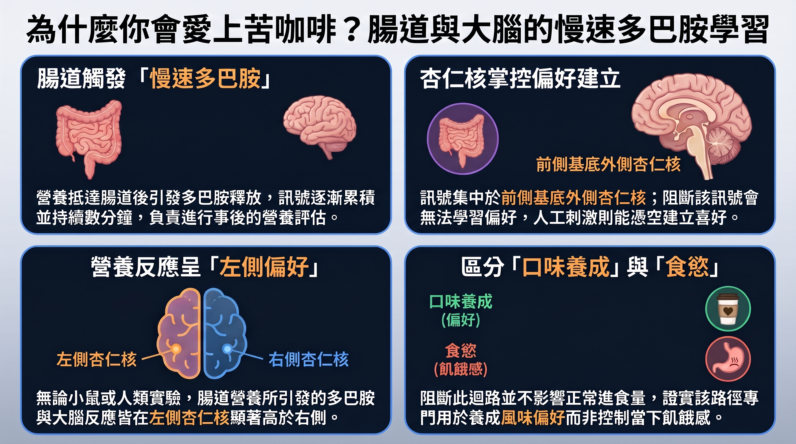

---

> *以下為虛構對話，人物與情節為創作，科學內容來源標註於文末。*

## ▌苦盡甘來的那半罐

中午十二點半，湯底的味道從廚房一路漫到門口。

Dg 坐在靠櫃台的位子，面前一碗乾麵，旁邊一罐黑咖啡。

他喝一口，眉頭皺起來，又硬生生撫平。

「良藥苦口。」

Liy 端著小菜經過，停下來。

「你生病了嗎？」

「不是。這是人生。」Dg 把罐子轉了半圈，讓標籤朝外。「苦盡甘來。」

「那甘什麼時候來？」

「……」

「你已經喝半罐了。」

Dg 清了清喉嚨。

「我在 K 桌上看到一篇《Nature》。人會愛上苦的東西，不是用舌頭愛上的。」他停頓，壓低聲音，「是用肚子。」

Liy 看了看他的肚子。

「肚子又沒有嘴巴。」

「是比喻。營養到了腸道，腸道會發訊號給大腦。多巴胺。很慢的那種，會持續好幾分鐘。」

「所以你現在覺得好喝了嗎？」

Dg 看了一眼手機上的時間。

「……還要幾分鐘。」

## ▌杏仁

門口的風鈴響了一下。

Cala 拎著識別證走進來，視線先往角落那張空桌掃了一圈，才坐到 Dg 隔壁。

「剛剛誰說用肚子愛上的？」

「我。但那是——」

「所以抓住一個人的心，真的要先抓住他的胃？」Cala 撐著下巴，「我就知道。那些料理節目都是有根據的。」

「不是那個意思，這是在講食物——」

「而且你說訊號會傳到哪裡？杏仁？」她已經在點餐單上寫字了，「所以多吃杏仁比較容易喜歡上人？」

「是杏仁『核』。基底外側杏仁核。腦袋裡的一個區域，長得像杏仁而已。」

「我又沒有要買杏仁。」

點餐單上，「杏仁」兩個字被她用筆劃掉，旁邊補了「核」。

Liy 收走點餐單，看了一眼。

「妳點的跟角落那位平常吃的一樣。」

「巧合。」

## ▌假的成績單

Dg 把罐子放下，難得地坐直。

「研究的人把糖水直接灌進老鼠的胃裡，不經過舌頭。結果杏仁核那邊的多巴胺還是會升起來。」

「然後呢？」Cala 問完，又補了一句，「我只是隨便問。」

「然後把這條訊號阻斷，老鼠照吃，吃得跟平常一樣多。可是牠學不會『這個新味道代表有熱量』。」

「反過來呢？」

「反過來，讓老鼠嘗一個零熱量的味道，再直接刺激那邊的多巴胺。老鼠就愛上那個味道了。」

Cala 眼睛亮了一下。

「所以只要一直給對方好心情，他就會慢慢喜歡上原本不喜歡的東西。」她頓了頓，「或是人。」

「老鼠是被電的。」Liy 說。

「我才沒有要電誰！」

Dg 張嘴想引一句什麼，又閉上了。

他盯著罐子看了一會兒。

「不對。重點是，想吃跟喜歡是兩回事。老鼠的食慾沒被關掉，牠只是沒被教會。」

他用指節敲了敲罐身。

「所以我喝這個，現在不是在喜歡它。我是在等我的肚子幫我上課。」

## ▌左邊

「還有一件事，」Dg 說，「不管老鼠還是人，反應都是左邊比較強。研究的人自己也沒想到。」

「左邊。」Cala 按住胸口，「心臟那邊。」

「心臟不在腦袋裡。」

「我知道！我是說……象徵上。」

Liy 把 Cala 的麵放下，順手拿起 Dg 的罐子，轉過來看背面。

「你剛剛說，肚子收到營養，才會跟大腦報告這個味道有熱量。」

「對。」

「可是你這罐是無糖的。」

她把罐子放回桌上，標籤朝著 Dg。

「你的肚子要拿什麼去報告？」

*Dg 拿起罐子，對著光看那行小字。熱量：0 大卡。他看了很久，把剩下的半罐推到桌子邊緣。*

---

**第一口黑咖啡的表情,很多人都記得:苦、皺眉、懷疑人生。幾個月後卻每天早上非喝不可。UCSF 團隊 2026 年 11 月在《Nature》發表的研究指出,這種轉變背後可能有一條「慢速」的多巴胺路徑:營養到了腸道之後,訊號才慢慢傳進大腦的基底外側杏仁核,教大腦「這個味道=有好處」。**

---

## 關鍵亮點

- **腸道是隱藏的老師**:糖、脂肪進入腸道後,會觸發一波**持續好幾分鐘**的多巴胺訊號,送到大腦的**基底外側杏仁核(BLA)**。
- **阻斷就學不會**:小鼠的這條訊號被阻斷後,吃得一樣多,卻**學不會**「某個新味道代表有熱量」。
- **刺激就能「造出」偏好**:人為刺激這批多巴胺纖維,小鼠會愛上一個**完全沒熱量**的味道。
- **人類也看得到類似訊號,而且偏左邊**:兩項人類腦造影研究在同一區域觀察到營養相關的活動,左側反應明顯較強,原因目前不明。

---

## 一、先從那杯咖啡說起

### 苦味本來是「警報」

人類天生對苦味有戒心,這很合理:自然界很多有毒植物都是苦的,討厭苦味等於內建一套防毒系統。所以咖啡、黑巧克力、啤酒這類東西,大多數人第一次接觸時都不太愛。

問題來了:**那為什麼後來會愛上?**

### 「味道」和「好處」被配成一對

研究的資深作者、UCSF 生理學教授 **Zachary Knight** 用咖啡舉例:當大腦把某杯咖啡的風味,和咖啡因帶來的提神感連在一起之後,那杯咖啡就會開始「變得好喝很多」。

換句話說,你愛上的可能不是苦味本身,而是大腦學到「**喝了這個味道,之後會有好事發生**」。這種學習在科學上叫做**風味—營養學習(flavor-nutrient learning)**:大腦把某個風味,跟它在身體裡造成的效果(熱量、營養、提神)配對起來。

這個現象在動物研究裡已經被觀察很久。這次研究要回答的是更細的問題:**這個「配對」在腦中到底是靠什麼訊號完成的?**

*從「好苦」到「好香」,中間可能隔著一條腸道通往大腦的慢速訊號。*

---

## 二、多巴胺不只有「秒殺型」:認識慢速版本

### 你熟悉的那種多巴胺

說到**多巴胺**,大家常把它想成「快樂物質」。其實它跟**獎賞、動機與學習**的關係更密切。過去大多數多巴胺研究關注的是**快速訊號**:看到喜歡的食物、聽到手機通知,幾秒內多巴胺就有反應。這是「外面發生了什麼事」所觸發的訊號。

### 這次主角:從身體內部慢慢升起的訊號

這篇研究關注的是另一種比較少被研究的**慢速多巴胺訊號**:

- 它不是看到食物時觸發,而是**營養已經進到腸道之後**才開始;
- 它會**慢慢累積**,而且可以**持續好幾分鐘**;
- 它的觸發來源是消化道裡偵測糖、脂肪等營養的感測器,屬於**腸腦軸(gut-brain axis)**的一部分。

Knight 也提到,這套慢速系統比較少被研究,我們自己也比較難察覺它。你可以把兩者想成:快速多巴胺是即時推播,慢速多巴胺比較像大腦的「事後檢討會」,吃完一陣子後才給這次經驗打分數。

### 一張表看懂兩種訊號

| 比較項目 | 快速多巴胺訊號 | 慢速多巴胺訊號(本研究) |
|---|---|---|
| 觸發來源 | 外部事件(看到、聞到食物) | 身體內部(營養抵達腸道) |
| 時間尺度 | 幾秒內 | 逐漸累積,可持續數分鐘 |
| 研究熱度 | 研究很多 | 相對少 |
| 主要作用 | 獎賞預期、即時動機 | 把風味和營養效果配對,形成長期偏好 |
| 本研究關注的腦區 | — | 前側基底外側杏仁核(BLA) |

---

## 三、小鼠實驗:關掉、打開,偏好跟著變

### 第一步:繞過嘴巴,直接送進胃

要證明「是腸道在教大腦」,得先排除味覺的干擾。研究團隊把**糖水或類似奶昔的液體直接送進小鼠的胃**,完全不經過舌頭。

接著量測全腦的多巴胺,結果在**前側基底外側杏仁核**看到一波**強烈而持久**的多巴胺釋放。這裡的重點是:小鼠根本沒嘗到味道,大腦卻仍然因為「營養到了」而有反應。

### 第二步:把訊號關掉

研究者阻斷這條路徑後,小鼠**照樣正常進食**,食慾沒變;但牠們**學不會**「某個新味道代表有熱量」。

這個結果很關鍵,因為它把兩件事拆開了:**想不想吃**是一回事,**學會喜歡什麼**是另一回事。這條慢速路徑管的是後者。

### 第三步:把訊號假造出來

反過來,研究者讓小鼠嘗一個**零熱量的味道**,然後人為刺激 BLA 裡的多巴胺纖維。結果小鼠**學會偏好那個味道**,刺激等於取代了營養本身。

用比喻來說:這就像給大腦發一張「假成績單」,它照樣相信這個味道很值得。關掉會學不會、打開能造出偏好,這種「必要+足夠」的組合,是動物實驗裡證明因果關係常見的做法。

*三步驟實驗:觀察訊號、阻斷訊號、假造訊號,看偏好如何跟著改變。*

---

## 四、人類大腦也有同樣的訊號嗎?

### 舊資料新解讀:PET 研究

小鼠的結果很漂亮,但人類呢?共同作者、耶魯大學的 **Dana Small** 重新分析了一項較早的 **PET(正子造影)研究**:**13 名男性**分別喝下奶昔或無熱量飲料。結果在營養抵達腸道之後,多巴胺釋放集中在**左側 BLA**。

### 新的 fMRI 研究

另一方面,德國馬克斯普朗克代謝研究所的 **Marc Tittgemeyer** 團隊用 **fMRI(功能性磁振造影)** 研究了 **38 名成人**,發現喝下葡萄糖之後,同一個腦區的活動增加。

### 但要記得:這是「看到」,不是「操控」

這裡值得放慢一下。小鼠實驗可以直接開關訊號,證明因果;人類研究只能「觀察」大腦在喝東西後有什麼變化。PET 那部分是**舊資料的重新分析**,樣本只有 13 人而且都是男性;兩項研究也都不是專門為了測試這條路徑而設計。所以比較準確的說法是:**人類資料和小鼠結果方向一致,但還不能說已經在人身上證明了同一套機制。**

---

## 五、意外的彩蛋:為什麼偏偏是左邊?

### 大家原本以為吃飯迴路是左右對稱的

像進食這種很基本的生理功能,一般認為大腦左右兩邊的迴路是對稱的。但這次無論在小鼠還是人類,營養引發的多巴胺反應都**在左側 BLA 明顯比較強**。

在研究團隊先前公開的預印本中(標題是 *A lateralized pathway for associating nutrients with flavors*),以營養飲品測試時,小鼠左側多巴胺訊號上升約 18%,右側約 5%。不過預印本尚未經同儕審查,正式版的數字可能有修訂,這組數據僅供參考。

### 目前沒有答案

為什麼是左邊?研究者坦白說,這出乎他們的預料,實驗室正在研究原因。這也提醒我們:「左右腦分工」這件事,遠比流行心理學說的「左腦理性、右腦感性」複雜得多,連吃東西這種基本功能都可能藏著不對稱。

*營養引發的多巴胺反應在左側明顯較強,原因仍是未解之謎。*

---

## 六、這項研究能說什麼、還不能說什麼

### 它開啟的新方向

研究者認為,未來的治療也許可以針對**「學會喜歡某種食物」的過程**,而不只是調整飢餓或飽足感。Knight 的意思大致是:如果能弄清楚從腸道偵測營養到大腦形成學習的每一步,就有機會細緻地調整人對食物的偏好。

### 關於 GLP-1 藥物:目前只是推測

近年很熱門的 **GLP-1 類藥物**,會模仿一種腸道荷爾蒙,改變進食行為。Knight 推測這類藥物**可能**會減弱營養觸發的多巴胺訊號,讓食物隨時間變得沒那麼有吸引力。但要特別強調:**這項研究沒有測試 GLP-1 藥物**,兩者有沒有關係目前完全未知。

### 幾個要放在心上的限制

- 核心的因果實驗都在**小鼠**身上完成。
- 人類證據來自**重新分析的舊 PET 資料(13 名男性)**和一項 **fMRI 研究(38 人)**,屬於相關性觀察。
- 咖啡只是**舉例說明**,研究並沒有直接測試咖啡偏好。
- **左側偏強的原因**尚未解開。

---

## 常見問題(FAQ)

**Q1:所以我愛喝咖啡,是被腸道「洗腦」了嗎?**
可以這樣開玩笑,但更精確的說法是「學習」。研究顯示,大腦會把風味和攝取後的效果配對;咖啡的例子是研究者用來說明這個機制的比喻,研究本身沒有直接測試咖啡。

**Q2:這條慢速多巴胺路徑跟「嘴饞」是同一件事嗎?**
不完全是。小鼠實驗中,阻斷這條路徑後小鼠**食量正常**,只是學不會新的風味偏好。它比較像負責「養成口味」,而不是控制「現在餓不餓」。

**Q3:為什麼要把液體直接灌進胃裡?不是很奇怪嗎?**
這是為了**排除味覺**。如果小鼠是用嘴喝,就分不清多巴胺反應來自「好吃」還是「有營養」。繞過舌頭,才能確定是腸道裡的營養在觸發訊號。

**Q4:減重藥會讓人不再愛吃甜食嗎?**
目前不知道。研究者只是推測 GLP-1 藥物可能減弱這條訊號,但這篇研究沒有測試任何藥物。

**Q5:人類研究的樣本是不是太少?**
確實偏小,PET 只有 13 名男性,fMRI 為 38 人,而且都不是專為這條路徑設計的實驗。它們的角色是「方向一致的佐證」,還需要更多專門設計的人類研究。

---

## 結論

這項研究最有趣的地方,是它把「喜歡一種食物」拆成了一個可以量測的生理過程:營養抵達腸道 → 慢速多巴胺在基底外側杏仁核逐漸升高 → 大腦把剛剛的風味記成「值得再吃」。在小鼠身上,這條訊號關掉就學不會,打開就能憑空造出偏好。

對文組讀者來說,也許可以這樣記:**你的口味不只是天生的,也是身體一點一點「教」出來的。** 至於這套機制在人類身上有多重要、為什麼偏向左腦、未來能不能用來幫助飲食相關的健康問題,都還是開放的問題。下次喝咖啡時,不妨想想:讓你覺得「好香」的,可能是幾分鐘前從腸道出發的一則訊號。

---

## 延伸搜尋

- [腸腦軸](https://www.google.com/search?q=%E8%85%B8%E8%85%A6%E8%BB%B8)
- [基底外側杏仁核 多巴胺](https://www.google.com/search?q=%E5%9F%BA%E5%BA%95%E5%A4%96%E5%81%B4%E6%9D%8F%E4%BB%81%E6%A0%B8+%E5%A4%9A%E5%B7%B4%E8%83%BA)
- [風味 營養 學習 制約](https://www.google.com/search?q=%E9%A2%A8%E5%91%B3+%E7%87%9F%E9%A4%8A+%E5%AD%B8%E7%BF%92+%E5%88%B6%E7%B4%84)
- [GLP-1 食物 獎賞 多巴胺](https://www.google.com/search?q=GLP-1+%E9%A3%9F%E7%89%A9+%E7%8D%8E%E8%B3%9E+%E5%A4%9A%E5%B7%B4%E8%83%BA)
- [大腦 側化](https://www.google.com/search?q=%E5%A4%A7%E8%85%A6+%E5%81%B4%E5%8C%96)

---

## 參考資料來源

- [How your brain learned to love coffee, chocolate, fat, and sugar(EurekAlert!/UCSF 新聞稿)](https://www.eurekalert.org/news-releases/1150381)
- [Gut-brain dopamine pathway drives learned food preferences over time(News-Medical)](https://www.news-medical.net/news/20261104/Gut-brain-dopamine-pathway-drives-learned-food-preferences-over-time.aspx)
- [Slow-Acting Dopamine Pathway May Explain How Bitter Tastes Become Cravings(Sci.News)](https://www.sci.news/othersciences/neuroscience/flavor-nutrient-learning-dopamine-pathway-15177.html)
- [Why Bitter Coffee Starts to Taste So Good to Your Brain(Neuroscience News)](https://neurosciencenews.com/dopamine-amygdala-bitter-taste-32380/)
- [A lateralized pathway for associating nutrients with flavors(預印本 PDF,Knight Lab)](https://knightlab.ucsf.edu/sites/g/files/tkssra15726/files/doc/A%20lateralized%20pathway%20for%20associating%20nutrients%20with%20flavors.pdf)
- [Learning of food preferences: mechanisms and implications for obesity & metabolic diseases(International Journal of Obesity, 2021)](https://pmc.ncbi.nlm.nih.gov/articles/PMC8455326)
- [The neural basis of sugar preference(Nature Reviews Neuroscience)](https://link.springer.com/article/10.1038/s41583-022-00613-5)
