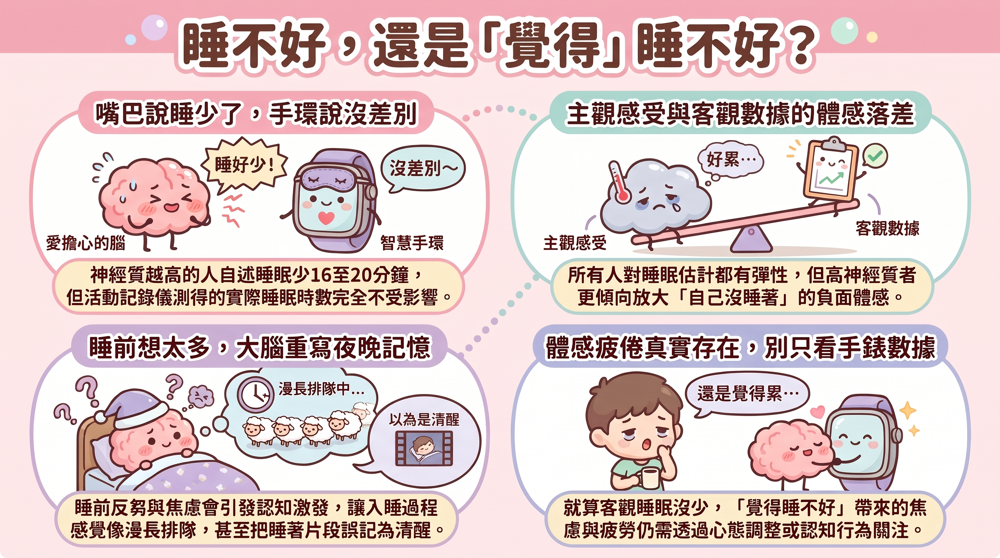

---

> *以下為虛構對話，人物與情節為創作，科學內容來源標註於文末。*

## ▌我思，故我沒睡

下午三點，辦公室的冷氣聲比平常更響。

Dg 推門進來，黑眼圈掛得很完整。

「K，我昨晚整晚沒睡。」

「嗯。」

「笛卡兒說過：『我思故我在。』我整晚都在思考，所以我整晚都醒著。」

K 沒抬頭。

「笛卡兒證明的是你存在。不是你醒著。」

「……這有差嗎？」

「差八小時。」

Dg 把手腕伸過去，想證明給他看。手環螢幕亮起來。

睡眠：6 小時 41 分。

他把手縮回去。

「這、這個手環壞了。」

K 終於抬頭，把螢幕轉向他。是一篇論文。

「剛好。今天的稿子。」

## ▌嘴巴和手腕的對帳

「134 個大學生。先填問卷，估自己過去一個月平常睡多久。再戴活動記錄儀，連續五晚。」

「活動記錄儀？」

「戴在手腕上，看你動不動。不動，就算睡。」

「跟我這個一樣。」

「原理差不多。」

K 往下滑。

「另外測神經質。」

「神經……我才沒有神經病。」

「神經質。容易擔心、容易有負面情緒的程度。不是病。」

Dg 想了一下昨晚。他傳給 Liy 的訊息，到現在還是已讀不回。他重看了十一次。

「……然後呢？」

「神經質每高一分，自己說的睡眠就少十六到二十分鐘。」

「那手環呢？」

「沒差。」

「完全沒差？」

「相關係數負零點零三。」

Dg 慢慢重述：「所以愛擔心的人，手環說他們睡得跟別人一樣，嘴巴卻說睡比較少。」

「而且就算手環上睡得一樣多，神經質高的人還是報得比較少。」

Dg 看著自己的手環。六小時四十一分。

他記得的是：天花板、手機、天花板。

## ▌盡信書不如無書

「等一下。」Dg 突然站起來，「孟子說：『盡信書，不如無書。』手環也不能全信！」

「孟子說的書是《尚書》。不是手環。」

「……」

「不過你這次歪打正著。」

Dg 愣住。他沒預期這句。

「躺著不動、但其實醒著，手環會判成睡著。作者自己也提了這個可能。」

「那我昨晚盯天花板的時間……」

「可能都被算進去了。」

「所以我是對的！」

「也可能不是。」

K 喝了一口已經冷掉的咖啡。

「Harvey 回顧過失眠研究。最常見的情況是：明明睡著了，大腦把那段記成醒著。尤其是睡前在擔心的人。」

Dg 坐回去。

很久沒說話。

窗外有機車經過，聲音拉得很長。

「所以……」他慢慢開口，「『我覺得我沒睡』跟『我睡了多久』，是兩份不同的報告。手環記的是我的手有沒有動，我記的是那一晚怎麼過的。兩份都可能錯，只是錯在不同的地方。」

K 沒有回答。

他把論文的 PDF 寄到 Dg 的信箱。

*Dg 打開手機，刪掉剛打好的限時動態「昨晚又整晚沒睡」。他翻開筆記本，寫下兩行——「覺得：0 小時」「手環：6 小時 41 分」——然後在兩行中間，畫了一個很大的問號。*

---

**「我昨晚根本沒睡！」說這句話的人，可能真的睡得不夠，也可能是大腦在睡醒之後重寫了昨晚。美國 Villanova University 的研究發現，神經質傾向越高的大學生，自己說的睡眠越短，但手腕上的活動記錄儀量不到差別。落差可能不在夜晚本身，而在我們怎麼記住夜晚。**

---

## 關鍵亮點

- 神經質分數每高 1 分（1 到 5 分的量表），自述睡眠少報約 **16 到 20 分鐘**，兩種自述問法都看得到。
- 但用**手腕活動記錄儀**連續量 5 晚，神經質高低和睡眠長短**沒有關聯**。
- 憂鬱、焦慮症狀和神經質高度相關，卻和睡眠長度無關；把它們納入控制後，神經質的效果**沒有變弱**。
- 過去失眠研究早就發現：「感覺睡多久」和「實際睡多久」常常是兩回事，**擔憂**是重要推手。

---

## 一、先認識主角：神經質是什麼？

### 不是「神經病」，是一種人格傾向

先幫「神經質」洗刷一下冤屈。在心理學裡，**神經質（Neuroticism）**是「五大人格」的其中一項，指的是一個人**多容易感受到擔憂、緊張與負面情緒**。它不是疾病診斷，而是一條光譜，每個人都在上面某個位置。

神經質高的人，可能是那種出門前檢查三次瓦斯、報告交出去後一直想「是不是哪裡寫錯」的人。神經質低的人，則可能是考前一晚還睡得很香的那位室友（對，就是讓你很想搖醒的那位）。

### 為什麼研究者關心它和睡眠？

直覺上，「愛擔心」和「睡不好」很像是同一組套餐。研究也大致支持這個印象：2025 年一篇整合了 12 項研究的統合分析發現，神經質越高的人，在問卷上回報的平常睡眠越短。

但換成儀器量，故事就不一樣了。過去多數用活動記錄儀測量的研究，都**找不到**神經質和睡眠長度的關聯。問題是，很少有研究在**同一批人**身上同時用問卷和儀器量睡眠，所以很難判斷落差從哪裡來。

如果一個人本來就比較容易往壞處想，那他填問卷時，會不會連昨晚的睡眠也往壞處想？這正是本研究想拆開的結。

*睡前腦袋停不下來，是很多人共同的夜晚經驗。*

---

## 二、研究怎麼做：問卷 vs. 手腕上的小間諜

### 受試者：134 位大學生

研究由 Derick M. DeCamp 與 Elizabeth J. Pantesco 主持，論文刊登於 *Personality and Individual Differences* 第 262 卷（2026）。受試者是美國東北部一所私立大學的 **134 位大學生**，平均 19.14 歲，女性 95 人（約 71%），男性 39 人。另有 5 位完成研究的人因為回報已診斷的睡眠疾患，被排除在分析之外。

### 兩種量睡眠的方法

研究者用兩套方法同時量睡眠，就像同一場比賽請兩位裁判計分：

**裁判一：自己說（主觀）**
受試者填匹茲堡睡眠品質量表（PSQI）的幾個題目，估計「過去一個月」的睡眠。這裡又分兩種算法：
- **直接問**：「過去一個月，你晚上實際睡了幾小時？」
- **推算**：用自己回報的上床時間、起床時間，再扣掉入睡需要多久，算出睡眠長度

**裁判二：手腕上的活動記錄儀（客觀）**
**活動記錄儀（Actigraphy）**是一種戴在手腕上的動作感測器，有點像專業版的運動手環。它的邏輯很簡單：你動得多，大概醒著；你很久沒動，大概睡著了。受試者連續戴 **5 個晚上**。

### 測量順序與量表

流程是這樣：受試者先到實驗室戴上儀器、填睡眠問卷；5 天後歸還儀器時，再填人格、憂鬱和焦慮問卷。所以**睡眠自述是在戴儀器之前就填好的**。

人格用的是五大人格簡式量表（BFI-2-S），神經質有 6 題，每題 1 到 5 分，取平均。憂鬱症狀用 CES-D，焦慮症狀用 GAD-7。

### 同時量了哪些「干擾因子」？

主要分析控制了年齡、性別、種族、族裔、主觀社經地位與 BMI；接著再把儀器測得的睡眠、憂鬱與焦慮症狀一層層加進去。另外，研究者也做了探索性分析，納入睡眠規律性和其他四項人格特質。目的是確認：如果真的有關聯，那是「神經質」本身的效果，而不是其他東西混進來。

---

## 三、結果：嘴巴說少了，儀器說沒有

### 先看平均值

| 測量方式 | 平均睡眠時間 | 和儀器比 |
|---------|------------|---------|
| 直接自述 | 6.74 小時 | 只多 0.04 小時，統計上沒有差別 |
| 推算自述 | 7.40 小時 | 多出約 0.70 小時（約 42 分鐘），差異顯著 |
| 活動記錄儀 | 6.70 小時 | — |

有趣的是，光是「自己說」這件事，換個問法就差了將近 40 分鐘。直接問的答案平均起來和儀器幾乎一樣；用時間推算，反而會高估。這也提醒我們：**人對自己睡眠的估計，本來就很有彈性。**

### 關鍵發現：神經質只影響「說法」

- **神經質越高，自述睡眠越短**：兩種問法都一樣。神經質每多 1 分，直接自述約少 0.26 小時（約 16 分鐘），推算自述約少 0.33 小時（約 20 分鐘）。
- **但活動記錄儀看不到差別**：神經質和儀器測得的睡眠，相關係數只有 −0.03。
- **把儀器測得的睡眠也納入控制，關聯依然存在**。換句話說，就算兩個人儀器上睡得一樣多，神經質比較高的那位還是會說自己睡得比較少。
- **憂鬱和焦慮症狀**和神經質高度相關（相關係數約 0.7），但和任何一種睡眠長度都無關；控制這兩項後，神經質的效果**沒有變弱**。
- 加入睡眠規律性和其他人格特質後，結果相同，甚至更強一點。

### 兩種問法，兩種偏差

細看「自述減掉儀器」的差距，兩種問法的模式不太一樣：
- **直接問**：神經質越高，越會**低估**自己的睡眠。
- **推算**：大家整體都會高估，但神經質越高，**高估得越少**。

用一個比喻：兩個人看了同一部電影，一個說「好長喔，大概三小時吧」，另一個說「差不多兩小時」。片長沒變，變的是**體感**。

---

## 四、為什麼會「覺得」睡得少？睡眠知覺的謎題

### 作者列出的幾種可能

作者提出好幾種解釋，但要先說清楚：**這份研究沒有直接檢驗其中任何一種**。

1. **負面回應偏誤**：過去研究發現，神經質高的人會更快辨識負面資訊、更注意負面刺激，也更常把模稜兩可的事往壞處解讀。回想昨晚時，可能也會這樣。
2. **回憶誤差**：神經質和自評的記憶問題有關，有些研究也看到客觀記憶表現較差。
3. **睡前想太多**：神經質的特徵就是擔憂、反芻和揮之不去的念頭，睡前的認知激發可能讓入睡「感覺」比實際更久。
4. **儀器看走眼**：神經質高的人也許花更多時間躺在床上醒著，而活動記錄儀把這些時間誤判成睡眠。
5. **都是問卷惹的禍**：神經質和睡眠都用自填問卷測，有一部分關聯可能只是「填問卷的習慣」相同，跟睡眠本身無關。

至於兩種問法為何出現不同偏差，作者推測：直接問一個總數時，人比較依賴整體印象，容易受情緒影響；推算需要回想好幾個時間點，可能比較深思熟慮，卻也多了記錯的機會。作者自己也說這只是推測。

### 失眠研究早就碰過這個謎

其實，「感覺」和「實際」對不上，在失眠研究裡是老問題，有個專有名詞叫**睡眠狀態知覺錯誤（sleep state misperception）**。

**Harvey 與 Tang（2012）**在《Psychological Bulletin》做了大型回顧，檢視了 13 種可能解釋。最有證據支持的包括：**把淺睡誤當成清醒、擔憂，以及短暫醒來**。至於「時間感比較差」這個解釋，反而沒獲得支持。換句話說，問題不是這些人不會看時間，而是大腦把某些睡著的時刻「記成醒著」。

### 睡前想太多，入睡就像排隊排很久

**Herbert 等人（2017）**追蹤睡不好的人連續七天，發現：
- **睡前認知活動越多**（也就是腦袋越忙）、**早上醒來心情越差**，越容易**低估**總睡眠時間。
- **越努力想睡著**，越容易**高估**入睡所需時間。

這有點像排隊：同樣等 10 分鐘，滑手機時一下就過了，盯著隊伍前進時卻感覺天長地久。睡前一邊擔憂一邊「拚命睡」，就是在盯隊伍。

### 睡得差不多，感覺卻天差地遠

**te Lindert 等人（2020）**用活動記錄儀在家裡量了多個晚上，發現失眠者可以分成幾種「知覺錯誤」類型，但各類型的**客觀睡眠都差不多約 7 小時**，差別主要在「覺得自己睡了多久」。

**Yoon 等人（2022）**則發現，低估睡眠的失眠患者，自述睡眠品質較差、入睡時間較長，深睡（N3）比例也較低。這提醒我們：知覺落差不全是「想太多」，也可能和睡眠結構有關。

*睡眠的「真實」與「感受」，在大腦裡可能是兩條不同的路線。*

---

## 五、先別急著下結論：這份研究的限制

### 效果其實不大

神經質大約只解釋了自述睡眠 5% 的個別差異。每分少報 16 到 20 分鐘聽起來不少，但睡眠長短主要還是由其他因素決定。

### 手腕不動，不等於睡著

活動記錄儀有個罩門：**躺著不動但其實醒著，可能會被判成睡著**。作者也把這點列為可能的解釋之一。所以「儀器沒看到差別」不能直接等於「睡眠真的沒差」。

### 時間窗不一樣長，5 晚也未必夠

自述問的是「過去一個月」，儀器只量了 5 晚，直接比較本來就有難度。另外，儀器要量幾晚才夠可靠，學界還沒有共識：有研究認為 5 天足夠，也有研究建議 7 晚以上。

### 被監測的感覺

神經質高的人戴上儀器後，可能因為更在意自己被觀察而改變作息，睡多或睡少都有可能。作者指出，若真是如此，戴儀器**之前**填的自述反而可能更接近平常的狀態。

### 樣本範圍窄

受試者都是同一所私立大學的學生，以女性為主、平均 19 歲。過去探討神經質與睡眠的研究，幾乎都以中老年人為對象；大學生的生活壓力和作息也自成一格，所以這個結果能不能推到其他年齡層或失眠患者身上，還需要更多研究。

### 沒有預先註冊

研究沒有事先公開登記分析計畫。這不代表結果有問題，但讀者在評估可信度時，可以把這點一起考慮。

---

## 常見問題（FAQ）

**Q1：所以愛擔心的人其實睡得很好，只是自己誤會了嗎？**
不能這樣說。這份研究只顯示「睡眠長度」在儀器上沒差別，沒有測睡眠品質或深睡比例，加上活動記錄儀本身有誤差。比較保險的說法是：神經質和「自述睡得少」的關聯，可能有一部分來自知覺與回憶。

**Q2：我的運動手環說我睡了 7 小時，但我覺得很累，該信誰？**
兩個都只說了部分事實。手環主要看動作，抓不到你躺著清醒的時刻，也看不到睡眠深淺；你的感覺則可能受心情和回憶影響。如果長期覺得疲累，比較好的做法是請教醫師，而不是單靠手環或感覺下判斷。

**Q3：「覺得睡不好」如果不是真的，那還需要處理嗎？**
需要。就算客觀睡眠沒少，「覺得睡不好」本身就會帶來焦慮、白天疲倦感，甚至讓人更擔心睡眠，形成惡性循環。這也是失眠的認知行為治療（CBT-I）會處理「對睡眠的想法」，而不只是延長睡眠時數的原因。

**Q4：憂鬱和焦慮跟睡眠沒關係嗎？這跟常識不太一樣。**
在這個樣本裡，兩者和睡眠長度都沒有相關，但都和神經質高度相關。作者的解讀是：影響自述睡眠的，是比較穩定的「負面情緒傾向」這個人格特質，而不是當下的症狀。不過，統合分析也發現，在憂鬱症狀較重的族群中，神經質和自述睡眠的關聯會更強，所以這個結果不能直接套用到臨床族群。

**Q5：睡前想很多，有什麼可以做的嗎？**
研究顯示睡前認知活動多、越努力想睡，入睡就會「感覺」更久。不過這份研究本身沒有測試任何改善方法，如果睡前擔憂已經影響生活，可以考慮尋求睡眠專科或心理專業人員協助。

---

## 結論

這份研究像是在問：當我們說「昨晚睡不好」時，到底在描述夜晚，還是在描述自己？

對神經質傾向高的人來說，答案可能偏向後者。手腕上的儀器沒看到睡眠變短，但他們的回報少了 16 到 20 分鐘；就算儀器上睡得一樣多，這個落差還是在。這和失眠研究多年來的發現一致：**擔憂、睡前思緒與醒來時的心情，都會改寫我們對睡眠的印象。**

作者也提醒，流行病學和臨床研究大量依賴「你平常睡幾小時」這類回溯式問題。如果人格會影響答案，那些「睡眠長短與健康」的研究結論，就得把人格因素一起考慮。

不過，這仍是一份樣本有限、量測工具有盲區的研究。未來需要用多種方法同時測量、拉長追蹤時間，才能分清楚這段落差到底是「感覺」不同，還是「回報」不同。

在那之前，至少下次你很肯定「我整晚沒睡」時，可以多留一點空間給另一種可能：你睡了，只是大腦不太記得。

---

## 延伸搜尋

- [睡眠狀態知覺錯誤](https://www.google.com/search?q=%E7%9D%A1%E7%9C%A0%E7%8B%80%E6%85%8B%E7%9F%A5%E8%A6%BA%E9%8C%AF%E8%AA%A4)
- [paradoxical insomnia](https://www.google.com/search?q=paradoxical+insomnia)
- [活動記錄儀 睡眠 準確度](https://www.google.com/search?q=%E6%B4%BB%E5%8B%95%E8%A8%98%E9%8C%84%E5%84%80+%E7%9D%A1%E7%9C%A0+%E6%BA%96%E7%A2%BA%E5%BA%A6)
- [失眠認知行為治療 CBT-I](https://www.google.com/search?q=%E5%A4%B1%E7%9C%A0%E8%AA%8D%E7%9F%A5%E8%A1%8C%E7%82%BA%E6%B2%BB%E7%99%82+CBT-I)
- [神經質 五大人格](https://www.google.com/search?q=%E7%A5%9E%E7%B6%93%E8%B3%AA+%E4%BA%BA%E6%A0%BC%E7%89%B9%E8%B3%AA+%E4%BA%94%E5%A4%A7%E4%BA%BA%E6%A0%BC)

---

## 參考資料來源

- [DeCamp & Pantesco (2026). Neuroticism is associated with self-reported, but not actigraphy-assessed, sleep duration. *Personality and Individual Differences*, 262, 113954](https://doi.org/10.1016/j.paid.2026.113954)
- [Psychology says frequent worry isn't a sure sign of shorter nights（PsyPost）](https://www.psypost.org/psychology-says-frequent-worry-isnt-a-sure-sign-of-shorter-nights-it-tracks-with-reporting-less-sleep-not-what-wrist-monitors-recorded/)
- [People high in neuroticism report sleeping less, but wrist monitors tell a different story（PsyPost）](https://www.psypost.org/people-high-in-neuroticism-report-sleeping-less-but-wrist-monitors-tell-a-different-story/)
- [Harvey & Tang (2012). (Mis)Perception of Sleep in Insomnia: A puzzle and a resolution](https://pmc.ncbi.nlm.nih.gov/articles/PMC3277880)
- [Herbert et al. (2017). Predictors of Nightly Subjective-Objective Sleep Discrepancy in Poor Sleepers](https://pmc.ncbi.nlm.nih.gov/articles/PMC5366828)
- [te Lindert et al. (2020). Actigraphic multi-night home-recorded sleep estimates reveal three types of sleep misperception](https://pmc.ncbi.nlm.nih.gov/articles/PMC7003481)
- [Yoon et al. (2022). Negative and positive sleep state misperception in patients with insomnia](https://pmc.ncbi.nlm.nih.gov/articles/PMC9243288)
- [Wang et al. (2025). The relationship between NEO-five personality traits and sleep-related characteristics: A systematic review and meta-analysis. *Sleep Medicine Reviews*, 81, 102081](https://doi.org/10.1016/j.smrv.2025.102081)
