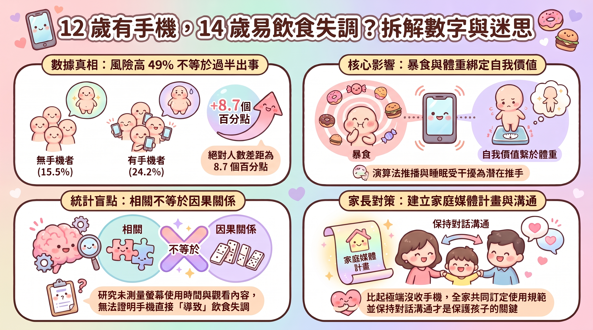

---

> *以下為虛構對話，人物與情節為創作，科學內容來源標註於文末。*

## ▌早起的鳥兒

擊球聲從隔壁場傳過來，一下，又一下。

Dg 蹲在底線，把滾到腳邊的球一顆顆塞進球筒。

K 說去開個會，十分鐘就回來。那是四十分鐘前的事。

「欸，工讀生。」

鐵網門被推開。Cala 穿著公司網球社的 polo 衫，球拍套斜背在肩上。

「K 呢？」

「開會。」

「喔。」她把球拍套放到長椅上。「我又沒有要找他，只是問一下。」

說完，她在長椅上坐下。剛好坐在 K 的毛巾旁邊。

Dg 站起來，拍掉膝蓋上的灰，擺出姿態。

「妳知道嗎？K 今天早上在看一篇研究。12 歲就有智慧型手機的小孩，兩年後比較容易出現飲食失調的症狀。」

「所以？」

「所以古人說得好——早起的鳥兒有蟲吃。」

Cala 盯著他。

「……你這個例子，比較像早起的鳥兒被蟲吃吧。」

「那、那就是失之東隅，收之桑榆！」

「什麼意思？」

「先失去，後得到。」

「所以是先得到手機，後失去什麼？」

Dg 張開嘴，又闔上。

## ▌太早擁有的東西

「重點不是鳥。」Dg 清了清喉嚨。「重點是『早期擁有者』。研究把 12 歲就有手機的人分成一組，一路追蹤到 14 歲。」

「太早擁有。」Cala 跟著唸了一次，聲音放輕。「太早擁有的東西，本來就不懂得珍惜。」

「……蛤？」

「我是說，這很合理啊。太早得到，就會開始拿自己跟別人比，覺得自己不夠好，然後——」

「我在講手機。」

「我知道是手機啊。」她把臉轉開。「誰在講別的了。」

她從口袋拿出手機，滑了兩下，遞給他。

螢幕上是那篇研究的英文報導，已經捲到一半。

「妳查過了？」

「剛好滑到的。」

她把手機收回去。

「反正我記得。有手機的小孩，有 49% 會出問題。很嚴重耶。」

Dg 本來要點頭。

點到一半，停住了。

## ▌兩顆球

「等一下。不是 49% 的人。」

「報導就寫 49 啊。」

「那是『高 49%』。」Dg 蹲回地上，撿起兩顆球，一左一右擺好。「沒手機的那群，14 歲時有 15.5% 出現至少一種症狀。有手機的那群，是 24.2%。」

他把右邊那顆往前推了一點點。

「24.2 比 15.5 多了將近一半，所以叫高 49%。可是換成人數，是每一百個人裡面，從十五個多變成二十四個。」

Cala 盯著那兩顆球。

「……那還是變多了啊。」

「是變多了。」Dg 說。「只是沒有一半的人。」

「我又沒說一半。」

「妳剛剛說 49% 的人。」

「那是口誤。」她把球拍套的拉鍊拉開，又拉上。

Dg 很想補一句名言。他想到的是「數字不會說謊」。

話到嘴邊，他自己先卡住了。

同一組數字，剛剛差點被說成兩件完全不一樣的事。

「而且，」他慢慢說，「K 早上講過，這只是相關。早點拿到手機的小孩，家裡收入、青春期、體重，本來就跟別人不一樣。研究有盡量把這些扣掉，可是沒測他們每天用多久，也沒測他們在手機上看什麼。」

「所以手機不是兇手？」

「不一定是。」Dg 想了一下。「手機比較像先到現場的人。先到，不代表就是他動的手。」

Cala 沒有接話。

鐵網外傳來腳步聲。她站起來的速度有點太快。

「我去暖身了。」她抓起球拍。「才不是因為有人回來了。」

*Dg 把長椅上 K 的毛巾摺好，放回原位。*

*接著他從口袋掏出原子筆，在球筒蓋上寫下兩個數字：15.5、24.2，中間畫一個箭頭。*

*筆尖停在旁邊，想寫 49%。停了一下，他把筆收回口袋。*

---

**一份追蹤近九千名美國青少年的研究發現：12 歲就有智慧型手機的孩子，兩年後出現飲食失調症狀的比例比較高。不過這是「相關」，研究沒有證明手機會「造成」飲食失調。這篇我們用不需要統計學分數的方式，把這份研究拆開來看：它發現了什麼、沒發現什麼，還有為什麼「風險高 49%」聽起來比實際情況可怕。**

---

## 關鍵亮點

- 研究分析了美國 ABCD 研究中 **8,957 名青少年**，12 歲時約有 **七成**已經擁有智慧型手機。
- 14 歲時，至少出現一項飲食失調症狀的比例：**早期擁有手機者 24.2%，沒有手機者 15.5%**；調整各種背景因素後，風險高 **49%**。
- 關聯最明顯的是**暴食**和**「自我價值繫於體重」**；「擔心體重增加」這一項沒有顯著差異。
- 第一作者 Jason Nagata 特別強調：**研究沒有顯示手機會導致飲食失調**，拿到手機的時間點只是眾多因素之一。

---

## 一、研究在講什麼？三十秒版本

### 主角是「12 歲那年有沒有手機」

想像一個大型班級，裡面有將近九千個美國青少年。研究團隊在大家 12 歲時問家長一個簡單問題：「你的孩子有沒有自己的智慧型手機？」只能打電話的傳統手機不算。

結果約有 **70%** 的孩子已經有了，其中大約三分之二是 iPhone。

兩年後，研究團隊再去看這群孩子 14 歲時的狀況，結果**當年就有手機的那一群，出現飲食失調症狀的比例比較高**。

### 「症狀」不等於「確診」

這裡要先講清楚一件很容易被誤會的事：研究測的是**症狀**，不是飲食失調的**診斷**。他們看四類症狀：

- **暴食**：短時間內吃下大量食物，並且有失控感
- **代償行為**：吃完之後試圖「抵銷」，例如催吐、禁食或過度運動
- **擔心體重增加**
- **自我價值繫於體重**：覺得自己好不好，主要取決於體重

只要有任何一項，就算「至少一項症狀」。所以新聞說「風險增加」，指的是出現這些症狀的機率，不是罹患厭食症或暴食症的機率。

*12 歲時約有七成的美國青少年已經有自己的智慧型手機。*

---

## 二、他們怎麼研究的？

### ABCD 研究：一份超大型的「成長日記」

資料來自 **ABCD 研究**（青少年大腦認知發展研究），這是美國追蹤青少年成長的大型計畫，涵蓋全美 21 個研究據點。這篇論文用的是 2018 到 2024 年的資料。

你可以把它想成一本很厚的「成長日記」：同一批孩子每隔一段時間就接受一次訪談和評估，研究者因此能看到同一個人怎麼隨時間改變。

### 兩種看法：拍照 vs. 錄影

研究團隊用了兩種分析方式：

- **橫斷分析（拍照）**：在 12 歲這個時間點，比較有手機和沒手機的孩子差在哪裡。
- **縱貫分析（錄影）**：追蹤同一批孩子到 14 歲，看 12 歲時有手機的人，後來是不是比較容易出現症狀。**而且有扣除他們 12 歲時就已經有的症狀**。

後者比較有說服力，因為它至少確認了時間順序：先有手機，後有症狀。

### 盡量「把其他可能性拿掉」

研究團隊知道，早給孩子手機的家庭可能本來就跟其他家庭不一樣。所以他們在統計上調整了一長串因素：性別、種族、家庭收入、家長教育程度、體重、青春期發育階段、憂鬱與 ADHD 症狀、家長監督程度，連有沒有平板、筆電、智慧手錶都算進去了。

症狀則是用經過驗證的兒童精神科結構式訪談（KSADS）來評估。

---

## 三、數字會說話，但也會「說得很大聲」

### 先看原始數字

| 年齡 | 沒有手機 | 有手機 | 調整後的比值 |
|------|---------|-------|-------------|
| 12 歲（至少一項症狀） | 11.3% | 16.1% | 1.36 倍 |
| 14 歲（至少一項症狀） | 15.5% | 24.2% | 1.49 倍 |

各項症狀的調整後結果：

| 症狀 | 12 歲（橫斷） | 14 歲（縱貫） |
|------|-------------|-------------|
| 暴食 | 1.61 倍 ✅ | 1.67 倍 ✅ |
| 代償行為 | 1.31 倍（不顯著） | 1.50 倍 ✅ |
| 擔心體重增加 | 1.30 倍（不顯著） | 1.02 倍（不顯著） |
| 自我價值繫於體重 | 2.21 倍 ✅ | 2.03 倍 ✅ |

*✅ = 統計上顯著。*

### 「高 49%」到底是多高？

這裡藏著科普閱讀最重要的技能之一：分清楚**相對風險**和**絕對數字**。

「風險高 49%」聽起來很嚇人，好像有手機的孩子一半都會出事。但實際上是從 **15.5% 變成 24.2%**，差了不到 9 個百分點。

打個比方：你常去的麵店，原本每 100 碗麵有 15 碗會不小心太鹹，換了新廚師之後變成 24 碗。你可以說「太鹹的機率暴增近五成」，也可以說「每 100 碗多了 9 碗太鹹」。兩句話都是對的，但聽起來完全不同。

這不是說 9 個百分點不重要。放到整個國家的青少年人口上，這是很多人。但看新聞標題時，最好在腦中自動把「高 XX%」翻譯回原本的數字。

### 小插曲：為什麼「擔心體重增加」沒差？

研究者推測，這可能是因為這項症狀本身在這個年齡層比較少見，樣本太少，統計上很難看出差異。另外，在 12 歲時，有手機的**女孩**確實比較擔心體重增加，只是整體來看不顯著。

---

## 四、為什麼手機可能有關？四個還沒被證實的猜想

先說清楚：**以下都是研究者提出的可能機制，這份研究本身沒有驗證**。

### 猜想一：沒人看著，加上演算法推播

自己的手機代表家長比較難知道孩子在看什麼。同時，社群媒體上充滿外貌導向的內容，青少年很容易拿自己跟網美比較。已經有回顧文獻整理過社群媒體如何影響青少年的身體意象。

### 猜想二：私下掉進極端風潮

私下使用手機，可能讓青少年接觸到一些極端的外貌改造風潮，例如網路上的「looksmaxxing」（追求把外貌「最大化」的次文化）。

### 猜想三：停不下來的大腦

強迫性滑手機和暴食，可能共用同一套**衝動、追求獎賞**的心理機制。「再滑一下就好」跟「再吃一口就好」，在大腦裡也許是近親。同一個研究團隊先前另一份研究也發現，螢幕時間能預測兩年後的暴食症，其中部分關聯可由憂鬱症狀解釋。

### 猜想四：睡不好，食慾也跟著亂

半夜滑手機會干擾睡眠，而睡眠和食慾調節、情緒反應都有關係。睡不好的隔天特別想吃垃圾食物，這個經驗大家應該都有。

*夜間使用手機可能透過影響睡眠，間接影響食慾與情緒。*

---

## 五、這份研究的盲點

### 相關不等於因果：經典再上演

這是統計課最常被引用的一句話，而這份研究是非常好的教材。

研究發現，早拿到手機的孩子在很多方面本來就和其他孩子不一樣：比較常是女孩、黑人或西語裔、來自低收入或低教育程度家庭、青春期發育比較快、體重比較重。研究團隊雖然在統計上調整了這些因素，但**沒被測量到的差異**可能還有很多，例如霸凌、神經發展狀況或其他心理健康問題。

另外也不能排除**反向因果**：會不會是本來就有某些困擾的孩子，家長比較傾向給他手機？

### 最關鍵的東西，反而沒測到

這份研究只問了「有沒有手機」，但沒有測：

- 每天用多久（螢幕時間）
- 用來做什麼（看什麼內容）
- 家裡有沒有手機使用規則

這就像研究「有沒有駕照」跟車禍的關係，卻不知道對方開多少公里、開什麼路、有沒有喝酒。真正的關鍵很可能藏在這些沒被測量的地方。

### 其他限制

- 症狀是青少年**自己回報**的，可能有回報偏誤
- 症狀只記錄**有或沒有**，不知道頻率與嚴重程度
- 因資料缺漏而被排除的人，跟留下來的人有系統性差異，研究結果能不能推論到所有青少年身上，要打個問號

---

## 六、所以，家長到底該怎麼辦？

### 研究沒有給出「最佳年齡」

很多家長最想知道的是：「那到底幾歲給手機比較好？」很抱歉，這份研究**沒有回答這個問題**。Nagata 的建議是，家庭在決定時機時要審慎考量，並且搭配清楚的使用規範。

### 與美國小兒科學會的建議一致

這和美國小兒科學會（AAP）的立場相符：**延後並個別化**決定孩子何時擁有手機，並搭配**家庭媒體計畫**，也就是全家一起訂出什麼時候用、在哪裡用、用來做什麼。AAP 也表示，目前沒有一個經證實安全的「首支手機年齡」。

### 給醫療人員的建議

研究團隊建議，臨床人員在篩檢青少年飲食失調風險時，可以順便問一下：孩子有沒有手機？社群媒體用得多不多？

---

## 常見問題（FAQ）

**Q1：所以研究證明手機會造成飲食失調嗎？**
沒有。這是觀察性研究，只能說兩者有關聯。作者本人也特別強調，研究不顯示手機會導致飲食失調。

**Q2：「風險高 49%」是不是代表一半的孩子會出問題？**
不是。49% 是相對比較。實際數字是 14 歲時至少有一項症狀的比例從 15.5% 變成 24.2%。

**Q3：那我應該把孩子的手機沒收嗎？**
這份研究不支持這麼極端的結論。比起「有沒有手機」，使用內容、時間長短和家庭規則很可能更重要，只是這份研究沒有測到。訂一份全家都同意的家庭媒體計畫，會比單純沒收更實際。

**Q4：為什麼要調整那麼多變項？**
因為早拿到手機的孩子，在家庭背景、體重、青春期發育等方面本來就和別人不同。不先把這些差異考慮進去，就無法判斷差別是來自手機，還是來自這些背景因素。

**Q5：如果覺得孩子或自己的飲食狀況不太對勁，該怎麼辦？**
飲食失調是可以治療的，愈早求助愈好。可以先和家醫科、兒科醫師或身心科專業人員聊聊，不需要等到「很嚴重」才開口。

---

## 結論：手機不是兇手，但可能是一面放大鏡

這份研究告訴我們一個值得注意的訊號：12 歲就有智慧型手機的青少年，兩年後比較容易出現暴食、代償行為，以及把自我價值綁在體重上的想法。

但它也同時提醒我們，**一個數字背後有多少沒被看見的變數**。手機比較像一個入口或放大鏡，真正影響孩子的，可能是透過手機接觸到的內容、被打亂的睡眠，或是家庭中原本就存在的其他因素。

未來的研究需要回答更細的問題：是社群媒體？是外貌內容？是睡眠？還有，孩子拿到手機或放下手機之後，症狀會不會跟著改變？在那之前，最好的做法可能不是恐慌，而是好好跟孩子聊聊：**你在手機上都看些什麼？**

---

## 延伸搜尋

- [ABCD 研究 青少年](https://www.google.com/search?q=ABCD+%E7%A0%94%E7%A9%B6+%E9%9D%92%E5%B0%91%E5%B9%B4)
- [相關不等於因果](https://www.google.com/search?q=%E7%9B%B8%E9%97%9C%E4%B8%8D%E7%AD%89%E6%96%BC%E5%9B%A0%E6%9E%9C)
- [相對風險 絕對風險](https://www.google.com/search?q=%E7%9B%B8%E5%B0%8D%E9%A2%A8%E9%9A%AA+%E7%B5%95%E5%B0%8D%E9%A2%A8%E9%9A%AA)
- [AAP 家庭媒體計畫](https://www.google.com/search?q=AAP+%E5%AE%B6%E5%BA%AD%E5%AA%92%E9%AB%94%E8%A8%88%E7%95%AB)
- [KSADS 兒童精神科訪談](https://www.google.com/search?q=KSADS+%E5%85%92%E7%AB%A5%E7%B2%BE%E7%A5%9E%E7%A7%91%E8%A8%AA%E8%AB%87)

## 參考資料來源

- [Nagata JM et al. (2026). Smartphone Ownership and Eating Disorder Symptoms in Early Adolescence. JAMA Network Open](https://jamanetwork.com/journals/jamanetworkopen/fullarticle/2854492)
- [PsyPost：Smartphone ownership at age 12 linked to higher risk of eating disorder symptoms two years later](https://www.psypost.org/smartphone-ownership-at-age-12-linked-to-higher-risk-of-eating-disorder-symptoms-two-years-later/)
- [Al-Shoaibi AAA et al. (2024). Prospective association of screen time with binge-eating disorder among adolescents in the United States. International Journal of Eating Disorders](https://escholarship.org/content/qt08t2072t/qt08t2072t.pdf)
- [Chu J et al. (2024). Screen time, problematic screen use, and eating disorder symptoms among early adolescents. Eating and Weight Disorders](https://link.springer.com/doi/10.1007/s40519-024-01685-1)
- [Mazzeo SE et al. (2024). Mitigating Harms of Social Media for Adolescent Body Image and Eating Disorders: A Review](https://www.dovepress.com/mitigating-harms-of-social-media-for-adolescent-body-image-and-eating--peer-reviewed-fulltext-article-PRBM)
- [AAP：American Academy of Pediatrics Calls for Creating a Child-Friendly Digital World](https://www.aap.org/en/news-room/news-releases/aap/2026/american-academy-of-pediatrics-calls-for-creating-a-child-friendly-digital-world/)
- [HealthyChildren.org：Helping Kids Thrive in a Digital World: AAP Policy Explained](https://www.healthychildren.org/English/family-life/Media/Pages/Helping-Kids-Thrive-in-a-Digital-World-AAP-Policy-Explained.aspx)
